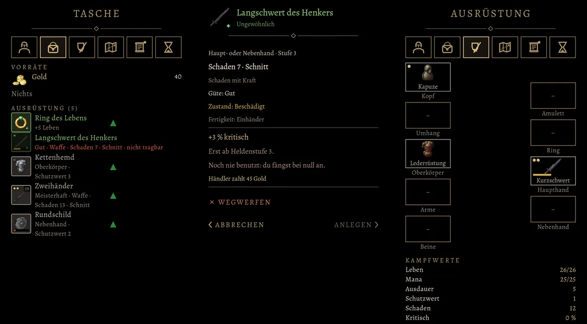

# 756 · Merkmale der Ausrüstung: Güte und Zustand am Bild · Team Tom (Spike) · 12.11., 14:21
E Oberfläche

Geprüft an: [Commit 5fc8653df](https://github.com/tramour-cmyk/androidapp_rpg_bornim/commit/5fc8653df) (Bildlauf am Rechner, Test `merkmale_bild_756`)

So gebaut, wie es im Spiel aussehen soll (756 A, 09.11., 17:46: „Probebild Merkmale jetzt“). Links die Tasche, in der Mitte das Fenster eines Stücks, rechts die Ausrüstung.

- **Am Bild, feste Stellen:** Rahmenfarbe = Seltenheit und „2H“ oben rechts, wie bisher. Neu oben links die **Güte**: Normal ohne Zeichen, Gut ein Goldpunkt (Kapuze; Langschwert, dort abgedunkelt), Meisterhaft zwei (Zweihänder, Kurzschwert), Schlecht ein matter Ring (Kettenhemd; Schlecht gibt es erst mit dem Rezeptbuch, 976). Neu unten der **Zustand** als Balken, nur bei Abnutzung: Beschädigt gelb (Langschwert, Kurzschwert), Defekt rot und das Bild grau (Rundschild); Benutzt ohne Balken. Was der Held noch nicht anlegen kann, ist abgedunkelt (Langschwert, Stufe 3).
- **Im Fenster:** unter „Güte“ die Zeile „Zustand: Beschädigt“; dazu „Erst ab Heldenstufe 3.“: der Grund, warum „Anlegen“ matt ist.

Schon im nächsten Build: die Zeile „Erst ab Heldenstufe n.“ (der Grund, warum man etwas nicht anlegen kann). Die SRD-Wörter sind seit Build 280 aus dem Fenster. Erst nach deinem „passt“: Güte- und Zustandszeichen. Den Zustand selbst gibt es erst nach dem Umbau auf unser Regelwerk, als eigenen Vorgang; den Satz zur Folge („muss repariert werden“, ohne Ort) schreibt dann Homer. Vermerk: Die Figur in der Ausrüstung fehlt im Rechnerbild, weil hier die gekauften Modelle fehlen.

**Sag bitte:** Passen Güte oben links und Zustand unten so? „passt“ oder was anders sein soll.
