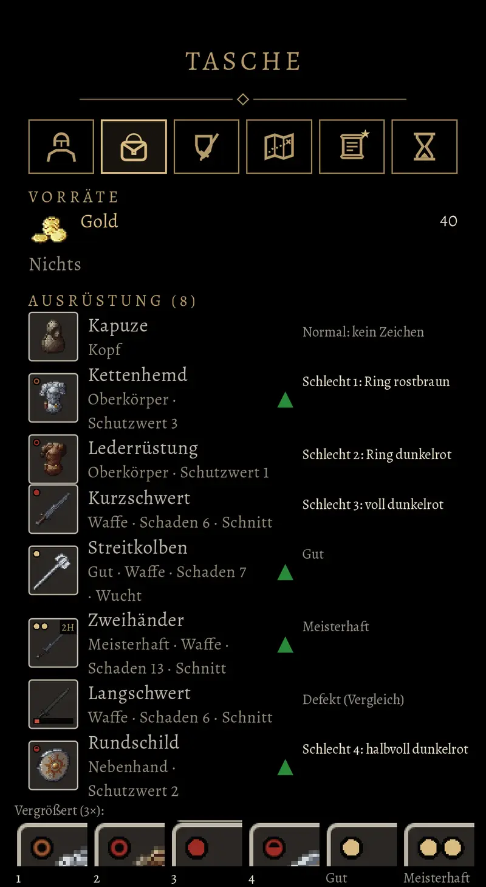

# 756 · Zeichen für Schlecht: Vorlage mit vier Varianten · Team Tom (Spike) · 13.11., 11:52

E Oberfläche

Geprüft an: [Commit fc26a112a](https://github.com/tramour-cmyk/androidapp_rpg_bornim/commit/fc26a112a) (Bildlauf am Rechner, Test `schlecht_bild_756`)

Die Vorlage, die du wolltest (12.11., 20:23: „Mit rostbraun oder dunkelrot oder halbvoll oder voll oder Ring … Vorlage angucken, dann entscheiden“): die Tasche wie im Spiel, jedes schlechte Stück zeigt oben links am Symbol eine andere Variante. Die Beschriftung rechts und der vergrößerte Streifen unten gehören nicht zum Spiel.

- **Schlecht 1:** hohler Ring, rostbraun (Kettenhemd)
- **Schlecht 2:** hohler Ring, dunkelrot (Lederrüstung); wie 1, nur die Farbe anders
- **Schlecht 3:** voller Punkt, dunkelrot (Kurzschwert)
- **Schlecht 4:** halbvoller Punkt, dunkelrot, untere Hälfte gefüllt (Rundschild)
- Zum Vergleich: Normal ohne Zeichen (Kapuze), Gut ein Goldpunkt (Streitkolben), Meisterhaft zwei (Zweihänder), Defekt als Leiste unten mit kurzem roten Stück, das Symbol grau (Langschwert).

Jedes Zeichen ist so groß wie ein Goldpunkt. Das Dunkelrot ist dunkler als das Rot der Defekt-Leiste, damit man Güte und Zustand nicht verwechselt.

Schon im nächsten Build: Gut und Meisterhaft am Symbol (dein „passt“ 12.11., 20:14). Schlechte Stücke gibt es im Spiel erst mit dem Rezeptbuch (Vorgang 976), den Zustand erst nach dem Umbau auf unser Regelwerk; bis dahin sieht man beides nur hier.

**Sag bitte:** Welche Variante, 1, 2, 3 oder 4? Oder sag, was du ändern willst.
