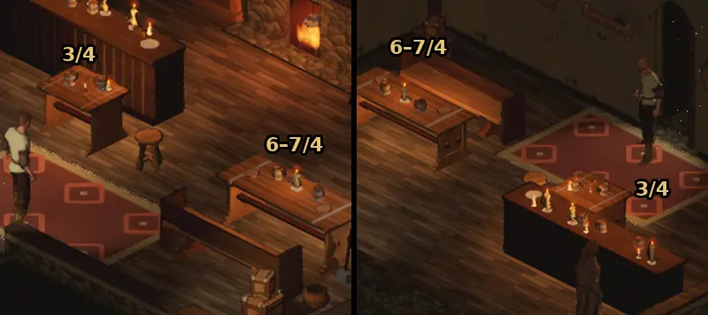

# 757 · Schenke: jeder Tisch mit eigenem Gedeck · Tom · 12.11., 17:20

[Bild von 12.11., 17:21](https://github.com/tramour-cmyk/androidapp_rpg_bornim/blob/bilder/2026-11/12-1721-757-Tom.png) (eingetragen von meldung.sh, Tom)

E Welt · Zweig `claude/tom-757-schenkentisch` · eine Probe (621 A), Spielansicht aus dem Lauf, Tagbild

Geprüft an: [Lauf 43244404456](https://github.com/tramour-cmyk/androidapp_rpg_bornim/actions/runs/43244404456), [Commit 8f33543](https://github.com/tramour-cmyk/androidapp_rpg_bornim/commit/8f335437c48d7cc0d38c63eaa6eabbc0f643591a)

Links Blick wie beim Eintreten, rechts Karte gedreht; Ausschnitt doppelt groß. Tische nach Feld (Spalte/Zeile): 3/4 vor der Theke, 6–7/4 der lange Tisch, an dem Borin sitzen soll (758), 7/2 der neue Tisch aus 604.

- Gebaut: Das Gedeck gehört jetzt dem Tisch, nicht mehr dem Feld darunter. Drei Gedecke wie in der alten Fassung, im Raum der Reihe nach verteilt, also nie zweimal dasselbe: 7/2 Leinenläufer, Brot mit Messer, Teller, umgekippter Krug in einer Bierlache; 3/4 dunkel gebeizt, Krüge, Würfel, Münzen; 6–7/4 hell gescheuert, Eintopf, Krug, Leuchter.
- Ursache vorher: Die Tische 7/2 und 3/4 zogen zufällig dieselbe Nummer und trugen dasselbe.
- **Mir ist aufgefallen, das Bild belegt es nur zum Teil:** Der Tisch 7/2 ist in keinem der beiden Bilder; der Lauf macht nur die üblichen Raumbilder. Zwischen 3/4 und 6–7/4 ist der Unterschied bei dieser Größe schwach: 3/4 wirkt kaum dunkler, Würfel und Münzen sind nicht zu erkennen. Ein Vorher-Bild aus demselben Blick gibt es nicht.

**Votum:** „Bild von allen drei Tischen“: ein Lauf mit Blick auf 7/2 und je Tisch nah, vorher und nachher; denn dein Fund war genau 7/2 neben 3/4, und den zeigt dieses Bild nicht.

**Was du sagen sollst:** „Bild von allen drei Tischen“; oder „757 passt“ (fährt im nächsten Build, dort am Gerät ansehen); oder dein Urteil zum Bild.
