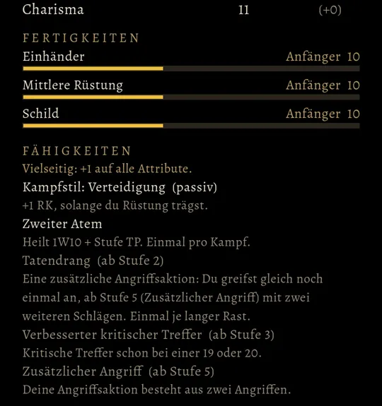

# 762 · Heldenreiter zeigt deine Fertigkeiten · Tom · 09.11., 20:31

[Bild von 09.11., 20:31](https://github.com/tramour-cmyk/androidapp_rpg_bornim/blob/bilder/2026-11/09-2031-762-Tom.png) (eingetragen von meldung.sh, Tom)

Beispiel Wachsoldat: im Heldenreiter neu der Abschnitt **Fertigkeiten** über den Fähigkeiten. Je Fertigkeit Name, Rang und Wert, darunter ein Balken, wie weit es bis zum Ende des Rangs ist (10 von 24 bis Geselle). Ränge und Grenzen stehen wie im Handbuch (Anfänger bis 24, Geselle bis 49, Meister bis 74, Großmeister bis 100). Die höchsten Werte stehen oben. Bei alten Spielständen ohne BRS-Held fehlt der Abschnitt.

**Offen:** Die Werte wachsen noch nicht, wenn du kämpfst. Fertigkeiten durch Tun ist Vorgang 471 und ruht, solange der Kampf vorgeht (338.1). Bis dahin stehen alle Werte auf dem Startwert 10. Eine Erklärung je Fertigkeit beim Antippen gibt es noch nicht, dafür fehlen Texte von Homer.

Geprüft an: [d84f96da4](https://github.com/tramour-cmyk/androidapp_rpg_bornim/commit/d84f96da4) (Test fertigkeiten_762 0 Fehler), Zweig `claude/tom-762-fertigkeiten`, fährt im nächsten Build mit.

Sag „passt“ oder was anders sein soll.
