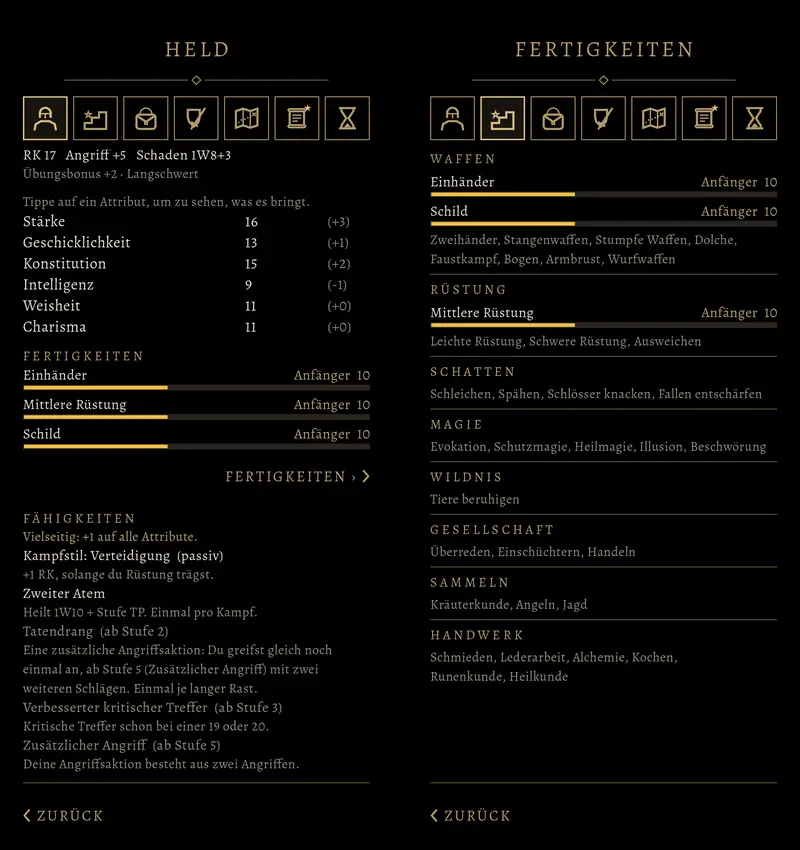

# 762 · Eigener Reiter „Fertigkeiten“ · Tom · 09.11., 21:09

Wie du um 20:59 entschieden hast: ein eigener Reiter **Fertigkeiten** gleich neben Held. Sein Zeichen sind drei Stufen mit einem Stern. Beispiel Wachsoldat.

- **Reiter Fertigkeiten (rechts):** alle acht Gruppen wie im Handbuch. Was der Held schon kann, steht mit Rang, Wert und Balken bis zum Ende des Rangs da, die höchsten oben. Was er noch nicht kann, steht matt als Namen darunter. So bleibt die Liste auch bei 37 Fertigkeiten kurz. Bergbau fehlt, das kommt erst ab Kapitel 2.
- **Heldenreiter (links):** zeigt nur die drei höchsten Fertigkeiten. Darunter springt „Fertigkeiten ›“ in den Reiter.
- Alte Spielstände mit einem Helden vor dem BRS zeigen weder den Reiter noch den Fertigkeiten-Block im Heldenreiter.

**Vermerk:** Im Bild hat „FERTIGKEITEN ›“ noch zwei Pfeile. Im Spiel steht dort nur noch einer, das ist schon behoben. Ein neues Bild gibt es erst nach deinem Urteil (621 A).
**Offen:** Die Werte wachsen noch nicht durch Tun. Das baut Spike in 471, die steigenden Werte siehst du dann in diesem Reiter. Der Abschnitt „zuletzt gestiegen“, den Sokrates vorgeschlagen hat, kommt mit 471. Erklärtexte je Fertigkeit beim Antippen fehlen noch, die liefert Homer.

Geprüft an: [90ac07e9f](https://github.com/tramour-cmyk/androidapp_rpg_bornim/commit/90ac07e9f) (Tests fertigkeiten_762 und menue_breite_581 je 0 Fehler), Zweig `claude/tom-762-fertigkeiten`, fährt im nächsten Build mit.

Sag „passt“ oder was anders sein soll.
