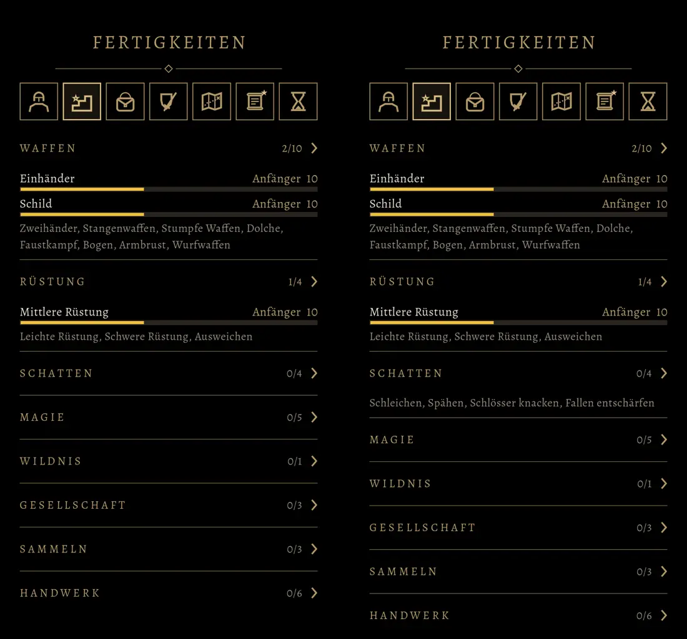

# 762 · Gruppen im Reiter Fertigkeiten einklappbar · Tom · 09.11., 22:15

[Bild von 09.11., 22:16](https://github.com/tramour-cmyk/androidapp_rpg_bornim/blob/bilder/2026-11/09-2216-762-Tom.png) (eingetragen von meldung.sh, Tom)

Links siehst du den Reiter so, wie er sich beim ersten Öffnen zeigt, rechts nach einem Tipp auf „Schatten“.

- Jede Gruppe hat eine eigene Kopfzeile, die man antippt. Ein Tipp klappt die Gruppe auf, ein zweiter Tipp klappt sie wieder zu.
- Beim ersten Öffnen stehen Gruppen, in denen der Held schon etwas kann, offen, die anderen sind zu.
- Rechts im Kopf steht, wie viele Fertigkeiten der Gruppe er geübt hat, von wie vielen insgesamt, z. B. „2/10“. Die Zahl ist golden, sobald er in der Gruppe etwas kann, sonst matt.
- Was du auf- oder zuklappst, bleibt so, auch nach einem Neustart des Spiels.
- Die achte Gruppe heißt „Handwerk“ (entschieden in 810).

**Noch offen:**
- Im Bild zeigt der Pfeil im Kopf auch bei geöffneten Gruppen nach rechts. Geöffnet soll er nach unten zeigen, wie bei den Lizenzen. Das ist behoben und im Test geprüft. Ein neues Bild gibt es noch nicht, weil nur ein Probebild erlaubt war (621 A).

Geprüft an: [279cee5e5](https://github.com/tramour-cmyk/androidapp_rpg_bornim/commit/279cee5e5) (Test fertigkeiten_762 ohne Fehler: auf- und zuklappen, Zahl im Kopf, Winkel, bleibt gemerkt). Zweig `claude/tom-762-fertigkeiten`, kommt mit 471 in den nächsten Sammelbuild.

Sag „passt“ oder was anders sein soll.
