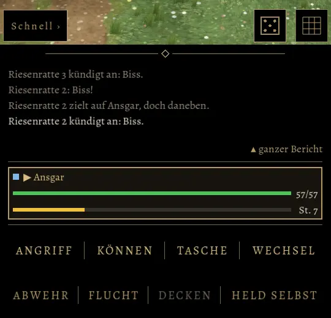
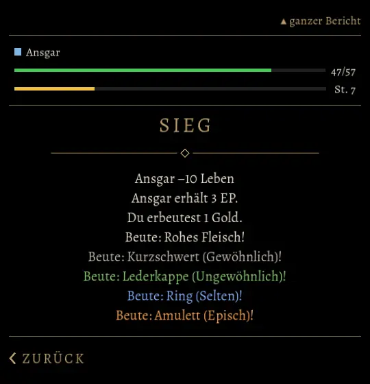

# 785.10 · Kampfschirm: Erfahrung im Kasten des Helden, Beute in Seltenheitsfarbe, „Schnell“ im leichten Kampf

Tom · 17.11., 07:41 · E Kampf · Rest aus 536 (alter Kampfschirm), von Jerry übernommen
Kurz: 785.10 (Kampfschirm wie alt): Erfahrungsbalken mit Stufe im Kasten des Helden, Beute in Seltenheitsfarbe, „Schnell“ im leichten Kampf.

Geprüft an: https://github.com/tramour-cmyk/androidapp_rpg_bornim/commit/0294a47c5 (Bildlauf am Rechner, Renderer des Handys); Kerntests 186 grün, `heldkasten_78510`, `schnell_78510`, `lohn_870` grün

**Bild 1, Kampf gegen Ratten, Held Stufe 7:** Im Kasten des Helden steht unter dem Lebensbalken jetzt ein goldener Erfahrungsbalken, dahinter die Stufe („St. 7“), wie in der Weltleiste. Unten links in der Szene steht „Schnell ›“. Der Knopf erscheint nur im leichten Kampf (Held mindestens 4 Stufen über dem stärksten Gegner, nie gegen Bosse); langes Drücken erklärt ihn.

👍 passt: Erfahrungsbalken und Stufe sitzen unter dem Leben wie in der Weltleiste, „Schnell ›“ steht unten links wie die Schalter rechts · 👎 falsch: der Balken stört, der Knopf sitzt falsch oder sieht anders aus als die Schalter

**Bild 2, Siegschirm nach „Schnell“:** Oben steht, wie viel Leben der Held im schnellen Kampf verlor („Ansgar −10 Leben“). Die Beute steht in der Farbe ihrer Seltenheit wie in der Tasche. Die vier Stücke von Gewöhnlich bis Episch hat der Bildlauf eingesetzt, um alle Farben zu zeigen.

👍 passt: Beute in der Farbe ihrer Seltenheit, gut lesbar · 👎 falsch: Farben schwer lesbar oder anders als in der Tasche

**Offen:** Das Bild vom Kampfbeginn („Ein leichter Kampf: dein Held Stufe 7, der stärkste Gegner Stufe 1.“ über „Kämpfen“ und „Schnell“) blieb schwarz, weil zu früh aufgenommen; im Test geprüft, im Build am Handy zu sehen.
