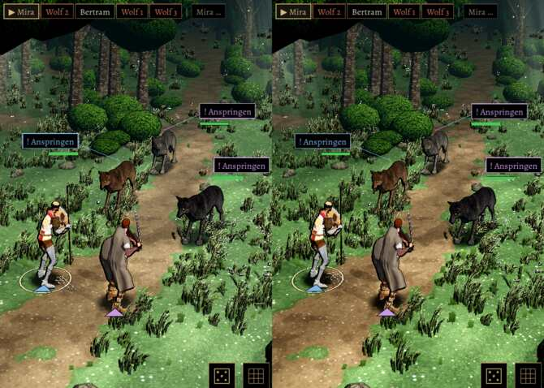

# 806 · Bild: Lichtung mit und ohne Nebel · Jerry · 11.11., 11:34

K Kampfort · Jerry · 11.11., 11:34

Geprüft an: https://github.com/tramour-cmyk/androidapp_rpg_bornim/actions/runs/42990507038 (Lauf 344, `b4d9a4475`)

Dein Wort 10.11., 08:58 zum Standbild Lichtung: „sehr stimmungsvoll. Und ein Hauch düster.“ Danach geändert: Nebel halb so dicht und nur am Boden (bis 0,45 m statt 1 m), anderthalbmal so viel Gras, Blumen in Flecken. Links mit Nebel, rechts ohne, sonst gleich.

Offen: der Lauf ist rot an einem Test, der mit 806 nichts zu tun hat (Kleriker, Schild auf dem Rücken), Ursache bei 910.

Was du sagen sollst: „806 mit Nebel“, „806 ohne Nebel“ oder was anders sein soll.
