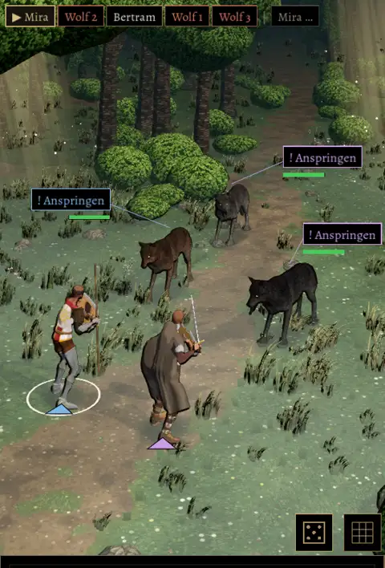

# 806 · Waldkampfort mit den gekauften Effektpaketen · Jerry · 10.11., 02:48

Geprüft an: https://github.com/tramour-cmyk/androidapp_rpg_bornim/actions/runs/42738057042

Standbild vom Bauserver in der Grafik des Handys (Lauf 42738057042), Lichtung mit Kämpfer, Kleriker und drei Wölfen. Neu im Kampfort:
- Gras und Blumen aus dem Graspaket (wie im Dorf, 804), über unserem bisherigen Gras. Die Spitzen sind dunkler als im Dorf, damit es eine Lichtung im Wald bleibt und keine Sommerwiese.
- Flacher Bodennebel aus dem Wetterpaket, graugrün.
- Oben rechts zwei Lichtschächte mit goldenem Staub (Effektpaket R7), ohne eigenes Licht, weil jedes Licht das Handy bremst.
- Im Testmenü unter Welt schalten „Gras“ und „Kampfnebel“ alles an und aus, damit du die Bilder je Sekunde vorher und nachher am Handy vergleichen kannst.

**Offen:**
- Der Nebel legt einen milchigen Schleier über das ganze Bild, die Farben wirken flach. Mein Vorschlag: Nebel halb so dicht und nur dicht am Boden.
- Bilder je Sekunde am Handy sind noch nicht gemessen; das geht erst im Build.
- Staub unter den Füßen beim Laufen (R7 footstep_dust) fehlt noch. Auf Gras halte ich ihn für falsch, auf dem Weg wäre er richtig.
