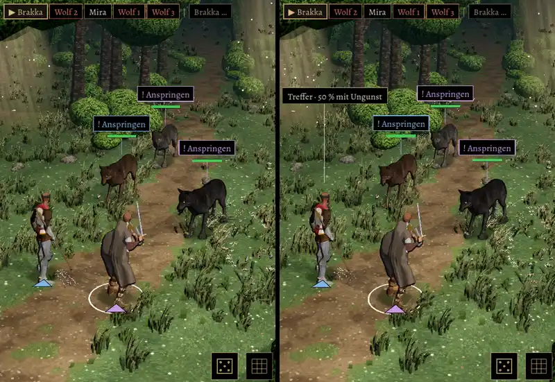

# 806 · Schatten im Kampfort günstiger · Team Jerry · 15.11., 01:32

[Bild von 15.11., 01:33](https://github.com/tramour-cmyk/androidapp_rpg_bornim/blob/bilder/2026-11/15-0132-806-Jerry.png) (eingetragen von meldung.sh, Jerry)

E Kampf

Geprüft an: `6ce33d03e` (Zweig `claude/jerry-806-bildrate`, Lauf 482, Bild `kampf=806`)

Anlass: dein „Kampf messen“ 278.19 (12.11., 14:41): 16 Bilder/s, Grenze 17; Schatten 27 ms, Bäume und Boden 42 ms. Neu: Baumschatten auf den Boden gemalt statt berechnet, Schatten-Auflösung im Kampfort halbiert (Dorf unverändert). Am Rechner Bildzeit Grafik 265–280 → 231 ms. Die Trefferzeile rechts oben kommt nur vom anderen Aufnahmezeitpunkt.

| Prüfpunkt | passt | falsch |
|---|---|---|
| Bild | beide gleich bis auf weichere Baumschatten, Figuren werfen weiter Schatten | Figuren ohne Schatten, rechts Kanten, Flimmern, Bruch |
| Handy, nächster Build, „Kampf messen“ | mindestens 17 Bilder/s | unter 17 |
