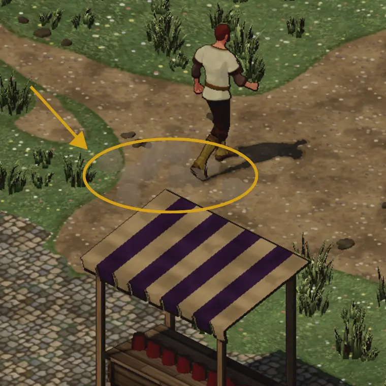

# 814 · Fußstaub: so sieht er aus und dort findest du ihn · Tom · 12.11., 11:55

[Bild von 12.11., 11:56](https://github.com/tramour-cmyk/androidapp_rpg_bornim/blob/bilder/2026-11/12-1156-814-Tom.png) (eingetragen von meldung.sh, Tom)

E Welt · Zweig `claude/tom-814-fussstaub` · am Rechner mit den gekauften Modellen und Effekten, Bild in echter Spielzeit (30 Bilder je Sekunde)

Geprüft an: [Commit b95e2a1](https://github.com/tramour-cmyk/androidapp_rpg_bornim/commit/b95e2a176)

Dorf, 10 Uhr, Erdweg südlich vom Schlagbaum, der Held geht nach Norden, normale Kartenansicht (Ausschnitt vergrößert). Im Kreis: die Staubwölkchen der letzten Schritte, grau und etwas heller als der Weg; jedes steht gut eine Sekunde und verweht.

Warum du sie bisher nicht gesehen hast (am Rechner nachgestellt):
- Das gekaufte Effektpaket blendet Staub nah am Boden aus, damit keine harten Kanten entstehen; bei unserer schrägen Sicht verschwanden die Wölkchen dadurch fast ganz.
- Auch ohne das waren sie nur ein Hauch: klein, höchstens halb deckend und das nur einen Augenblick, dazu so beige wie der Erdweg.
- Jetzt größer, fast deckend, etwas heller als die Erde und länger sichtbar; die hellen Funken aus dem Effektpaket sind weg (sie wirkten in dieser Größe wie weiße Kügelchen). Abends ist der Staub dunkler.

Kommt in den nächsten Testbuild (280); die Prüfliste verweist dort auf dieses Bild.

**Was du sagen sollst:** „814 passt“ oder, was anders sein soll (stärker, schwächer, kürzer, Farbe).
