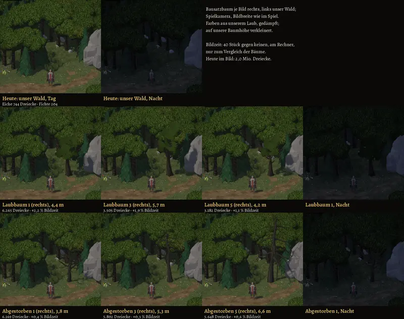
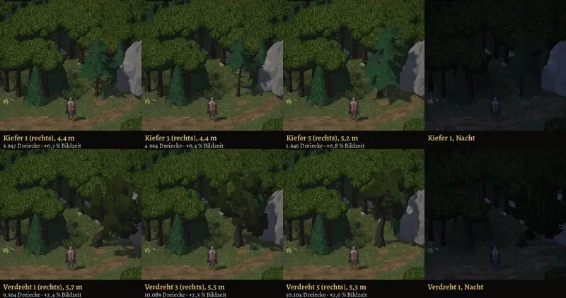

# 831 · Bäume aus dem Nature MegaKit mit unserer Signatur · Tom · 11.11., 12:49

[Bild von 11.11., 12:52](https://github.com/tramour-cmyk/androidapp_rpg_bornim/blob/bilder/2026-11/11-1252-831-Tom.png) (eingetragen von meldung.sh, Tom)

[Bild von 11.11., 12:52](https://github.com/tramour-cmyk/androidapp_rpg_bornim/blob/bilder/2026-11/11-1252-831-Tom.jpg) (eingetragen von meldung.sh, Tom)

Die vier Baumarten des freien Bausatzes (Laubbaum, Abgestorben, Kiefer, Verdreht), je drei Varianten, im Flüsterwald im echten Spiel: gleicher Ausschnitt, gleiches Licht und gleiche Zeichnung wie im Spiel, Held daneben. Jedes Feld zeigt links unseren heutigen Wald, rechts den Bausatzbaum; die Nachtfelder stehen ganz rechts (bei „Heute“ daneben). Nur ein Vorschaubild, im Spiel ist nichts eingebaut. Großbild in voller Auflösung: Telegram 11.11.

**Was du sagen sollst:** welche Arten und Varianten ins Spiel sollen (z. B. „Abgestorben und Verdreht ja, Laubbaum nein“), oder „nein“.

Gemacht: Farben aus unserem Laub (Eiche, Fichte; Verdreht düster olivgrau statt rot), gedämpft; Höhe auf unsere Bäume verkleinert (Bausatz 7 bis 16 m, hier 3,8 bis 6,6 m); Form der Baumkronen wie im Bausatz.

Kosten je Baum (unter jedem Feld): Dreiecke und Mehrzeit je Baum in Prozent der Bildzeit, gemessen am Rechner (Bildzeit mit 40 Bäumen gegen ohne, umgerechnet auf einen Baum), nur zum Vergleich untereinander. Unsere Eiche hat 744 Dreiecke, die Fichte 204; der Bausatz 1.646 bis 10.104. Abgestorben +0,3 bis 0,6 %, Kiefer +0,4 bis 0,8 %, Laubbaum +1,1 bis 2,2 %, Verdreht +2,4 bis 2,6 % (Verdreht hat auch die meisten Dreiecke).

Offen, nicht behoben:
- Dunkle Umrisslinie wie an unseren Bäumen (Signatur): an den Bausatzkronen kaum zu sehen, die Kronen wirken flacher als unsere. Behebbar beim Einbau.
- Nacht: an dieser Stelle fast schwarz, unser Wald dort ebenso; Mond oder Feuer liegt nicht im Ausschnitt.
- Wie viel die Bäume auf dem Tablet kosten, zeigt erst ein Build.

Geprüft an: https://github.com/tramour-cmyk/androidapp_rpg_bornim/commit/1f9f89bea (Bildlauf am Rechner 11.11., 12:44). Bestand geprüft: Stylized Nature MegaKit [Standard], Lizenz CC0, daraus die Bäume genommen.
