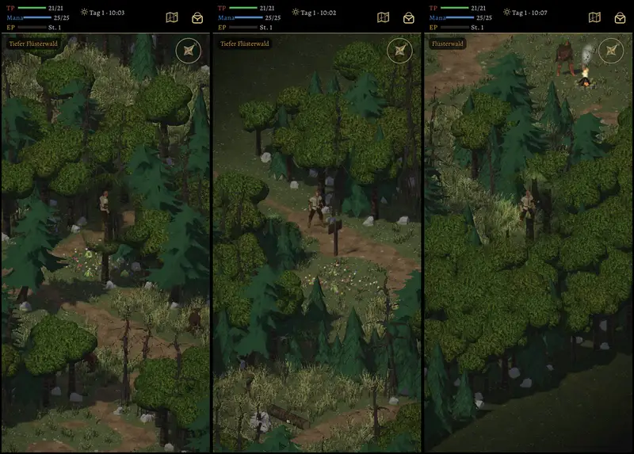

# 831 · Bäume aus dem Nature MegaKit im Wald, Spielbild · Tom · 12.11., 03:18

Eingebaut wie entschieden (11.11., 16:19 „831 wie Sokrates“): abgestorbene Bäume 3 und 5, Kiefer 5. Sie stehen zwischen unseren Eichen und Fichten, im Flüsterwald etwa jeder achte Baum abgestorben und jeder achte eine Kiefer, im Tiefen Flüsterwald etwa jeder sechste abgestorben. Sie bekommen Licht, Schatten und Tusche wie unsere Bäume (Kronen der Kiefern mit Tusche nach Licht, Wind und Durchsicht).

Im Bild: die kahlen, verzweigten Stämme sind die abgestorbenen Bäume, die gestuften Nadelbäume die Kiefern.

**Offen:** die Bildzeit auf dem Tablet misst erst ein Build; bis dahin nichts dazu.

**Was du sagen sollst:** „passt“ (dann fährt 831 im nächsten Sammelbuild) oder was anders sein soll.

Geprüft an: Lauf 368, https://github.com/tramour-cmyk/androidapp_rpg_bornim/actions/runs/43134378063 (Zweig `claude/tom-831-einbau`, 70b9815e6); alle 15 Waldbilder (Tag und Nacht) im Artefakt bornim-godot-bilder.
