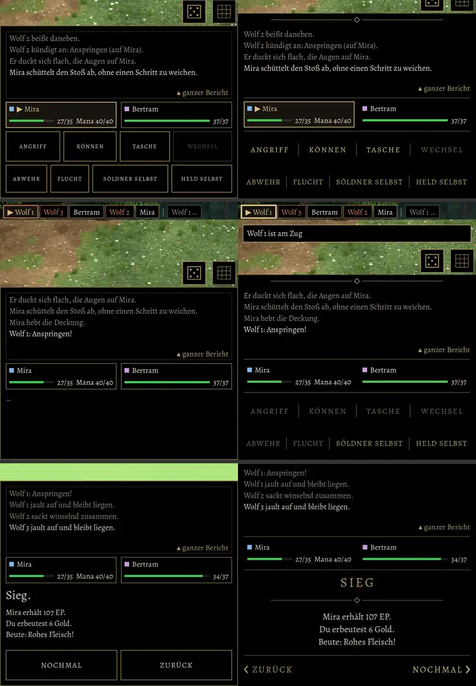

# 833 · Unterer Kampfschirm ohne Kasten im Kasten · Jerry · 11.11., 23:46

[Bild von 11.11., 23:47](https://github.com/tramour-cmyk/androidapp_rpg_bornim/blob/bilder/2026-11/11-2347-833-Jerry.png) (eingetragen von meldung.sh, Jerry)

Probekampf gegen das Wolfsrudel (Mira, Söldner Bertram), links wie heute, rechts Vorschlag A. Nur Bilder, kein Build.

**Was du sagen sollst:** „833 A“, oder was anders sein soll.

Oben: Mira ist am Zug. Mitte: ein Wolf zieht; heute steht dort „…“, in A bleiben alle Knöpfe an ihrem Platz, ausgegraut außer „Söldner“ und „Held“; ein Tipp auf einen ausgegrauten Knopf zeigt „Wolf 1 ist am Zug“, und Wolf 1 leuchtet oben in der Zugleiste auf (heller Rahmen). Unten: Sieg.

So ist A gebaut:
- Kein Rahmen mehr um den ganzen Kasten, um den Bericht und um die Knöpfe. Oben die Zierlinie der Schirme, zwischen Bericht, Gruppe und Knöpfen je eine schlichte Linie.
- Knöpfe ohne Rahmen in gesperrten Großbuchstaben wie in den Menüs: die vier oberen hell, die unteren gedämpft, eine feine senkrechte Linie zwischen den Knöpfen. Nicht wählbare Knöpfe grau; „Söldner“ und „Held“ (Auto oder selbst) bleiben auch beim Zug der Gegner schaltbar, wie in der alten Fassung.
- Einen Rahmen hat nur noch der Kasten dessen, der am Zug ist (wie abgenommen in 565).
- Die Höhe des Kastens bleibt beim Zugwechsel gleich; heute ändert sie sich mit „…“, und das Bild darüber passt sich neu an (gehört zu 709).
- Sieg wie die Blenden: „SIEG“ gesperrt in Gold, darunter die Zierlinie, der Lohn mittig, unten „‹ ZURÜCK“ links und „NOCHMAL ›“ rechts wie in den Menüs.

Offen:
- Das Sieg-Paar unten stammt vom Rechner (Figuren dort nur als Platzhalter, darum links oben ein grüner Streifen); auf dem Bauserver kam der Lauf nicht rechtzeitig bis zum Kampfende. Der untere Kasten ist derselbe Code.
- Niederlage und Flucht zeigen in A ihren Satz („Der Kampf ist verloren.“, „Du bist entkommen.“) unter der Zierlinie, ohne Titelwort wie „SIEG“; ein Titelwort käme von Homer.
- Das Fenster „ganzer Bericht“ und das kleine Erklärfenster haben noch ihren Goldrand; mit A würden sie wie die Fenster ohne Kasten umgebaut.

Geprüft an: Lauf 364 (Zweig `claude/jerry-833-kampfschirm`, Commit fbc1ce7e9, Artefakt `schirm833`), Test `schirm_833`: in A kein Rahmen, beim Zug des Gegners dieselben Knöpfe ausgegraut, Höhe gleich, Tipp nennt den, der am Zug ist.
