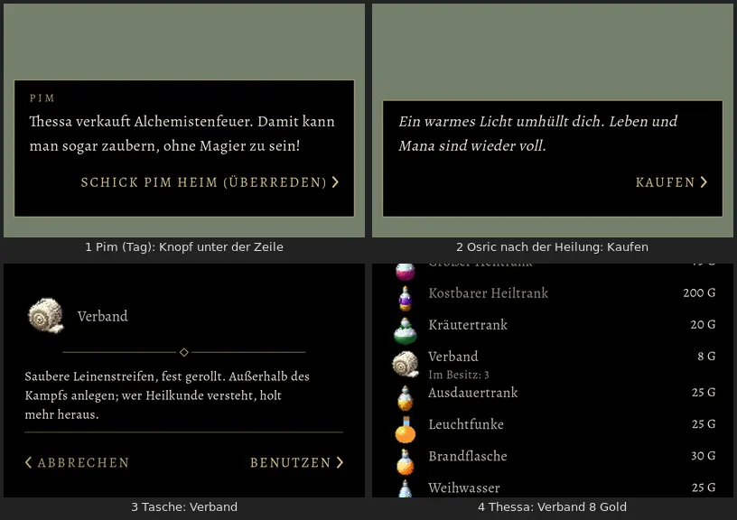

# 842 · Pim und Osric mit sichtbarem „Nicht jetzt“, Brandflasche, Verband · Team Tom · 12.11., 23:57

[Bild von 13.11., 00:00](https://github.com/tramour-cmyk/androidapp_rpg_bornim/blob/bilder/2026-11/13-0000-842-Tom.png) (eingetragen von meldung.sh, Tom)

E Welt

Geprüft an: https://github.com/tramour-cmyk/androidapp_rpg_bornim/commit/3641ee7e4

Bild am Rechner vom Stand [57ef59f40](https://github.com/tramour-cmyk/androidapp_rpg_bornim/commit/57ef59f40); das ▼ danach behoben in [3641ee7e4](https://github.com/tramour-cmyk/androidapp_rpg_bornim/commit/3641ee7e4). Der Ablauf (Knöpfe, Gold, Tippen) ist im Test geprüft, nicht nur im Bild. Großbild: Telegram 12.11., 23:58.

Nach deinem „nö, passt nicht“ (20:48) gebaut, so wie es im Spiel aussieht:

- **Bild 1, Pim:** Pim sagt jetzt „Brandflaschen“ (Homer). Rechts „SCHICK PIM HEIM (ÜBERREDEN) ›“, darunter „GIB PIM 5 GOLD ›“ (nur mit 5 Gold in der Tasche, Homer 1085), links unten „‹ NICHT JETZT“ (Homer 1074). Solange die Knöpfe stehen, schaltet Tippen auf den Text nicht weiter.
- **Bild 2, Osric:** nach seiner Heilung (Erzählzeile, darum ohne Namen) „KAUFEN ›“ rechts, „‹ NICHT JETZT“ links; das Gespräch läuft danach weiter wie bisher.
- **Bild 3 und 4, Verband:** in der Tasche mit Homers Beschreibung und „Benutzen“, bei Thessa für 8 Gold. Er stillt zuerst die Blutung, dann Leben (1038).

Was du sagen sollst: passt, oder was anders soll.

Vermerk: Im Bild 2 blinkt unten rechts noch das ▼ (Zeichen für „weitertippen“); behoben, solange Knöpfe stehen, fehlt es jetzt; nicht neu fotografiert, eine Probe je Thema. Die grüne Fläche steht am Rechner für das Dorf. Die Chance beim Überreden wächst mit dem Wert in Überreden und der Stufe des Helden (Zahlen nach Sokrates' Vorentscheid 1084, vorläufig). Offen: Verband im Kampf (Homers Satz liegt bereit), Ansehen bei Pims Mutter wirkt erst mit 447.4.1.
