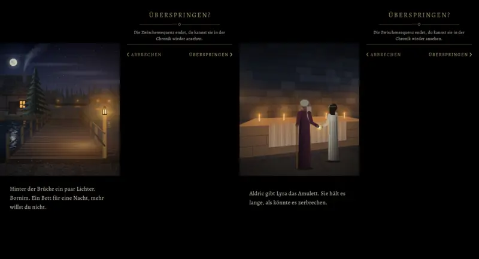

# 856 · Zwischensequenz: „Überspringen?“ und Satz ohne Kasten (Vorgang 856) · Spike · 11.11., 19:03

Dein Fund aus Build 274: beim Tippen in die Zwischensequenz kam „Überspringen?“ noch im alten Kasten mit Goldrahmen und gerahmten Knöpfen, das Spiel schien halb durch, und der Satz unter dem Bild stand in einem Kasten. Nur ein Vorschaubild am Rechner, kein Build; kommt im nächsten Build mit.

Von links: Intro Bild 2 mit Satz, Rückfrage „Überspringen?“, Tempelszene mit Satz, Rückfrage.

**Was du sagen sollst:** „856 passt“, oder was anders sein soll; für den Satz allein „856 Satz zurück“.

Neu gegenüber Build 276:
- Die Rückfrage sieht aus wie jede andere: schwarz und ganz deckend, nichts scheint durch; oben „ÜBERSPRINGEN?“ mit Zierlinie, darunter der Satz, unten „‹ ABBRECHEN“ links und „ÜBERSPRINGEN ›“ rechts, ohne Rahmen. Die Szene läuft dahinter weiter; Tippen daneben und die Zurück-Taste heißen „Abbrechen“.
- Der Satz unter dem Bild steht ohne Goldrahmen frei auf Schwarz, an derselben Stelle wie vorher. Unser Stilbuch sah dort den Textkasten vor; das ist hier nach deinem Wort „der Text kommt auch in einem Kasten“ geändert.
- Intro und Tempelszene laufen über dieselbe Klasse, beide sind geändert.

Bekannt, nicht geändert:
- Alle übrigen Rückfragen (Spielstand löschen, Wegwerfen, Laden, Brauen, Menge, Platzwahl, Kapitelende) waren schon ohne Kasten.

Geprüft an: https://github.com/tramour-cmyk/androidapp_rpg_bornim/commit/ce69f3c7c (Zweig `claude/tom-856-ueberspringen`, Bildlauf am Rechner 11.11., 18:58).
