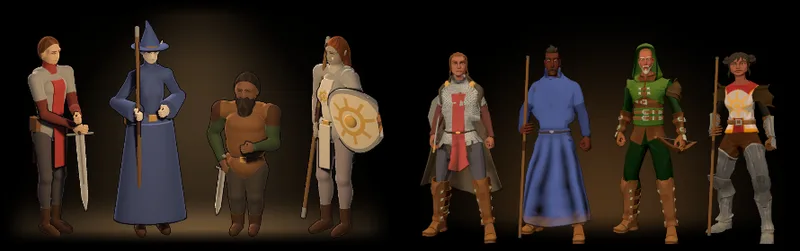

# 867 · Hauptmenü: die vier Helden mit deinen Ergänzungen und neuem Licht · Team Tom (Spike) · 12.11., 21:20

[Bild von 12.11., 21:20](https://github.com/tramour-cmyk/androidapp_rpg_bornim/blob/bilder/2026-11/12-2120-867-Spike.png) (eingetragen von meldung.sh, Spike)

G Stil

Geprüft an: [Lauf 400](https://github.com/tramour-cmyk/androidapp_rpg_bornim/actions/runs/43289694128) (Zweig `claude/tom-867-vorlage2`, Schritt „Hauptmenübild (867)“), Hauptmenü am Bauserver mit den gekauften Figuren wie im Spiel. Der Lauf ist rot nur wegen eines fremden Tests (Ziege im Dorf); der Bildschritt 867 lief durch. Großbild: Telegram 12.11., 21:20.

In der Probe umgesetzt, wie du es um 20:01 gesagt hast (nicht A, B oder C; deine Ergänzungen sind die Nachträge 18:25 und 18:27):
- Frisur (18:25): Jeder Held trägt die Frisur seiner Herkunft, nicht mehr alle dieselbe erste Frisur; Zauberlehrling und Jägerkind sehen nicht mehr aus „wie Brüder“. Die Wachsoldatin trägt jetzt ihren Zopf; beim Jägerkind verdeckt die Kapuze das Haar, der Zwerg behält seinen Bart.
- Haarfarbe (18:27, deine Antwort 18:28 „Schwarz“): Haar und Bart des Zauberlehrlings schwarz statt blond; gilt auch in der Erschaffung.
- Blond (18:28 „das Blond auch entgelben“): weniger gelb für Menschen und Hügelvolk, überall im Spiel; im Bild nicht zu sehen, weil keiner der vier blond ist.
- Licht: Der warme Schein steht hinter den Beinen und läuft nach allen Seiten weich ins Schwarz aus, ohne Kante; eine Lampe vorn oben bringt die Gesichter ins Licht, auch das dunkle des Zauberlehrlings.

**Mir ist aufgefallen:**
- Das Jägerkind (Zwerg) hat graues Haar und einen grauen Bart und wirkt wie ein alter Mann. Ursache: Die Herkunft gibt die vierte Haarfarbe, beim Menschen Rot, beim Zwerg Grau. Gilt auch in der Erschaffung. Vorschlag: beim Zwerg Rot (wie beim Menschen); sagst du ja, kommt es mit dem Einbau.
- Der Zwerg ist so groß wie die Menschen, die Elfe sieht aus wie ein Mensch: Alle Völker haben noch denselben Körper (431, nach dem Umzug).
- Der Rundschild der Wachsoldatin ist von vorn nicht zu sehen, ihr Schwert nur als schmaler Strich an der Hand.
- Der Kurzbogen des Jägerkinds liegt waagrecht in der Hand und wirkt fast wie eine Armbrust.

**Sag bitte:** Passt das Hauptmenü so? „passt“ (dann baut Tom es ein, eine Zeile im Zweig des Umzugs, und du siehst es im nächsten Build) oder was anders sein soll; dazu ja oder nein zum roten Haar des Zwergs.
