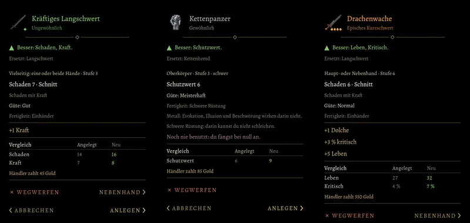

# 870.7 · Gegenstandsfenster mit den Werten unseres Regelwerks (Vorgang 870.7) · Tom · 11.11., 17:16

[Bild von 11.11., 17:16](https://github.com/tramour-cmyk/androidapp_rpg_bornim/blob/bilder/2026-11/11-1716-870.7-Tom.png) (eingetragen von meldung.sh, Tom)

Das Fenster, das sich beim Antippen eines Gegenstands in der Tasche und im Laden öffnet, zeigt jetzt nur noch Werte unseres eigenen Regelwerks (Vorgang 870, Umstellung von den alten Regeln auf unser Regelwerk, Schritt 6). Drei Stücke aus der Tasche eines Wachsoldaten, nebeneinander: ein gutes Langschwert, ein meisterhafter Kettenpanzer, ein episches Kurzschwert mit drei Zusatzeigenschaften. Nur ein Vorschaubild am Rechner, kein Build. Großbild in voller Auflösung: Telegram 11.11.

**Was du sagen sollst:** „870.7 passt“, oder was anders sein soll.

Neu gegenüber dem Stand auf deinem Gerät (Build 276):
- Statt „+1“ am Namen und „Angriff +1“ steht die Güte als eigene Zeile: „Güte: Normal“, „Gut“ oder „Meisterhaft“ (Wortlaut Homer).
- Schaden und Schutzwert rechnen die Güte mit (gutes Langschwert 7 statt 6, meisterhafter Kettenpanzer 6 statt 5); dazu die Schadensart (Schnitt, Stich, Wucht) und darunter, welcher Grundwert in den Schaden geht („Schaden mit Kraft“).
- „Fertigkeit: Einhänder“ (oder Bogen, Schwere Rüstung, Schild): welche Fertigkeit das Stück braucht. Ist sie beim Helden noch null, steht rot „Noch nie benutzt: du fängst bei null an.“ (wie in Build 276).
- Zusatzeigenschaften im Wortlaut des Regelwerks: „+1 Kraft“, „+3 % kritisch“, „+5 Leben“, „+1 Dolche“.
- Nach dem Bild entfernt, weil Homers Wortlaute es so verlangen: „Vielseitig: eine oder beide Hände“ beim Langschwert (heißt jetzt „Haupt- oder Nebenhand“; mit beiden Händen kämpft man im neuen Regelwerk nicht) und beim Kettenpanzer „Schwere Rüstung: darin kannst du nicht schleichen.“ (kommt erst, wenn man im Spiel schleichen kann).

Bekannt, nicht geändert:
- Oben steht der Wert des Stücks allein (Langschwert Schaden 7, Kettenpanzer Schutzwert 6), im Vergleich darunter der des ganzen Helden mit allem, was er trägt (Schaden 14 auf 16, Schutzwert mit Schild 6 auf 9). So zeigt es auch Build 276.

Geprüft an: https://github.com/tramour-cmyk/androidapp_rpg_bornim/commit/be0b4edb8 (Stand des Bildes, Bildlauf am Rechner 11.11., 17:10); die beiden entfernten Zeilen: https://github.com/tramour-cmyk/androidapp_rpg_bornim/commit/a01b8283b. Nichts neu gezeichnet, nur Text geändert.
