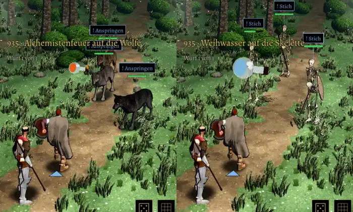

# 935 · Wurfmittel im Kampf: Flasche im Bogen geworfen · Tuffy · 12.11., 00:16

Film aus Lauf 360 (Telegram). Dein Fund aus Test 277 (11.11., 20:34): „kein Wurf, das war ja wie ein Feuerball … Keine Parabel, die geworfen wurde, sondern ein nach vorne gerichteter Schubser“. Jetzt holt Ansgar aus, die Flasche fliegt sichtbar im Bogen und zerschellt am Ziel: zuerst Brandflasche auf die Wölfe (ab 11 Sekunden), dann Weihwasser auf die Skelette (ab 27 Sekunden).

**Was du sagen sollst:** „935 passt“, oder was anders sein soll.

Neu gegenüber Build 277:
- Wurfbewegung und Flug im Bogen statt Feuerball.
- Weihwasser lässt sich nur auf Untote werfen (vorher war kein Skelett je Ziel).
- Die Wirkung wächst mit Alchemie wie in der Simulation: bei Alchemie 10 ist die Brandflasche doppelt so stark wie in Build 277.

Bekannt, nicht geändert:
- Die Weihwasserflasche wirkt im Flug zu groß.
- Die Wurfprüfung meldet im Lauf 1,8 Meter Abstand zum Ziel, am Rechner trifft sie; im Film trifft die Flasche. Ursache offen.

Geprüft an: https://github.com/tramour-cmyk/androidapp_rpg_bornim/commit/826e245e8 (Zweig `claude/tuffy-935-wurf` auf Build 277; Lauf 360).
