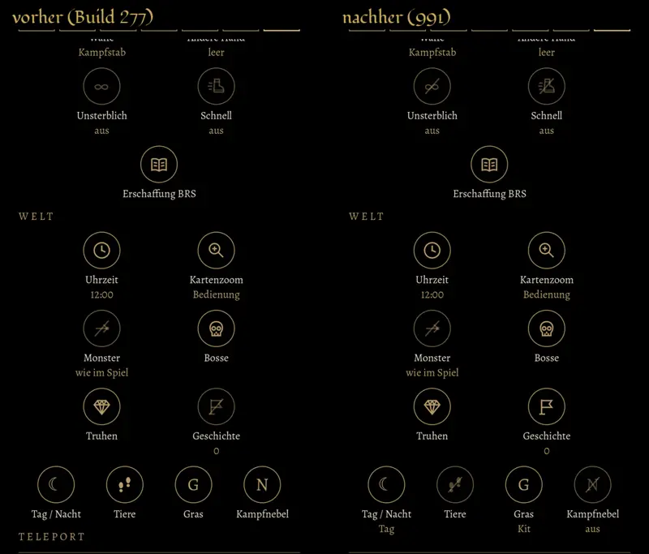

# 991 · Testmenü: jeder Schalter zeigt seinen Zustand am Zeichen · Tom · 11.11., 21:16

[Bild von 11.11., 21:18](https://github.com/tramour-cmyk/androidapp_rpg_bornim/blob/bilder/2026-11/11-2118-991-Tom.png) (eingetragen von meldung.sh, Tom)

Reiter „Test“, Abschnitt Held und Welt, links wie in Build 277, rechts neu. Eine Regel für alle Schalter: an = Zeichen gold, aus = Zeichen matt und durchgestrichen, darunter immer „an“/„aus“ oder der Wert. Knöpfe, die nur etwas tun (Gold, Heilen, Truhen, Bosse, Orte, Stationen, Strahlen), bleiben gold. Nur ein Vorschaubild am Rechner, kein Build; im Bild sind Kampfnebel aus und Gras mit Kit (das gekaufte Gras) gestellt. Unter „Tiere“ fehlt im Bild noch das Wort „aus“; es ist inzwischen ergänzt.

**Was du sagen sollst:** „991 passt“, oder was anders sein soll.

Neu gegenüber Build 277:
- Durchgestrichen, wenn aus, jetzt auch bei Zeichen aus Buchstaben und beim Stiefel: Unsterblich (∞), Schnell, Sichtlinie (◎), Rettung (✗), Gras (G, bei „alt“), Kampfnebel (N). Vorher waren sie nur matt. Sichtlinie und Rettung sind im Bild nicht zu sehen.
- Mit Zustand, vorher ganz ohne: Kampfnebel (an/aus), Gras („Kit“ oder „alt“), Tiere (an/aus), Tag/Nacht (darunter „Tag“ oder „Nacht“; der Mond steht für das Umschalten und bleibt gold, weil beides kein Aus ist).
- Geschichte klappt nur die Liste der Schritte auf, wie „Waffe“ die Liste der Waffen: immer gold, darunter die Zahl der erledigten Schritte. Vorher war es zugeklappt matt und durchgestrichen und sah aus wie „aus“.

Bekannt, nicht geändert:
- „Monster: wie im Spiel“ ist durchgestrichen (wie schon in Build 277), weil der Schalter „Monster beachten mich nicht“ heißt; an ist er, wenn Monster dich übersehen. Ebenso Rettung: an heißt, Zauber treffen Gegner immer voll. Soll das Zeichen stattdessen zeigen, ob das Spiel normal läuft, sag es.
- Die Kampfhilfen (Kritisch, Rettung) folgen derselben Regel.

Geprüft an: https://github.com/tramour-cmyk/androidapp_rpg_bornim/commit/1ce41fc5b (Zweig `claude/tom-277-funde` auf Build 277; Bildlauf am Rechner 11.11., 21:14).
