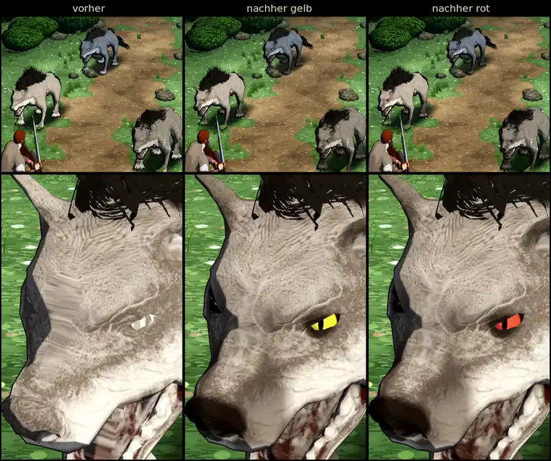

# 995 · Grabhund: Augen, Kopf und Körper lesbar · Team Jerry · 12.11., 14:35

E Figuren

Geprüft an: [Stand 783bc44ee](https://github.com/tramour-cmyk/androidapp_rpg_bornim/commit/783bc44ee) (am Rechner, Kampfort Wald am Tag)

Dein Wort (11.11., 20:58, Film 744): der Grabhund wirkt durch seine Farbe unstrukturiert, „wie halb transparent“; klar erkennbare Augen in einer klaren Farbe, rot oder gelb; Nasenrücken und Ohren lesbarer. Oben das Spielbild, unten der Kopf von nah; links vorher, Mitte gelb, rechts rot.

- **Augen:** klare Iris mit schmaler Pupille in einer dunklen Augenhöhle, leicht leuchtend, damit sie auch im Schatten zu sehen sind. Im Spielbild klein, beim vorderen Hund als Punkt erkennbar.
- **Verwaschen:** Das „halb Durchsichtige“ am Kopf kam vor allem daher, dass das Modell fürs Handy vereinfacht wird. Dabei wurde die Oberfläche quer über den Fang verzogen (unten links der helle Streifen). Jetzt behält der Kopf mehr Einzelheiten, der Rumpf weniger; zusammen ist das Modell nicht schwerer als bisher.
- **Nase und Fang:** Nase schwarz, Seiten des Fangs dunkler, der Nasenrücken steht dadurch hell. Falten der gekauften Vorlage treten stärker hervor, die Läufe werden zum Boden hin etwas dunkler wie von Grabeserde.

Offen: Die Ohren habe ich dunkler gemalt, im Bild ist davon kaum etwas zu sehen. Vermerk: Bisher galt „Augen matt, auch wo das Modell leuchtet“ (Figurenliste, 26.10., nur das Skelett behält seinen glühenden Augenpunkt); das leichte Leuchten weicht davon ab. Ohne Leuchten sind die Augen im Schatten kaum zu sehen.

**Sag bitte:** Gelb oder rot? Und passen Augen, Kopf und Körper so, oder was soll anders sein?
