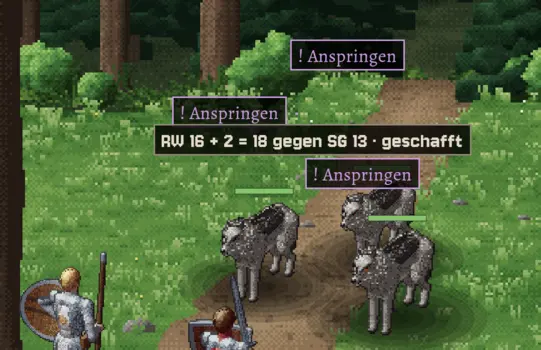
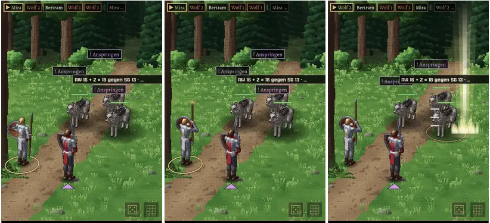

# Jerry · Build 50 · 0.1.917 · MARS: Zaubergeste, Würfel-Knopf, Automatik-Sperre · PR #138
E Kampf · Jerry · 20.10., 18:37 · [APK (Artefakt bornim-apk)](https://github.com/tramour-cmyk/androidapp_rpg_bornim/actions/runs/39459529054)

Ein Weg: Testreiter, MARS-Testkampf gegen drei Wölfe, Held als Magier oder Kleriker. Build 50 enthält Build 49 (49.1–49.6 gelten mit); über Build 48 (Tom) installieren.

| # | Nr. | Wo und wie | Richtig | Falsch |
|---|---|---|---|---|
| 50.1 | 249 | Held zaubert (z. B. Heilige Flamme) | Er bleibt stehen, hebt Stab oder Hand zur Zaubergeste, dann der Effekt am Ziel | Er macht einen Ausfallschritt und schlägt mit dem Stab zu |
| 50.2 | 260 | Rechts unten links neben dem Gittersymbol der Würfel; antippen | Aus: keine Würfe über den Figuren, Würfel blasser; nochmal: wieder an | Kein Würfel da, oder Würfe bleiben trotz „aus“ |
| 50.3 | 260 | Würfel an, einen Angriff abwarten | Wurf mit Ausgang („… gegen RK 17 · daneben“) liegt über den Absichten der Wölfe, ganz lesbar, gut 2 s, dann blendet er weich aus | Text abgeschnitten, unter einer Absicht, oder verschwindet schlagartig |
| 50.4 | 260 | Lang auf eine Figur drücken (Name), dann loslassen und warten | Name und Hinweis blenden nach einer Weile weich aus | Sie verschwinden schlagartig |
| 50.5 | 241.2 | Held knapp über einem Drittel der LP (Balken), „Held selbst“ antippen | Knopf geht auf „auto“; falls die Gegner ihn vor seinem Zug unter ein Drittel bringen, hält die Automatik vor seinem Zug an | Meldung „Unter einem Drittel“, obwohl der Balken mehr zeigt |

Schadenspunkte stehen wie bisher in der Kampfmeldung, nicht im Wurf. Zaubereffekte (Heilige Flamme, Feuerpfeil u. a.) sind die des klassischen Kampfs (249, Liste 14:41). Schritte, Zoom und Blut fahren noch nicht mit; sie warten auf dein Wort zu den Bildern 249-schritte und 249-zoom-blut (228).

Vorschau (links nach rechts: Wurf liegt über „Anspringen“; Mira hebt den Stab, Flamme auf Wolf 2):

