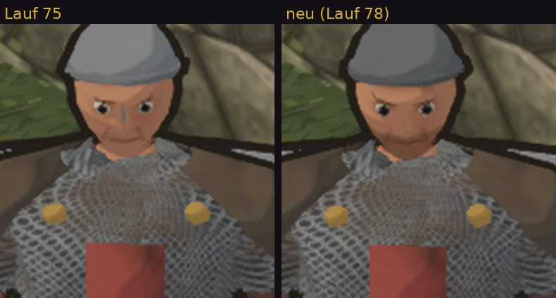

# Tom · Build 78 · 0.348.78 · Godot-Dorf: Wenden, MuMu, Heldengesicht · –
D Umzug · Tom · 26.10., 14:05 · [APK: Artefakt „bornim-godot-apk“ im Lauf 78](https://github.com/tramour-cmyk/androidapp_rpg_bornim/actions/runs/40325787134)

**Testbitte** zu deinen Punkten von Lauf 75 (11:41, 11:42); ersetzt die Testbitte Runde 5 (Lauf 50), deren Punkte hier mitlaufen. Ein Weg: auf der Seite des Laufs unten das Artefakt „bornim-godot-apk“ laden (ZIP, mit GitHub-Anmeldung), entpacken, die APK über die letzte Godot-Fassung installieren (Handy und MuMu), App „Bornim (Godot)“ öffnen; der Held startet am Brunnen auf dem Marktplatz.

| # | Team | Nr. | Wo und wie | Richtig | Falsch |
|---|---|---|---|---|---|
| 1 | Tom | 348.6 | Am Rechner: APK in MuMu-Player installieren und öffnen (die APK enthält jetzt auch die Fassung für Rechner-Prozessoren, x86_64) | startet wie am Handy, Dorf und Held erscheinen | startet nicht, schwarzer Schirm oder schließt sich (dann bitte sagen, welche MuMu-Fassung) |
| 2 | Tom | 348.6 | Mit zwei gespreizten Fingern ganz nah an den Helden heran; zwei Finger kreisen lassen, bis er dich ansieht | Augenpartie und Brauen als dunkle, ernste Linie; kein grauer Steg auf der Nase (der Nasenschutz am Helm ist weg) | Gesicht ohne Brauen; grauer Steg oder Fleck auf der Nase |
| 3 | Tom | 348.6 | Auf dem Marktplatz 30 s den Leuten zusehen, die hin und her gehen (etwa der Junge Pim) | beim Umkehren drehen sie in einem kleinen Bogen über etwa zwei Schritte, gut eine Sekunde; Füße rutschen nicht | wirbeln auf der Stelle herum; gleiten beim Drehen |
| 4 | Tom | 348.6 | Brunnen und die Marktstände daneben von allen Seiten ansehen | Brunnen offen, Satteldach auf zwei Pfosten, Eimer am Seil; die Marktstanddächer liegen auf allen Pfosten | Dach schwebt oder liegt verkehrt |
| 5 | Tom | 348.6 | Finger auflegen und weit ziehen; danach Knopf „Tag / Nacht“ rechts oben tippen und dasselbe | Held geht, dann rennt er (Oberkörper vor, Knie hoch); nachts trägt er die Fackel in seiner linken Hand vor der Schulter | sieht aus wie schnelles Gehen; Fackel hinter dem Rücken |
| 6 | Tom | 348.6 | Held 10 s stehen lassen und ansehen; dann die Leute im Dorf (Kleidung, Gang, Stab oder Speer in der Hand) | Held und Leute atmen ruhig ohne Ruck; jeder geht in eigenem Takt; Kleidung ohne dunkle Risse | Zucken alle 3–4 s; alle im Gleichschritt; dunkle Risse an Seite oder Schulter |

**Sag:** zu jeder Zeile „passt“ oder was nicht; vor allem zu 2, ob das Gesicht in die richtige Richtung geht.

**Bekannt, nicht behoben (fremde Prüfung):**
- **Das Brunnendach schneidet in den linken Marktstand** (die beiden stehen zu dicht); folgt im nächsten Lauf.
- **Gesicht noch rund und jungenhaft; der Blick wirkt eher grimmig; der Bartschatten um Mund und Kinn kann wie Schmutz wirken, der Mund verschwindet darin; der Helm wirkt wie eine Mütze (kein Metallglanz).**
- **Im alten Spiel beginnt der Kämpfer ohne Helm (Haar sichtbar); neu trägt er immer Helm.** Eine Probe ohne Helm las sich als Kappe ohne Ohren; kommt erst mit Haar und Ohren.
- Nachts sitzt die Flamme der Fackel auf Kopfhöhe dicht vor dem Gesicht.
- Über den Schultern stechen helle Ecken des Schilds aus dem Umhang.
- MuMu: Ursache vermutet (die APK hatte nur die Handy-Fassung, ARM); am Rechner hier nicht nachstellbar.
