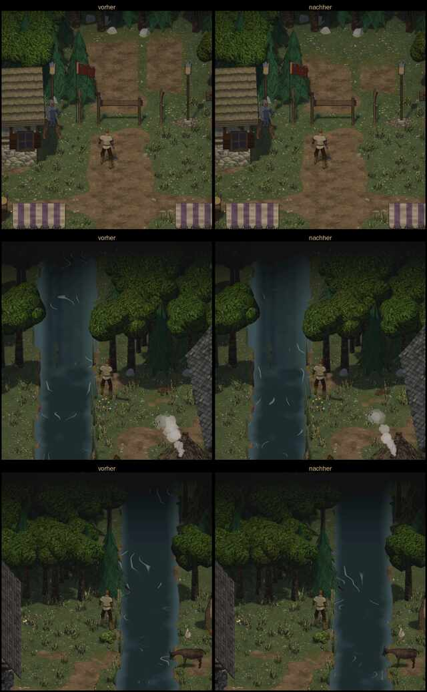

# 1022 · Vorentscheid „Kartenrand passt bis auf zwei Reste“ billigen?
Sokrates · 12.11., 23:50 · E Welt · Vorentscheid in der Nacht (Archiv 1077), nach deinem Maß 20:07
Kurz: der weiche Rand ins Dunkel passt; Weg am Schlagbaum und Fluss sollen noch mit ins Dunkel laufen, dann fährt er im nächsten Build

Geprüft an: [Lauf 43310392064](https://github.com/tramour-cmyk/androidapp_rpg_bornim/actions/runs/43310392064), [Commit 88c0b35](https://github.com/tramour-cmyk/androidapp_rpg_bornim/commit/88c0b353c), Bilder Spike 23:42 (`ansehen/1022-kartenrand.md`, gelöscht 12.11., 23:50, in Git; Bilder `bilder/1022-rand-1.webp` bis `-3.webp`)

**Frage:** Passt der neue Kartenrand (1,5 Kacheln hell, dann über 4 Kacheln weich ins Schwarz) zu deinem Wort 20:07 „sanfter Übergang und dann dunkel“?

**Entschieden:** Ja, mit „Rest weg (1), (2)“: (1) die Wegstücke hinter dem Schlagbaum werden vor den Bäumen dunkler, statt hell an der Baumreihe zu enden; (2) am Fluss verschwinden die hellen Wellenlinien mit dem Wasser. Neue Bilder nur dieser zwei Stellen; passen sie, fährt 1022 im nächsten Build.

**Berührt:** 1022 (Tom, Spike)

**Begründung:** An Wald, Feld und Brücke ist der Übergang jetzt weich (im Bild über 30 bis 60 Pixel von hell nach dunkel, keine Kante). Am Schlagbaum springt die Helligkeit auf dem Weg dagegen fast ohne Übergang von hell auf dunkel (gemessen 73 auf 35 in 15 Pixeln), genau an der Stelle, die du um 13:51 gefunden hast. Dort schaust du zuerst hin.

**Sachverhalt:**
- Vorher (Build 280) brach der Rand als harte schwarze Kante ab; du hast das um 20:07 zurückgegeben.
- Spike hat die Ursache gefunden: der Übergang war am Boden gemessen und darum im schrägen Bild nur 1,6 Kacheln hoch. Jetzt ist er im Bild gemessen, an allen Seiten und Ecken rund (Commit 88c0b35, Randtest grün).
- Neun Bildpaare (Dorf Nord, Süd, Kornfeld, Fluss West und Ost, Flüsterwald Ost und Süd, Tiefer Wald Ost und Süd): Wald und Wiese laufen weich ins Schwarz; Spike nennt selbst die zwei Reste.

**Auswertung:**
- **A (entschieden):** beide Reste weg, dann Build.
- **B (verworfen):** so in den Build, Reste später. Spart einen Bilderlauf, aber der Schlagbaum wäre dein erster Fund.
- **Stärkstes Gegenargument gegen A:** eine dritte Bilderrunde kostet Zeit und Geld (bisher 28,85 $). Dagegen: es sind zwei kleine Stellen, und Qualität geht vor Eile.

**Folgerungen:** Tom (Spike) dunkelt Weg und Wellenlinien mit ab und legt nur diese zwei Stellen als Bildpaar vor; passt es, fährt 1022 im nächsten Build. Sagst du „zurück“, fährt der Stand 23:42 ohne die zwei Änderungen.

**Umgesetzt:** Commit 6c56b43, Bildpaar Tom 13.11., 01:05 ([Lauf 43326236234](https://github.com/tramour-cmyk/androidapp_rpg_bornim/actions/runs/43326236234)); Sokrates 01:07: passt, fährt im nächsten Build.

- Schlagbaum: die Wegstücke laufen jetzt vor den Bäumen ins Gras aus, statt als helles Rechteck an der Baumreihe zu enden.
- Fluss: die Wellenlinien verlöschen mit dem Wasser; das Wasser ist am oberen Rand so dunkel wie die Kronen daneben (gemessen, Tom hatte es heller gesehen).

**Rückbau:** sagst du „zurück“, fährt der Stand vom 23:42 ohne die Reste.

**Kosten:** ein kleiner Bau und ein Bilderlauf.

Antwort: …
