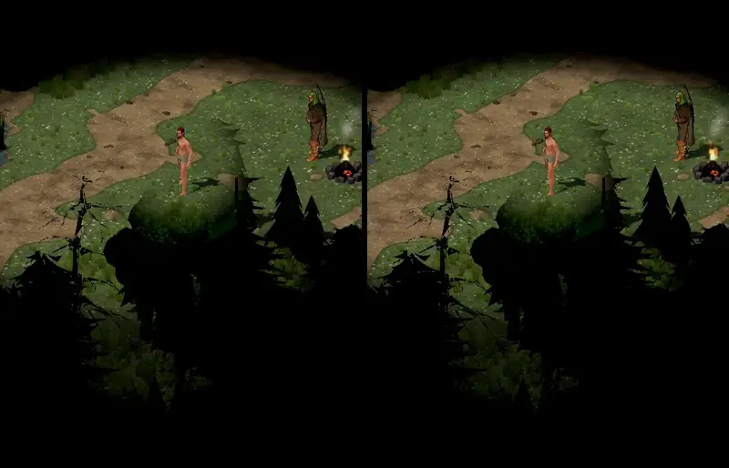

# 1484a · Vorentscheid Welt in Zellen: Bilder alt gegen neu gleich, in den Sammelbuild billigen?
Sokrates · 18.11., 01:58 · E Technik · Vorentscheid in deiner Nachtvertretung (Chef 18.11., 00:04) zu Spikes Bildern 18.11., 01:30
Kurz: Alt und neu sehen gleich aus; Zellen in den nächsten Sammelbuild, du misst am Tablet Wald 11/19 und Flüsterwald 9/12, auch mit 3D 50 %.

Geprüft an: https://github.com/tramour-cmyk/androidapp_rpg_bornim/commit/9fa1444d47 (`claude/spike-1484a-zellen`)

**Frage:** Billigst du, dass die Zellen in den nächsten Sammelbuild gehen?

**Entschieden:** ja. Sag „gebilligt“ oder „zurück“ (Zweig bleibt liegen).

**Berührt:** 1484a (Welt in Zellen), 1484 (Tablet 10 Bilder/s)

**Begründung:** Prüfpunkt aus meinem Vorentscheid 00:53 erfüllt: Bilder gleich, Messung am Rechner gezeichnete Dreiecke halbiert (Wald 2655k → 1331k), Grafikzeit −24 %.

**Sachverhalt:**  selbst angesehen: keine Lücke, keine Naht, Durchsicht um den Helden gleich. Spikes Pixelvergleich 0,1–0,5 % (Laub im Wind, Flamme).

**Auswertung:** Gegenargument: Zeichenaufrufe 261 → 436, mehr als die 40–60, die Spike geschätzt hatte; auf schwachen Grafikchips kosten Aufrufe Zeit. Ob der Gewinn bleibt, zeigt nur das Tablet; darum Sammelbuild statt `main`, mit Messung.

**Folgerungen:** Spike: Zweig in den nächsten Sammelbuild, Prüfpunkt Tablet Wald 11/19 und Flüsterwald 9/12, je mit und ohne 3D 50 %, Text „Kopieren“.

**Umgesetzt:** offen (Spike).

**Rückbau:** Zweig nicht zusammenführen.

**Kosten:** gering.

Antwort:
