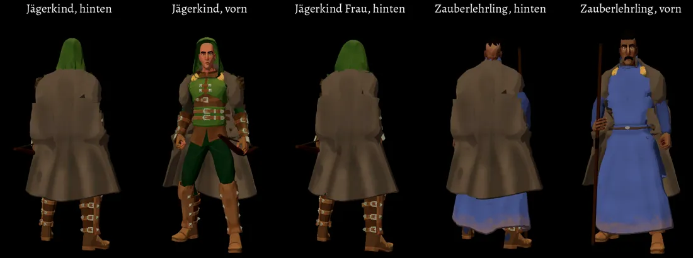

# 1569.1 · Vorentscheid Umhang Bild 4 (Seiten 4 cm weiter) billigen?
Sokrates · 18.11., 03:08 · E Figuren · Vorentscheid in deiner Nachtvertretung (Chef 18.11., 00:04) zu Toms Bild 18.11., 02:42
Kurz: Bild 4 so lassen, mit 1569 in den nächsten Sammelbuild; kein weiterer Bildlauf. Prüfpunkt am Handy: Keil und Wölbung in der Spielkamera.

Geprüft an: https://github.com/tramour-cmyk/androidapp_rpg_bornim/commit/fa6e46791 (`claude/tom-1569-umhang`)

**Frage:** Billigst du Bild 4?

**Entschieden:** 👍 so lassen. Sag „gebilligt“ oder „zurück“ (dann Bild 3, Seitenweite raus).

**Berührt:** 1569 (Umhang), 1569.1 (Umhang Schulter), 431h (Kleidung Stufe 2)

**Begründung:** Die beiden Fehler aus Bild 3 sind behoben oder fast weg: grüner Rand beim Jägerkind weg, Innenseite 30 → 3 und 35 → 9 Messpunkte, Kleidung durch den Umhang 617 → 174. Mehr Weite (6 cm) machte die Rückseite laut Tom wieder schlechter, ein weiterer Lauf verspricht wenig.

**Sachverhalt:**  selbst angesehen, gegen Bild 3: Keil an der rechten Schulter nur noch als kleiner Fleck; Seiten am Oberarm etwas runder, Umriss wie ein Umhang über Schultern, nicht störend; Zauberlehrling hinten: blauer Ärmel rechts neben dem Umhang sichtbar, wie vorher.

**Auswertung:** Gegenargument: der Umriss ist am Oberarm unruhiger als in Bild 3 (gut aussehend, Oberste Direktive). Antwort: in der Spielkamera von schräg oben zählt der Rücken mehr als die Seite, und ein dunkler Keil liest sich als Fehler, eine Wölbung als Stoff. Entscheidet sich am Handy; dort Prüfpunkt.

**Folgerungen:** Tom: 1569 mit 1569.1 in den nächsten Sammelbuild; Prüfpunkt am Handy „Umhang von hinten: kein dunkler Fleck an der Schulter, Seiten ruhig“.

**Umgesetzt:** offen (Tom).

**Rückbau:** Seitenweite `UMHANG_WEIT` auf 0.

**Kosten:** gering.

Antwort:
