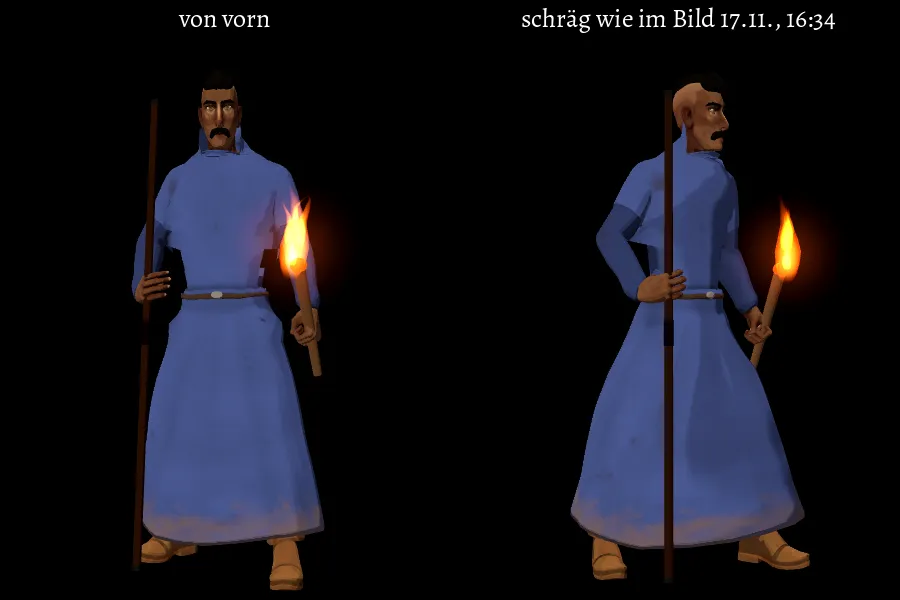

# 1571 · Vorentscheid Fackel der Nebenhand sitzt richtig (links) billigen?
Sokrates · 18.11., 01:58 · E Figuren · Vorentscheid in deiner Nachtvertretung (Chef 18.11., 00:04) zu Toms Befund 18.11., 01:48
Kurz: Die Fackel sitzt in der linken Hand; in deinem Bild vom 17.11. war der Held gedreht. Nichts zu bauen; 1571 erledigt, sobald Zauberstab (1587) und Umhang (1569) im Build sind.

Geprüft an: https://github.com/tramour-cmyk/androidapp_rpg_bornim/commit/9a53e6aaf (`claude/tom-1571-fackel`, Messung `fackel_hand_1571`, 8 Helden)

**Frage:** Billigst du, dass an der Fackelhand nichts gebaut wird?

**Entschieden:** stimmt. Sag „gebilligt“ oder „zurück“ (dann baut Tom die Fackel in die andere Hand).

**Berührt:** 1571 (dein Fund Build 297), 1587, 1569

**Begründung:** Die Vorderansicht ist eindeutig: Stab rechts, Fackel links in der Hand der Figur.

**Sachverhalt:**  selbst angesehen, gegen dein Bild `t297-stab-fehlt.webp`: dort steht der Held im Profil nach rechts, Fackel vor dem Körper.

**Auswertung:** Gegenargument: dein Fund; wer im Profil nach rechts schaut, zeigt eher die rechte Seite, das Bild bleibt mehrdeutig. Entscheidet die Vorderansicht und Toms Messung an allen acht Helden. Fehlt dir die Fackel trotzdem „falsch“, ist es die Haltung im Profil, nicht die Hand: dann „zurück“ mit Wort.

**Folgerungen:** Tom: 1571 auf erledigt, sobald 1587 und 1569 im Sammelbuild sind; kein Bau.

**Umgesetzt:** offen (Tom).

**Rückbau:** Fackel an die rechte Hand, eine Zeile.

**Kosten:** keine.

Antwort:
