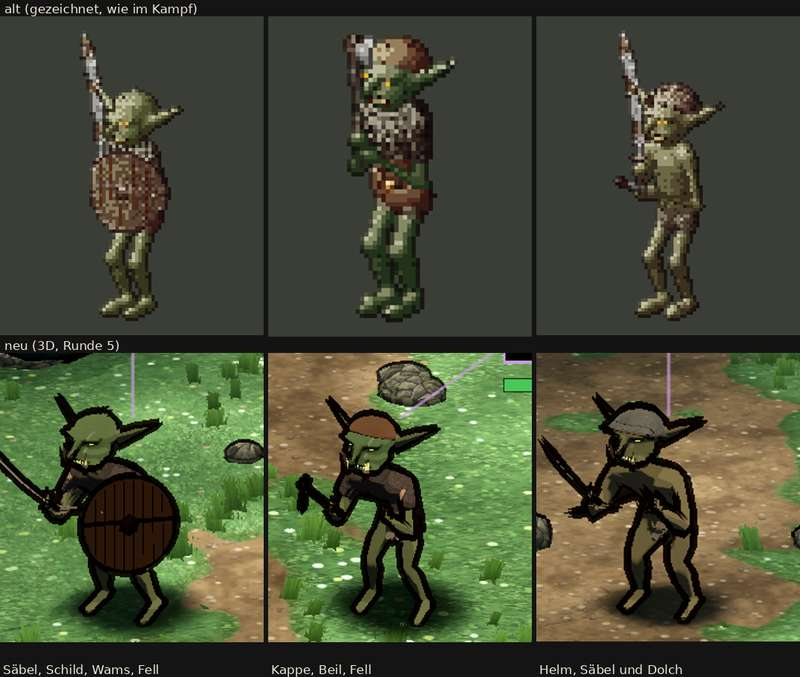

# 348.7 · Goblin Runde 5 · Jerry · 26.10., 00:16

**Entschieden (Sokrates statt Chef, 362; 26.10., 00:5x): „Runde 6“** wie Jerrys Vorschlag unten, dazu Maul als Fratze, die in Spielgröße liest. Grund: dein Maß „düster und erwachsen“ ist nach beiden Prüfern noch nicht erreicht; die übrigen Punkte der Liste sind es. Nicht entschieden: dicke schwarze Umrisse (gelten für alle Modelle, deine Sache). Antwort „gebilligt“ oder „zurück“.

Oben alt (gezeichnet), unten neu. Dein Wort 23:33: auf Runde 4 aufbauen, kein Klon der Vorlage, düster und erwachsen; Maß ist die Abnahmeliste. Großbild und ganzes Kampfbild in Telegram unter 348.7.

**Gemacht:** Schädel flacher und nach vorn geschoben (beim ersten Goblin bleibt der Hinterkopf leicht gewölbt); Brauenwulst, Augen im Schatten; Unterkiefer vor dem Oberkiefer, zwei große Hauer davor; Nase mit Knick nach unten; Ohren breiter und flacher. Haut dunkler; Körper schlank, mittel, kräftig. Helm tiefer und dicker als die Kappe.

**Urteil des Prüfers** (fremder Helfer, drei Bildrunden und das Blatt): besser als Runde 4, nicht mehr „wie Dobby“, aber noch nicht düster. Dagegen sprechen die dicken schwarzen Umrisse, die Ohren, der saubere Rundschild und das Maul ohne Fratze.
- Erfüllt: Kopf groß auf drahtigem Körper, zwei Hauer, Zahnreihe, Brauenwulst, gelbe Schlitzaugen, Narbe, drei Ausrüstungen verschieden, geduckte Haltung bei zwei von drei; Größe etwa bis zur Brust des Helden (wegen der Perspektive nur ungefähr).
- Nicht erfüllt: Säbel mit der Umrisslinie ganz schwarz (ohne Linie als Metall lesbar, Rost kaum); Beilkopf dunkel, Dolch mit der Hand ein schwarzer Klumpen; das ferne Ohr steht steil, beide wirken im ganzen Bild wie Fühler; Nasenhaken und gefletschtes Maul in Spielgröße nicht lesbar; Hände und Füße nicht groß; der Schild-Goblin steht aufrecht; Schild glatt rund statt roher Bretter; Helm mittelgrau wie eine Mütze, Rand wie eine Naht statt Rost; der zweite Goblin grünlicher als die beiden anderen; hautfarbene Flecken am Fell.
- Blatt: lila Zeigerlinien der Angriffsansage über den Köpfen, in der Mitte eine Ecke eines Schilds und ein Lebensbalken, Klinge links angeschnitten.

**Diogenes (00:17):** Leitbild eingehalten, die Figur ist nicht heller oder bunter als alt (Haut im Licht neu Helligkeit 101, alt 94–120); das Blatt unten wirkt nur heller, weil neu auf grünem Gras steht, alt auf grauem Grund. Liste: Größe, Farbe, Haltung erfüllt; der Helm-Goblin knapp zu groß (110–115 % statt höchstens 109 %); Narbe nicht zu erkennen, Fell bei den ersten beiden nicht zu sehen (mein Prüfer sah beides), Dolch unsichtbar, Klingen schwarz ohne Rost.

**Sag:** „steht“ (Rest in den Feinschliff) oder „Runde 6: …“ mit dem, was zuerst muss. Vorschlag Runde 6: Klingen heller und mit dünnerer Linie (ganz ohne hoben sie sich vom Gras nicht ab), Beil und Dolch größer und heller, Helm dunkler mit Glanz und Rost, fernes Ohr flach, Hände und Füße größer, Schild-Goblin vorgebeugt, Schild aus rohen Brettern.
