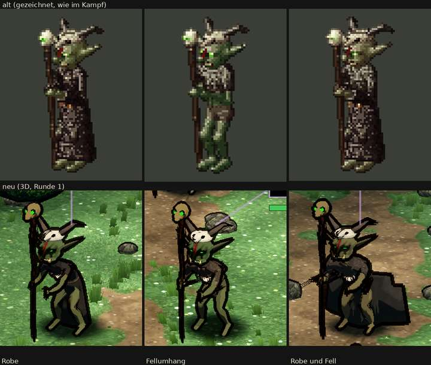

# 348.7 · Goblin-Schamane Runde 1 · Jerry · 26.10., 01:14

**Entschieden (Sokrates statt Chef, 362; 26.10., 01:2x): „Runde 2 wie Vorschlag“** (unten), nach Goblin r6 und Späher r2, weil Beine, Hände und Füße vom gemeinsamen Körper kommen. Grund: Merkmal (Totenschädel-Gesicht) und Haltung (aufrecht, Hand vorgestreckt) der Liste fehlen, die Figur wirkt niedlich statt unheimlich. Antwort „gebilligt“ oder „zurück“.

Oben alt (gezeichnet), unten neu. Die dünnen hellen Linien über den Köpfen und der grüne Balken gehören zur Kampfanzeige, nicht zur Figur. Maß ist die Abnahmeliste „Goblin-Schamane“ (`LISTE-FIGUREN.md`). Körper und Kopf wie Goblin Runde 5. MARS kennt den Schamanen noch nicht: im Probekampf heißen sie schon „Goblin-Schamane 1–3“, kämpfen aber wie Goblins. Ganzes Kampfbild in Telegram unter 348.7.

**Gemacht:** drei Ausrüstungen wie im alten Spiel: rußschwarze Robe; Fellumhang mit nacktem Oberkörper; beides. Auf dem Kopf der Schädel eines gehörnten Tiers mit Schnauze und Zähnen. Gesicht: Augenhöhlen rußschwarz, Blutstreifen von der Stirn über den Nasenrücken, Augen glühen grün. Kette aus Knochen und Zähnen mit einem kleinen Schädel vorn. In der rechten Hand (im Bild links) ein knorriger Stab, der am Boden steht, oben ein Tierschädel mit grün glimmenden Augenhöhlen. Die linke Hand sollte zum Gegner vorgestreckt sein (siehe Prüfer).

**Urteil des Prüfers** (fremder Helfer, drei Bildrunden):
- Erfüllt: Merkmale (gehörnter Schädel als Kappe, schwarze Augenhöhlen, Blutstreifen, grüne Augen, Kette, glimmender Stabschädel), Haut, drei Ausrüstungen am Umriss verschieden, Stab steht am Boden. Größe wegen der Perspektive nur ungefähr prüfbar.
- Nicht erfüllt: Die freie Hand sitzt auf Bauchhöhe statt erhoben; gekrümmte Finger sieht man nicht, die Hände sind klein. Eine Faust um den Stab ist nicht zu lesen. Der Tierschädel auf dem Kopf ist zu weiß und wirkt mit den runden Augenlöchern „wie eine Halloween-Kuhmaske“ (eine Runde vorher war er grau, las sich aber als Klumpen). Bei „Robe und Fell“ steht der untere Teil der Robe als eckige Platte ab, und ein Strich ragt eine Unterarmlänge über den Stab hinaus (vermutlich greift die Hand durch den Stab). Der Stabschädel ist braun statt knochenfarben, ohne Hörner und wirkt rund „wie ein Ball“. Die Kette ist nur ein heller Fleck unter dem Kinn.
- Im ganzen Bild: die Wiese ist bunter als alt (betrifft den Kampfort, nicht den Schamanen).

**Diogenes** (26.10., 01:14): frei, die Figur ist nicht heller oder bunter als alt (Mittel alt 57/68/59, neu 33/52/62), das grüne Glühen ist klein. Gegen die Abnahmeliste aber strenger als der Prüfer:
- Merkmal nicht erfüllt: Gesicht grün, nicht als Totenschädel bemalt; Augenhöhlen nicht rußschwarz; Blutstreifen schräg über Stirn und Auge statt über die Nase; Kette nur ein weißer Klecks; Stabschädel ein ockerfarbener Klumpen „wie Maske oder Kürbis“, er glimmt nicht. Erfüllt nur die grünen Augen.
- Haltung nicht erfüllt: freie Hand am Körper, Figur stark gebückt (alt aufrecht).
- „Robe“ ist ein vorn offener grauer Umhang, Beine und Bauch nackt; alt reicht die Robe bis zu den Füßen, mit Gürtel und Schnalle. Fell nur ein Schulterkragen.
- Tierschädel nur eine kleine Kappe, die Hörner lesen sich als zweites Paar Ohren (alt geweihartig über den ganzen Oberkopf).
- Beine lang und x-beinig statt kurz; Hände und Füße nicht groß. Größe etwa 105–120 cm, oberer Rand.
- Umrisslinien dick und treppig (Stab, Hörner); Umhang bei „Robe und Fell“ mit eckiger Stufe rechts; Haut und Umhang flach, ohne Stofftextur; die rundliche Form wirkt eher niedlich als alt.
- Unklar: aus der Stabhand ragt bei „Robe und Fell“ ein graues Teil nach links (wohl die Hand durch den Stab, siehe Prüfer).

**Sag:** „Runde 2 wie Vorschlag“, „Runde 2: …“ mit dem, was zuerst geändert werden muss, oder „steht“ (Rest in den Feinschliff). Vorschlag Runde 2: aufrecht statt gebückt; Arm mit der freien Hand in Kopfhöhe, Finger gekrümmt; Faust um den Stab; Robe geschlossen bis zu den Füßen, mit Gürtel und Schnalle, unten weich hängend; Gesicht als Totenschädel bemalt, Augenhöhlen deutlich schwarz, Blutstreifen über die Nase; Tierschädel grau, größer und länglicher über den ganzen Oberkopf, kleinere Augenhöhlen; Stabschädel knochenfarben und glimmend, mit kurzen Hörnern nach hinten; Kette größer, Knochen einzeln erkennbar.
