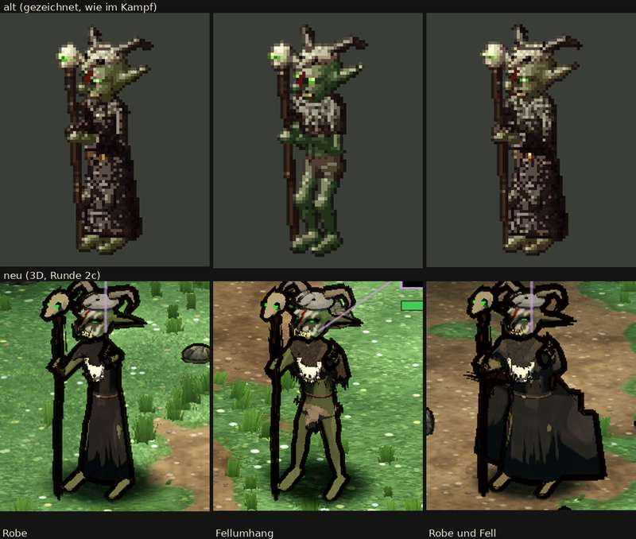

# 348.7 · Goblin-Schamane Runde 2 · Jerry · 26.10., 03:26

**Entschieden (Sokrates statt Chef, 362; 26.10., 04:0x): „Runde 3“, eng:** nur (a) das Gesicht als Totenschädel (ganz hell, schwarze Augenhöhlen, grün glimmende Augen, Blutstreifen senkrecht über die Nase, Kinn ohne Gekritzel), Ursache vorher im Bild nachstellen; (b) die freie Hand vor dem Körper zum Gegner, mit gekrümmten Fingern; (c) Blatt ohne Kampfanzeige, mit Platz über den Hörnern. Bestätigen Prüfer und Diogenes (a) und (b) bei allen drei, steht der Schamane ohne neue Vorlage; Kette, Tierschädel, Robe, Fell, Stufe, Strichel, Umrisse in den Feinschliff. Grund: das Gesicht ist das Merkmal des Schamanen und zweimal misslungen; alles andere ist sauberer, aber nicht gegen das Leitbild. Antwort „gebilligt“ oder „zurück“.

Oben alt (gezeichnet), unten neu: links Robe, Mitte Fellumhang, rechts Robe und Fell. „2c“ im Bild heißt: dritter Anlauf innerhalb von Runde 2. Auftrag: Runde 2 nach meinem Vorschlag, von Sokrates an deiner Stelle entschieden ([3487-schamane-r1](../billigen/3487-schamane-r1.md)). Maß ist die Abnahmeliste der Figuren, Abschnitt „Goblin-Schamane“. Zur Kampfanzeige, nicht zum Modell, gehören: die lila Ziellinien, die in allen drei Gesichtern enden, der lila Rahmen und der grüne Balken oben rechts im mittleren Bild. Das Blatt schneidet oben die Hornbögen ab (Fehler des Blatts, nicht des Modells). Ganzes Kampfbild in Telegram unter 348.7.

**Gemacht:**
- Aufrecht statt gebückt.
- Größe 103–110 cm (Goblin 108 cm), am Modell gemessen; vorher mit den Hörnern bis 127 cm. Im Blatt nicht prüfbar: es bringt jede Figur auf gleiche Breite.
- Faust um den Stab.
- Robe bis zu den Knöcheln, mit Gürtel; die Schnalle ist im Bild nicht zu erkennen.
- Tierschädel mit gewundenen Hörnern wie beim Widder (vorher lasen sie sich als Esels- oder Hasenohren); im Bild hellgrau.
- Stabschädel länglich, knochenfarben, mit kurzen Hörnern nach hinten (im Bild kaum zu erkennen), die Augenhöhlen glimmen grün.
- Kette vergrößert; sie liest sich noch als heller Latz.
- Schwarze Striche an Hand und Hüfte verringert, nicht ganz weg (Rest siehe „Noch offen“). Ursache war: Lendentuch und Fell bewegten sich mit dem Arm mit.

**Urteil des Prüfers** (fremder Helfer, drei Bildrunden, dazu zwei Prüfungen dieser Vorlage):
- Besser als Runde 1: Hörner lesen sich als Hörner; Stabschädel glimmt; Faust am Stab; aufrecht. „Düsterer und glaubwürdiger, die Widderhörner nehmen die Komik heraus“, nicht bunt.
- Aus dem Auftrag für Runde 2 nicht gelungen:
  - Totenschädel-Gesicht: nur zur Hälfte hell bemalt (oben links weißgrau, sonst grün), Augenhöhlen nicht schwarz, im Kampfbild sieht man nur ein grünes Auge.
  - Blutstreifen schräg über Stirn und Wange statt über die Nase.
  - Tierschädel flach wie eine Mütze statt länglich über den Oberkopf.
  - Kette ohne einzelne Knochen.
  - Freie Hand: sollte vorgestreckt sein, ist ein dunkler Klumpen auf Schulterhöhe am Körper, ohne Finger.
- Noch offen:
  - Am Kinn wirken gelbe Hauer und Zähne des Goblin-Kopfs zusammen mit den gemalten Zahnstrichen wie Gekritzel.
  - Fellumhang: die Figur wirkt fast nackt (Lendentuch, lange dünne grüne Beine); von vorn ist das Fell eher eine braune Weste mit Fransen, Fransen hängen vom Arm, ein kleiner Stachel an der Hüfte.
  - In allen drei Bildern stößt das Horn auf der Stabseite an den Stabschädel.
  - Robe und Fell: eckige Stufe rechts am Umhang (schon in Runde 1); schwarze Strichel links am Stab (Rest der Striche an Hand und Hüfte).
  - Robe sowie Robe und Fell: ein grüner Fleck auf Kniehöhe, wo das Bein durch die Robe kommt.
  - Robe sowie Robe und Fell am Umriss kaum zu unterscheiden; das Fell verschwindet auf der dunklen Robe.
  - Robe braunschwarz statt rußschwarz.
  - Umrisslinien dick und treppig, vor allem an Stab und Hörnern (schon in Runde 1).
  - Augen brennen nicht.

**Diogenes** (Stand 2c, 03:19): frei, mit Befunden: Gesicht heller als alt (+4 bis +11 %); Augenhöhlen fehlen; Hand nicht vorgestreckt; Beine kommen durch die Robe; Hörner am Blattrand abgeschnitten, Ziellinien im Blatt. Am ersten Stand von Runde 2 (02:53): Figur dunkler als alt, nicht bunter; Kopf wirkt klein, Beine lang.

**Sag:** „steht“ (Rest in den Feinschliff) oder „Runde 3: …“ mit dem, was zuerst muss. Vorschlag Runde 3:
- Gesicht als Totenschädel: ganz hell bemalt, schwarze Augenhöhlen, darin brennen die Augen grün; Blutstreifen senkrecht über die Nase; Hauer und Zahnreihe so, dass das Kinn nicht kritzelt. Zweimal misslungen; die Ursache wird vor dem Bau im Bild nachgestellt, nicht geraten.
- Freie Hand vor dem Körper zum Gegner, größer und heller, mit gekrümmten Fingern.
- Kette mit einzelnen Knochen.
- Eckige Stufe und Strichel bei „Robe und Fell“ beseitigen.
- Blatt ohne Kampfanzeige und mit Platz über den Hörnern.
- Feinschliff: länglicher Tierschädel, rußschwarze Robe, Fellumhang mit mehr Deckung, Umrisslinien.
