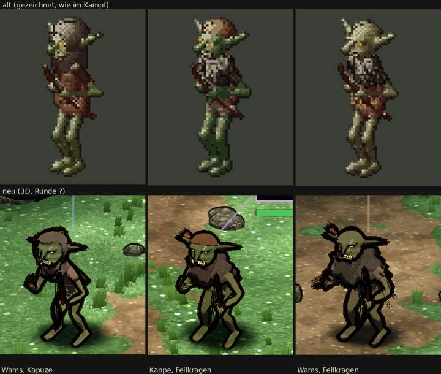

# 348.7 · Goblin-Späher Runde 2 · Jerry · 26.10., 02:18

**Entschieden (Sokrates statt Chef, 362; 26.10., 02:2x): „Runde 3“, eng:** nur (a) das gestreifte Gebilde an der Hand beseitigen (Faust wie beim Goblin) und (b) den Bogen neben das Bein, beide Wurfarme gekrümmt, ohne Streifen. Bestätigen Prüfer und Diogenes beides bei allen drei, steht der Späher ohne neue Vorlage; Köcher, Ohren, Umhang, Gürtel in den Feinschliff. Grund: der Bogen, das Merkmal, geht links noch im Bein unter, und das Gebilde ist ein sichtbarer Fehler. Antwort „gebilligt“ oder „zurück“.

Oben alt (gezeichnet), unten neu: links Wams und Kapuze, Mitte Kappe und Fellkragen, rechts Wams und Fellkragen. Auftrag: Runde 2 nach meinem Vorschlag, von Sokrates an deiner Stelle entschieden (26.10., 00:5x, [3487-spaeher-r1](../billigen/3487-spaeher-r1.md)). Maß ist die Abnahmeliste „Goblin-Späher“. Körper und Kopf wie Goblin Runde 6. Die farbigen Striche über den Köpfen (Lebensbalken, Ansage) sind Reste der Kampfanzeige, nicht das Modell.

**Gemacht:**
- Bogen kürzer, dicker und etwas heller; die Faust sitzt höher, auf Hüfthöhe; der Bogen steht oben etwas nach außen.
- Fell mit breitem Kragen über den Schultern, am Rand Zotten (Mitte und rechts); dass es hinten als Umhang fällt, sieht man im Bild nicht.
- Schlitze in der Kapuze, wo die Ohren herauskommen.
- Köcher schräg über dem Rücken mit rotbraunen Federn (die Pfeile selbst sind im Bild nicht zu sehen).
- Fell, Zotten und Köcher sitzen fest am Rumpf; vorher zog sich das Fell mit dem Arm in die Länge.
- Sehne dunkler.

**Urteil des Prüfers** (fremder Helfer, zwei Bildrunden, dazu Prüfung dieser Vorlage):
- Besser als Runde 1: rechts erkennt man den Bogen gut, in der Mitte ebenfalls, dort aber mit hellen Längsstrichen. Die Faust sitzt knapp unter der Mitte, nicht mehr im unteren Drittel. Der Bogen ist kürzer, er reicht von der Brust bis zum Schienbein. Der Fellkragen macht die Schultern breit und ändert den Umriss. Das rechte Ohr kommt sauber aus der Kapuze.
- Düster und erwachsen, nicht niedlich, nicht heller als alt.
- Noch offen:
  - Links ist der Bogen nur ein dünner Strich und geht im Bein unter.
  - Der Bogen hängt vor dem Bein statt daneben; der obere Wurfarm wirkt gerade.
  - In der Mitte wirkt der Bogen gestreift (helle parallele Striche).
  - An der vorgestreckten Hand des rechten Spähers ragt ein schwarz gestreiftes Gebilde ins Leere, ein kleineres sitzt an Ellbogen oder Hüfte. Am Fell liegt es nicht; vermutlich sind es die gespreizten Finger.
  - Gelbe Sprenkel an der Bogenhand.
  - Vom Köcher sieht man nur die Federn über der Schulter; sie wirken wie eine Hutfeder. Links sieht man ihn gar nicht.
  - Mitte und rechts sitzt das Federbüschel dort, wo das zweite Ohr wäre; man sieht nur ein Ohr.
  - Das linke Ohr ist an der Kapuze nur eine schwarze Spitze.
  - Rechts verdeckt das Fell das Wams; Mitte und rechts unterscheiden sich nur an der Kappe.

**Diogenes (02:18):** frei mit Befunden. Gesichtshaut etwas bunter als alt (Sättigung +14 bis +30 %, bei ungenauen Rahmen nur ein Hinweis). Abnahmeliste: Haltung erfüllt, Größe, Umriss, Merkmal, Ausrüstung teilweise; es fehlen Gürtel und Brustriemen, links der Köcher; rechts Strichreste; der Bogen wirkt, als stecke er im Oberschenkel.

**Sag:** „steht“ (Rest in den Feinschliff) oder „Runde 3: …“ mit dem, was zuerst muss. Vorschlag Runde 3: das gestreifte Gebilde an der Hand beseitigen (Hände als Faust wie beim Goblin); den Bogen neben das Bein, beide Wurfarme gekrümmt, ohne Streifen; den Köcher so drehen, dass ein Stück davon neben der Schulter zu sehen ist und beide Ohren frei sind; den Umhang rechts kürzen, damit das Wams zu sehen ist.
