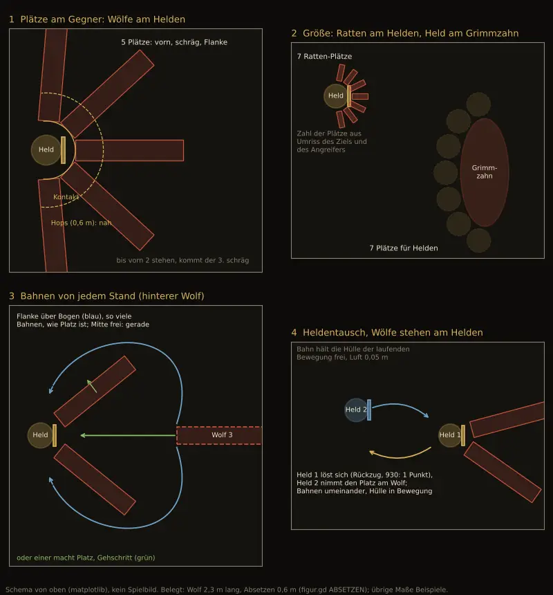

# 1072 · Welchen Weg gehen wir bei Plätzen, Laufwegen und Bissen im Kampf, bevor Jerry wieder baut?
Sokrates · 13.11., 23:39 · E Kampf · aus deinem Wort 23:35 („erstmal unsere Hausaufgaben … was wollen wir zusammenbringen? Was kostet was? Wie kann es laufen?“)
Kurz: Fünf Baustellen hängen zusammen; vorgeschlagen ist, nur die Bewegungsfragen aus 930 jetzt zu entscheiden und 709, 709.1 in 1072 aufgehen zu lassen.
Beim Chef, weil: neue Richtung im Spielgefühl (Laufwege und Aufstellung aller Kämpfe) und Geld (über 10 $)

Geprüft an: https://github.com/tramour-cmyk/androidapp_rpg_bornim/commit/37f4da501 (Vorgangsliste und Archiv); Jerrys Vorlage von 23:32 (`git show dc00f3dcc:docs/chefsache/entscheiden/1072-plaetze-am-gegner.md`, Bild unten); Regelseite 930 in `DESIGN-KAMPF.md`; Bericht Jerry 23:37 (Zweige, Kosten)

**Frage:** Jerry hat seit dem 08.11. an drei Stellen einzeln gebaut, die im Kampf dasselbe sind: wo eine Figur steht, wie sie dorthin kommt und ob ihr Biss oder Schlag dort das Ziel erreicht. Dazu liegt meine Regelseite zum Handgemenge (930) unentschieden daneben. Bisher sind dafür rund 260 $ ausgegeben, und der Fehler, den du siehst (hinterer Wolf läuft außen herum, Bisse zu kurz), ist noch da. Sollen wir zuerst nur die drei Bewegungsfragen entscheiden, dann alles in einem Vorhaben (1072) in drei Schritten bauen, und 709, 709.1 darin aufgehen lassen?

**Votum:** „1072 Weg 3“, mit deiner Antwort auf die drei Bewegungsfragen unten (mein Vorschlag jeweils „ja“).

**Berührt:** 709, 709.1 (gehen in 1072 auf), 930 (nur Regeln 1 und „Tippen“ als Bild vorgezogen, der Rest bleibt offen), 760, 1068, 1043, 1032, 931, 1224 (warten auf 1072), F5, F7, F9 in `DESIGN-KAMPF.md`; Team Tom nur, wo Leute kämpfen.

**Begründung:** Dein Wort 23:35: „bevor Jerry jetzt wieder irgendwas einfach so entwickelt und viel Zeit verplempert …“. Die Zahlen geben dir recht: 709.1 allein hat 74,79 $ gekostet, mit drei Messläufen und ohne Ursache; der Bissplatz, an dem er misst, wird in 1072 ohnehin neu gerechnet.

**Sachverhalt — was zusammengehört:**
- **1072 Plätze und Bahnen** (29,94 $): Startplätze aus dem Umriss, Plätze am Gegner, Bahnen von jedem Stand, Platzmachen. Ursache des Umwegs belegt (Lauf 462: 0,3 m Luftzuschlag, frei wären 0,18–0,26 m). Runde heute 30,8 s statt 14,6 s (F9).
- **709 und 709.1 Bisse zu kurz** (62,14 $ und 74,79 $): Wolf trifft, Grimmzahn bleibt 0,52 m vor dem Schild, Ratte 0,135 m vor Kleriker und Zauberer. Ursache nur vermutet, im Bissplan (`_bite_plan`), der den Platz am Ziel nachträglich sucht. Genau das ersetzt 1072 Schritt 2.
- **930 Handgemenge** (19,74 $, Rechnung 930.3 8,58 $): Regeln kennen heute keinen Abstand; Stehen und Laufen gibt es nur im Bild. Die Regelseite bringt nah, fern, weit, zwei Punkte, Ausdauer, Rückzug, Zurückdrängen. Groß, unentschieden, Film wartet auf 931.
- **Deine Entscheide dazu:** Gegner bleibt nach Ausweichen stehen (703 A), setzt nach dem Angriff ab und bleibt (717 C), Held „geht zügig rückwärts heim“ (784 A, F9). Deine Begründung 23:24 („es wird ja die Angriffsposition eingehalten … wenn die Monster oder die Helden am Gegner dran stehen“) setzt voraus, dass auch der Held stehen bleibt. Das widerspricht 784 A.
- **Wartet auf 1072:** 760 (Wolf springt nicht), 1068 (Ring bei großen Schlägen), 1043 (29,65 $, Ausweichen), 1032 (Taumeln ohne Angriff), 931 (Takt Wolf), 1224 (Berührung beim Tausch sperrend).
- **Bisher zusammen:** rund 260 $ (709, 709.1, 1072, 1043, 930, 930.3, dazu 784 26,72 $ und 1041 7,55 $).
- **Offen auf Zweigen, nicht auf `main`:** `claude/jerry-709-1-film`, `claude/jerry-709-1-wolfsbiss-c`, `claude/jerry-1043-sprung`, `claude/jerry-1032-treffer`, `claude/jerry-709a-tiefbiss`.

**Die drei Bewegungsfragen** (nur Bild und Stellung, keine Regelzahlen; sie hängen nicht am Rest von 930):
1. **Held bleibt nach dem Schlag am Gegner,** höchstens ein Hops zurück (ersetzt in F9 „geht zügig rückwärts heim“). Vorschlag ja: spart das Hin und Her, das heute die meiste Zeit der Runde kostet.
2. **Zwei Abstände im Bild:** am Gegner (nah) und in der eigenen Reihe (fern). „Weit“ und die Punkte bleiben bei 930. Vorschlag ja.
3. **Zweierstellung** (dein Wort 23:28): hinterer Fernkämpfer tritt zur Seite, bis die Linie frei ist, schießt, geht zurück; hinterer Nahkämpfer geht am Vorderen vorbei auf einen Platz am Gegner. Vorschlag ja.

**Auswertung — wie es laufen kann:**
- **Weg 3 (Empfehlung): Bewegungsfragen jetzt, dann 1072 in drei Schritten.** (1) Umrisse, Startplätze, Gassen, Luft 0,05 m; Messung Sollbild 784. (2) Plätze am Gegner mit Hops, Bisse und Schläge erreichen das Ziel (709, 709.1 darin); Messung Wolf, Grimmzahn, Ratte. (3) Bahnen von jedem Stand, Tausch, Platzmachen, Zweierstellung; Messung Tausch. Je Schritt ein Lauf, kein Film dazwischen, Halt und Meldung, wenn ein Schritt über 30 $ geht. Am Ende ein Film von oben und von der Seite, auch in der Höhle (Krogg). Danach 760, 931, 1068. **Kosten:** Jerry schätzt 3 Arbeitstage; grob 200–250 $ (gerechnet aus Jerrys letzter Sitzung, 7,63 $ in 52 Minuten, bei etwa 9 Stunden am Tag; Schätzung, nicht gemessen). **Du siehst:** einen Film nach Schritt 3.
- **Weg 2: nur das Kleinste.** Nur Schritt 1 (hinterer Wolf läuft durch die Mitte). Etwa ein Tag, grob 70–80 $. Bisse und Gedränge am Ziel bleiben; 709, 709.1 ruhen weiter, sonst geht das Messen am alten Bissplan weiter. **Du siehst:** bald den Wolf auf dem kurzen Weg, sonst nichts Neues.
- **Weg 1: erst 930 ganz.** 930 vollständig entscheiden (Rechnung, Film, Gegenlesen fehlen noch), dann 1072 mit allen Abständen und Punkten. Kein doppelter Bau, aber Tage ohne Bau am Kampf; die Fehler bleiben so lange sichtbar.
- **Stärkstes Gegenargument gegen Weg 3:** Wer die Bewegungsfragen vor 930 entscheidet, legt sich auf ein Bild fest, bevor die Regeln stehen; kippt 930 später (etwa Rückfall auf „nur nah und fern“), muss nachgebaut werden. Dagegen: Die drei Fragen betreffen nur, wo Figuren stehen; die Regelseite selbst sagt, dass die Regeln heute keinen Abstand kennen. Nah und fern gibt es in beiden Fassungen von 930.
- **Was ich nicht weiß:** ob drei Arbeitstage halten; 709.1 war auch kleiner geschätzt. Darum der Halt bei 30 $ je Schritt.

**Folgerungen:** Bei Weg 3 trage ich deine drei Antworten ins Archiv und F9 nach; Jerry legt 709, 709.1 in 1072 zusammen und baut Schritt 1 auf einem Zweig von `main`, meldet nach jedem Schritt Kosten und Messung an mich. Bei Weg 2 nur Schritt 1, 709, 709.1 ruhen. Bei Weg 1 ziehe ich 930 vor (Gegenlesen, Rechnung, Film), Jerry ruht am Kampf. Jerrys Vorlage von 23:32 ist hierin aufgegangen (in Git).

Antwort: …
