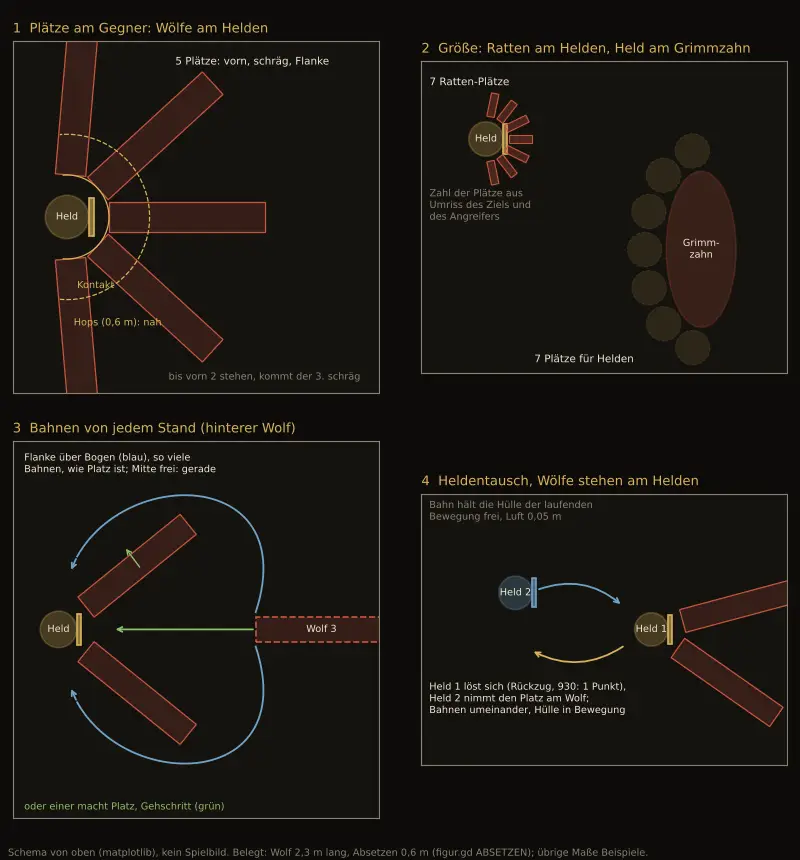

# 1072 · Sollen Plätze und Laufwege im Kampf aus dem Umriss von oben berechnet werden, mit Plätzen am Gegner und Bahnen von jedem Stand?

[Bild von 13.11., 23:33](https://github.com/tramour-cmyk/androidapp_rpg_bornim/blob/bilder/2026-11/13-2333-1072-Jerry.png) (eingetragen von meldung.sh, Jerry)

Jerry · 13.11., 23:32 · E Kampf · aus deinem Wort 12.11., 20:09–20:43, 13.11., 21:39–21:51 und 23:20–23:24
Kurz: Startplätze, dazu Plätze am Gegner (Kontakt und ein Hops dahinter) aus beiden Umrissen; Bahnen von jedem Stand, Platzmachen als Gehschritt; in drei Schritten mit Messung.
Beim Chef, weil: neue Richtung im Spielgefühl (Laufwege und Aufstellung aller Kämpfe)

Geprüft an: https://github.com/tramour-cmyk/androidapp_rpg_bornim/commit/28d978c49 (Code: `godot/kampf/figur.gd` `_detour` mit `AIR` 0,3, `_tier_heim` mit `ABSETZEN` 0,6, `footprint()`, `_tausch_bogen`; `godot/kampf/kampfort.gd` `_stand`, `_spot_ab`, `FRONT_M` 1,4, `BACK_M` 2,9; Messlauf 462 `kampf=1072m`)
Bestand geprüft: Schema mit eigenem Werkzeug (matplotlib), kein Spielbild; Plätze am Gegner und Bahnen fehlen im Bestand.

**Frage:** Heute hat jede Figur einen festen Platz in ihrer Reihe (sechs je Seite). Nach dem Angriff setzt ein Gegner 0,6 m zurück und bleibt dort, ein Held geht heim. Wo genau einer am Gegner steht und wie der nächste an ihm vorbeikommt, rechnet heute niemand vorher; wer nicht durchpasst, sucht sich nachträglich einen Umweg. Soll stattdessen eine Routine für alle Figuren gelten, die drei Sorten Plätze kennt: (1) **Startplätze** je Seite, (2) **Plätze am Gegner**: um jedes Ziel Kontaktplätze (vorn, schräg, Flanke), so viele, wie nach den Umrissen von Ziel und Angreifer nebeneinander passen, und je einer einen Hops (0,6 m) dahinter, (3) **Bahnen von jedem Stand** zu jedem dieser Plätze, mit mehreren Bögen und, wenn nötig, einem kurzen Gehschritt eines Vorderen, der Platz macht?

**Votum:** „1072 A“: Plätze und Bahnen wie im Bild, in drei Schritten mit je einem Messlauf; danach Film von oben und von der Seite an dich, auch am engsten Kampfort.

**Berührt:** 760, 1068, 1043, 1032, 931, 1224 (warten auf 1072); 930 Handgemenge und Abstand (Regelseite Sokrates, noch nicht entschieden); 703 A und F5, F7 (Absetzen, Stehenbleiben); F9 und Sollbild 784 (Rundenzeit); Tausch aus 1041 (`tausch_1041`); Team Tom nur, wo Leute kämpfen (gleiche Routine).

**Begründung:** Chef 13.11., 23:24: „lösen sich die Position[en] auf von den 6, weil ja nicht nach jedem Angriff zurückgelaufen wird auf die Position, sondern es wird ja die Angriffsposition eingehalten und vielleicht nur ein Hops zurückgemacht. Also braucht man noch mehr Positionen … wenn die Monster oder die Helden am Gegner dran stehen.“ 21:47: „ein kleines Kaninchen ist was anderes als ein Elefant“. 21:51: „eine Projektion von oben gesehen nach unten … auch in Bewegung“. 23:23: „wenn einer mal, einmal der linke, einmal der rechte, ein Stück rutscht, damit der einfach cool durch kann“.

**Sachverhalt:**
- Gegner nach dem Angriff (717 C, `_tier_heim`): Absetzen um `ABSETZEN` 0,6 m mal Größe, dann stehen; zurück in die Reihe erst mit dem eigenen Zug. Ausweichen (703 A, F5): bleibt am Ausweichplatz. Der Stand nach dem Angriff ist also schon heute ein eigener Platz, nur wird er nicht geplant, sondern ergibt sich.
- Held nach dem Angriff: geht zügig rückwärts heim (F9). Der Entwurf 930 (Regel 2, „Tippen“) sieht vor, dass er nach Heranrücken und Schlag stehen bleibt; entschieden ist das nicht.
- Wo der Angreifer am Ziel steht, sucht heute der Biss- oder Hiebplan für sich allein (bis 60° um das Ziel gedreht, `_bite_plan`); ob dort schon einer steht oder gleich hinläuft, prüft er erst danach (`_platz_luft`, `_weg_luft`).
- Umweg (Lauf 462): `_detour` verlangt 0,3 m Luft; der hintere Wolf hätte durch die Mitte 0,18–0,26 m frei und läuft außen herum. Runde 30,8 s statt 14,6 s im Sollbild 784.
- Umriss heute (`_footprint`): Rechteck aus der Ruhehaltung, einmal gemessen, dazu der Schild; Waffe und Bewegung fehlen.
- 930 (Entwurf): Abstand nah (im Handgemenge), fern (ein Feld), weit (zwei Felder); ein Kampf beginnt fern.

**Auswertung:**
- **A (Empfehlung):**
  - **Umrisse:** je Figur zwei Projektionen von oben, Ruhe-Umriss und Bewegungshülle je Bewegung (Laufen, Tausch, Angriff, Absetzen), einmal beim Laden aus Kapseln, Waffe und Schild gerechnet. Luft zwischen Hüllen 0,05 m statt 0,3 m (Bedingung 4 Sokrates).
  - **Startplätze:** sechs je Seite, Abstände aus den Hüllen, mit Gassen so breit wie die Hülle des Breitesten, der durch muss; Varianz nur, so weit die Gasse hält. Das ist der Abstand **fern** aus 930.
  - **Plätze am Gegner:** um jedes Ziel ein Kontaktring (Zähne oder Klinge am Ziel, wie der Biss- und Hiebplan heute rechnet) mit Plätzen von vorn über schräg bis zur Flanke; ihre Zahl ergibt sich aus der Breite des Angreifers am Ring und dem Umfang des Ziels: am Helden etwa 5 Wölfe oder 7 Ratten, um Grimmzahn etwa 7 Helden (Bild, Felder 1 und 2; Maße Beispiele). Je Kontaktplatz ein Hopsplatz 0,6 m dahinter. Beide zählen als **nah** (Handgemenge, 930). Wer angegriffen hat, bleibt am Kontaktplatz oder hopst zurück und bleibt dort, bis sein eigener Zug etwas anderes will (703 A, F7). Belegte Plätze sind belegt; der Nächste nimmt den nächsten freien, vorn zuerst.
  - **Bahnen von jedem Stand:** gerade, wo frei; sonst mehrere Bögen links und rechts, so viele, wie Platz ist (Bedingung 3); die Bahn hält die Hülle der laufenden Bewegung frei (Feld 3). Reicht keine, macht ein Vorderer Platz: ruhiger Gehschritt von höchstens einer halben Körperbreite, abwechselnd links und rechts, gleichzeitig mit dem Anlauf, danach zurück; kein Satz, keine Zeile (Bedingung 5). Heldentausch, während Wölfe am Helden stehen: der vordere löst sich, der andere nimmt den Kontaktplatz, Bahnen umeinander (Feld 4).
  - **Schritte (Bedingung 1):** (1) Umrisse und Startplätze, Messung `sollbild_784`; (2) Plätze am Gegner und Hops, Messung `wolf_mess_438` und der Biss-Film aus 709; (3) Bahnen von jedem Stand, Tausch, Platzmachen, Messung `tausch_1041`. Nach jedem Schritt ein Lauf, kein Film dazwischen; läuft ein Schritt über 30 $, melde ich das vor dem nächsten. Aufwand geschätzt 3 Arbeitstage (bisher 2; Schritt 2 ist neu). Film am Ende auch in der Höhle (Krogg), dem engsten Ort (Bedingung 2).
  - Ersetzt `_detour` in der Aufstellung, `_tausch_bogen`, die acht Sonderfälle in `_spot_ab` und das nachträgliche Suchen des Bissplatzes.
- **B:** Nur Schritt 1 (Startplätze mit Gassen aus den Hüllen), Plätze am Gegner bleiben wie heute ungeplant. Etwa ein Tag; behebt den Umweg des hinteren Wolfs, nicht das Gedränge am Ziel und nicht den Tausch.
- **Stärkstes Gegenargument gegen A:** Feste Kontaktplätze können starr wirken: drei Wölfe, die immer bei 0°, +39° und −39° stehen, sehen nach Raster aus. Dagegen: Reihenfolge der Plätze nach Herkunft (wer von links kommt, nimmt den linken), kleine Varianz im Winkel, solange die Hüllen frei bleiben; ob das reicht, zeigt der Film vor dem Build.
- **Nicht entschieden, aber berührt:** ob der Held nach dem Schlag stehen bleibt, regelt 930. Bei A bekommt er dieselben Kontaktplätze wie die Gegner; solange 930 offen ist, geht er wie heute heim.

**Folgerungen:** Bei A baut Jerry auf einem Zweig von `main` in drei Schritten mit je einem Messlauf, dann Film an dich; danach 760 und 1068. Bei B nur Schritt 1, der Rest bleibt in 1072 offen. Das Bild ist ein Schema: belegt sind Wolfslänge 2,3 m und Absetzen 0,6 m, die übrigen Maße sind Beispiele.

Antwort: …
