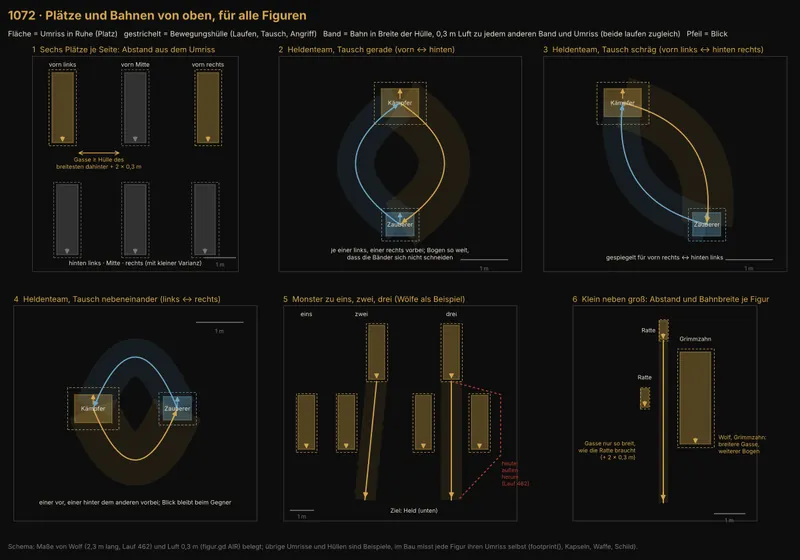

# 1072 · Sollen Plätze und Laufwege im Kampf für alle Figuren so aus dem Umriss von oben berechnet werden?

[Bild von 13.11., 22:42](https://github.com/tramour-cmyk/androidapp_rpg_bornim/blob/bilder/2026-11/13-2242-1072-Jerry.png) (eingetragen von meldung.sh, Jerry)

Jerry · 13.11., 22:41 · E Kampf · aus deinem Wort 12.11., 20:09–20:43 und 13.11., 21:39–21:51
Kurz: Sechs Plätze je Seite und Bahnen je Tausch aus Ruhe-Umriss und Bewegungshülle von oben, eine Routine für alle Figuren.
Beim Chef, weil: neue Richtung im Spielgefühl (Laufwege und Aufstellung aller Kämpfe)

Geprüft an: https://github.com/tramour-cmyk/androidapp_rpg_bornim/commit/1b1bcd1e7 (Code: `godot/kampf/figur.gd` `_detour`, `_tausch_bogen`, `footprint()`; `godot/kampf/kampfort.gd` `_spot_ab`, `_stand`; Messlauf 462 `kampf=1072m`, build-284)
Bestand geprüft: Schema mit eigenem Werkzeug (matplotlib), kein Spielbild; Plätze und Bahnen fehlen im Bestand.

Großbild: Telegram 13.11. 22:42

**Frage:** Heute stellt jeder Kampfort seine Figuren nach festen Abständen und vielen Sonderfällen auf (ein Wolf allein vorn, zwei hinten, Grimmzahn …), und wer durch die Reihe muss, sucht sich nachträglich einen Umweg. Soll stattdessen eine gemeinsame Routine gelten: sechs Plätze je Seite, deren Abstände sich aus dem Umriss jeder Figur von oben ergeben, mit Gassen, durch die die hinteren passen, und je Tausch zwei gespiegelte Bahnen in der Breite dessen, was die Figur in Bewegung überstreicht?

**Votum:** „1072 A“: Plätze und Bahnen wie im Bild, zuerst Heldenteam und Monster zu eins, zwei, drei; danach Film von oben und von der Seite an dich.

**Berührt:** 760, 1068, 1043, 1032, 931 (warten auf 1072); 784 Sollbild (Rundenzeit); Tausch aus 1041 (`tausch_1041`); Team Tom nur, wo Leute kämpfen (gleiche Routine).

**Begründung:** Chef 13.11., 21:44: „Das betrifft die Zweierrotation im Heldenteam. Das betrifft eine 1er-, 2er- oder 3er-Kombi auf Seite der Monster.“ 21:47: „ein kleines Kaninchen ist was anderes als ein Elefant. Also, da müssen die Bahnen ja auch anders laufen.“ 21:51: „Letztendlich muss es eine Projektion von oben gesehen nach unten geben … auch in Bewegung.“ 12.11.: „nagel nicht immer alles auf 3 fest“.

**Sachverhalt:**
- Ursache belegt (Lauf 462): `_detour` verlangt 0,3 m Luft; die vorderen Wölfe stehen 2,2 m Mitte zu Mitte, der Kaufwolf ist 2,3 m lang und dreht sich zum Ziel; durch die Mitte bleiben 0,18–0,26 m, darum „kein freier“ Weg und außen herum (bis x −2,75). Runde 30,8 s statt 14,6 s im Sollbild 784, Wolfszug 9,7 s statt 3,4 s.
- Plätze heute: feste Meter (`FRONT_M` 1,4, `BACK_M` 2,9, quer 1,2 bzw. 0,9) plus acht Sonderfälle in `_spot_ab`; Größe zählt nur nachträglich (`_ausweichen`, 0,08 m).
- Umriss heute (`_footprint`): Rechteck aus der Ruhehaltung, einmal gemessen; dazu nur der Schild in seiner jetzigen Lage. Waffe und Bewegung fehlen.
- Tausch heute (`_tausch_bogen`): ein Bogen fester Höhe 0,35 m je Seite; reicht der Platz nicht, wie vorher Umweg. `tausch_1041` misst ihn, 0 Fehler in Lauf 462.

**Auswertung:**
- **A (Empfehlung):**
  - Zwei Umrisse je Figur, beide als Projektion von oben: Ruhe-Umriss (Platz) und Bewegungshülle je Bewegung (Laufen, Tausch, Angriff), einmal beim Laden aus den Kapseln samt Waffe und Schild gerechnet.
  - Sechs Plätze je Seite (vorn und hinten, je links, Mitte, rechts). Abstand quer = halbe Hülle + Gasse + halbe Hülle, Gasse = Hülle des breitesten dahinter + 2 × 0,3 m; Tiefe ebenso. Kleine Varianz, nur so weit die Gasse hält. Ratte neben Grimmzahn: jede Gasse nach dem, der durch muss (Feld 6).
  - Bahnen: je Tauschart (gerade, schräg, nebeneinander) zwei gespiegelte Bögen, so weit, dass zwischen den Bändern 0,3 m bleiben; mehr Bahnen, wo Platz ist, nicht fest drei. Die Bahn hält nur die Hülle der Bewegung frei, die gerade läuft.
  - Ersetzt `_tausch_bogen`, `_detour` in der Aufstellung und die Sonderfälle in `_spot_ab`. Aufwand etwa 2 Arbeitstage; je ein Messlauf und ein Film von oben und von der Seite.
- **B:** Nur die Gasse vorn verbreitern (Abstand der vorderen Wölfe um etwa 0,6 m), Rest wie heute. Ein halber Tag, löst den Fund mit dem hinteren Wolf, nicht die Größen und nicht den Tausch.
- **Stärkstes Gegenargument gegen A:** Breite Hüllen (Grimmzahn, Speerschwung) brauchen breite Gassen; die Aufstellung wird breiter und reicht am Handy hochkant aus dem Bild. Dann rückt die hintere Reihe zur Seite statt die vordere auseinander, und die Hülle zählt nur für die laufende Bewegung. Wo es trotzdem nicht passt, zeigt der Film das vor dem Build.

**Folgerungen:** Bei A baut Jerry die Routine auf einem Zweig von `main`, misst mit `tausch_1041`, `sollbild_784` und `wolf_mess_438`, dann ein Film an dich; danach 760 und 1068. Bei B ändert Jerry nur die Abstände vorn, 1072 bleibt für später offen. Das Bild ist ein Schema: belegt sind Wolfslänge 2,3 m und Luft 0,3 m, die übrigen Maße sind Beispiele.

Antwort: …
