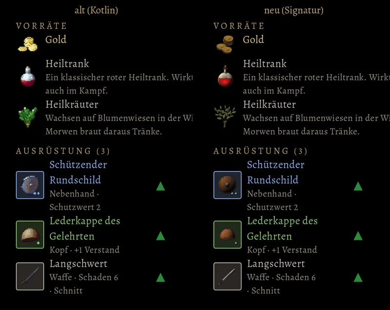
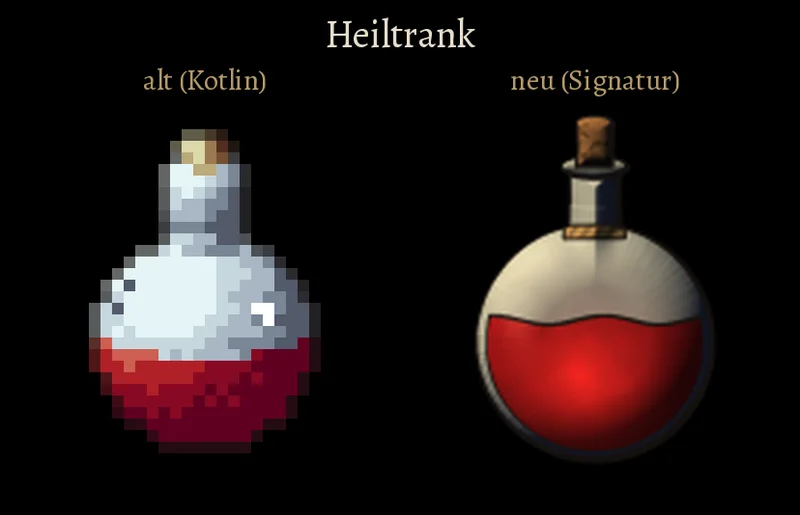
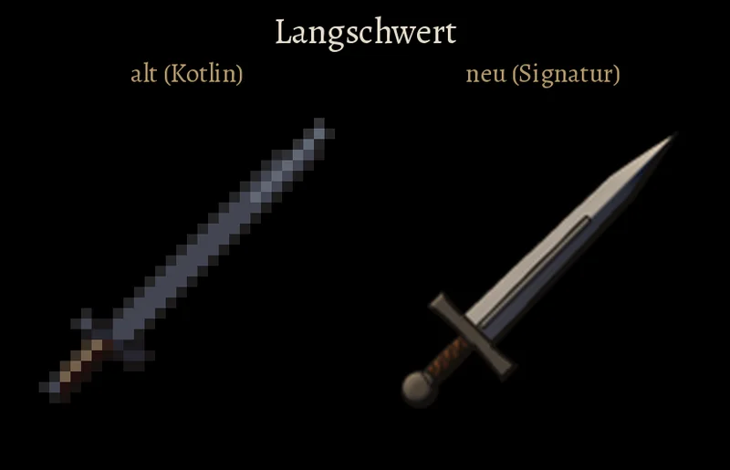

# 1073 · Sollen die Bilder der Dinge in Tasche und Laden so gemalt werden wie in dieser Probe?
Spike · 13.11., 19:27 · G Stil · aus deinem Wort zu den Gegenständen im Inventar (12.11., 20:31 und 20:38)
Kurz: Bilder der Dinge nach unserer Signatur statt der Kotlin-Pixelbilder; Probe mit sechs Stücken, alt neben neu.
Beim Chef, weil: Aussehen

Geprüft an: https://github.com/tramour-cmyk/androidapp_rpg_bornim/commit/e3cff5ab0 (Zweig claude/spike-1073-dingbilder, Probe am Rechner mit dem Spielcode, `godot/tests/dingbilder_1073.gd`)
Großbild: Telegram 13.11. 19:28 (Tasche und je Ding ein Bild, alt neben neu)

**Frage:** Die Bilder der Dinge in der Tasche, im Laden und im Fenster eines Gegenstands sind noch die kleinen Pixelbilder aus der alten Fassung (32 mal 32 Punkte). Du hast gesagt, sie passen nicht zu unserem Stil und unserer Signatur. Die Probe malt sechs Stücke neu, in vierfacher Schärfe und nach den drei festen Zwängen: Licht kommt oben links aus einer warmen Quelle, die abgewandte Seite wird kühl blauschwarz; jedes Teil hat eine Tuschelinie, im Schatten dicker, im Licht dünner; nur Gold und Magie glänzen (die Münzen, der rote Trank, die Steine der Seltenheit), Stahl, Eisen, Leder, Holz und Glas bleiben matt. Die Steine der Seltenheit unten rechts bleiben wie bisher (ein Stein je Stufe). Sollen alle Dinge so gemalt werden?

**Votum:** „1073 A“: so, dann male ich alle Dinge in dieser Art und lege sie dir als Bild vor.

**Berührt:** Tasche, Laden, Fenster eines Gegenstands, Wechselliste der Ausrüstung (Tom); die Tasche im Kampf (Jerry, `kampf_ui.gd` zeichnet die Bilder noch pixelscharf und muss auf glatt umgestellt werden).

**Begründung:** Du hast am 12.11. um 20:31 gesagt: „Das ist ja alles noch Kotlin … passt ja stilmäßig nicht unbedingt zu unserem Godot-Stil und zu unserer Signatur“, und um 20:40: „am besten gegenüberstellen. Alt Kotlin, neu“. Die neuen Bilder sind so gebaut, wie sie später im Spiel aussehen: dieselbe Größe (48 dp), dasselbe Fenster, dieselben Rahmen.

**Sachverhalt:**
- Heute: 22 Vorräte, das Gold und 57 Grundformen in je sechs Seltenheiten, alle als Pixelbild aus der alten Fassung (`godot/daten/ding-*.bild`, `stueck-*.bild`; gezeichnet von `ThingArtExport.kt`).
- Probe: Heiltrank, Langschwert, Heilkräuter, Lederkappe, Rundschild, Gold; die drei Ausrüstungsteile in allen sechs Seltenheiten. Gemalt von `tools/dinge/dingbilder.py`, 128 Punkte groß.
- Einen Verband und einen Hut gibt es im Spiel nicht; statt Verband die Heilkräuter, statt Hut die Lederkappe.
- Im Spiel werden die neuen Bilder glatt verkleinert, die alten bleiben scharf; beides geht nebeneinander, solange nicht alle neu sind.
- Bestand geprüft: für Waffen und Schilde gibt es die 3D-Modelle aus der Welt (`LISTE-QUELLEN.md`), für Tränke, Kräuter, Gold und die meisten Rüstungsteile nicht; darum für alle Dinge eine gemalte Art, Eigenbau.

**Auswertung:**
- **A (Empfehlung):** alle Dinge so malen, je Art ein Bauplan (Tränke, Klingen, Rüstungen, Schmuck …); etwa zwei bis drei Sitzungen, dann ein Bild aller Dinge an dich, danach ein Build.
- **B:** so, aber mit Änderungen (etwa heller, voller, andere Steine); dann neue Probe mit denselben sechs.
- **C:** Waffen und Schilde aus den 3D-Modellen der Welt ablichten, nur den Rest malen; dasselbe Schwert wie am Helden, aber zwei Arten nebeneinander in der Tasche.
- **Stärkstes Gegenargument gegen A:** klein in der Tasche (36 dp) sind feine Teile wie die Blätter der Kräuter oder die Nähte der Kappe kaum zu sehen; die alten Pixelbilder sind dort mit ihren kräftigen Flächen etwas leichter zu erkennen.

**Folgerungen:** Bei A male ich alle Dinge (Spike oder Tom, Vorgang 1073), Jerry bekommt einen Vorgang, die Tasche im Kampf auf glattes Verkleinern umzustellen; bei B neue Probe.

Antwort: …
