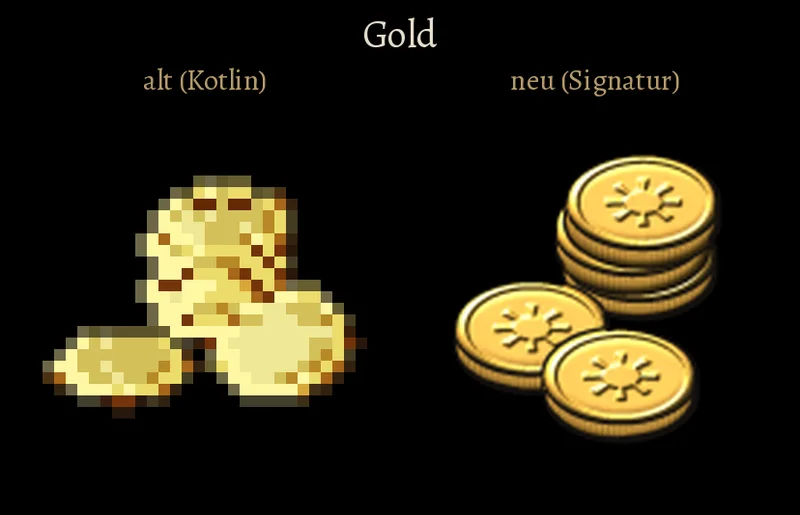
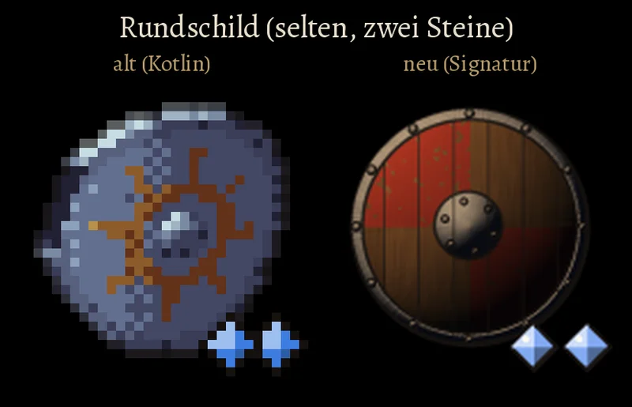

# 1073 · Passen die Bilder der Gegenstände jetzt, nach deinen vier Änderungen?

[Bild von 13.11., 20:02](https://github.com/tramour-cmyk/androidapp_rpg_bornim/blob/bilder/2026-11/13-2002-1073-Spike-4.png) (eingetragen von meldung.sh, Spike)

[Bild von 13.11., 20:02](https://github.com/tramour-cmyk/androidapp_rpg_bornim/blob/bilder/2026-11/13-2002-1073-Spike-3.png) (eingetragen von meldung.sh, Spike)

[Bild von 13.11., 20:02](https://github.com/tramour-cmyk/androidapp_rpg_bornim/blob/bilder/2026-11/13-2002-1073-Spike-2.png) (eingetragen von meldung.sh, Spike)

[Bild von 13.11., 20:02](https://github.com/tramour-cmyk/androidapp_rpg_bornim/blob/bilder/2026-11/13-2002-1073-Spike.png) (eingetragen von meldung.sh, Spike)

Spike · 13.11., 20:02 · G Stil · aus deinem Wort „1073 B, aber die Gegenstände sehen sehr gut aus!“ (13.11., 19:53)
Kurz: Zweite Probe der Gegenstandsbilder: Gold heller, Kräuter voller, Schild und Kappe unterscheidbar, Steine kräftiger.
Beim Chef, weil: Aussehen

Geprüft an: https://github.com/tramour-cmyk/androidapp_rpg_bornim/commit/a669e55f5 (Zweig claude/spike-1073-dingbilder, Probe am Rechner mit dem Spielcode in Handygröße 1080 × 2340, `godot/tests/dingbilder_1073.gd`)
Großbild: Telegram 13.11. 20:03 (Tasche in Spielgröße und je geändertem Gegenstand ein Bild, alt neben neu)

**Frage:** Du hast die erste Probe mit B beantwortet: die Art bleibt, aber vier Dinge sollten anders werden. Jetzt: (1) Gold glänzt als hellstes Ding, gelb statt bronzebraun, mit breitem Schimmer; (2) die Heilkräuter sind ein voller Bund in kräftigem Grün, sieben Stiele statt fünf; (3) der Rundschild ist geviertelt in abgeschabtem Ochsenblutrot bemalt, mit hellem Eisenrand; die Lederkappe ist hell gegerbt und hat Ohrenklappen mit Riemen, damit sie nicht mehr wie eine zweite braune Kuppel aussieht; (4) die Steine der Seltenheit sind größer, in voller Farbe mit heller und dunkler Facette und kräftiger Tuschelinie. Passt das so?

**Votum:** „1073 A“: passt, dann male ich alle Gegenstände in dieser Art und lege dir das Bild aller Gegenstände vor.

**Berührt:** Tasche, Laden, Gegenstandsfenster, Wechselliste der Ausrüstung (Tom); die Tasche im Kampf (Jerry: `kampf_ui.gd` zeichnet die Bilder noch pixelscharf und muss auf glatt umgestellt werden).

**Begründung:** Deine vier Punkte sind einzeln umgesetzt (Wortlaut im Vorgangsarchiv, 13.11., 19:53); Heiltrank und Langschwert sind unverändert, weil du zu ihnen nichts gesagt hast.

**Sachverhalt:**
- Gezeigt in der Tasche wie im Spiel: Gold, Heiltrank, Heilkräuter, Rundschild (selten, zwei Steine), Lederkappe (ungewöhnlich, ein Stein), Langschwert; alt aus `main`, neu aus dem Zweig.
- Vermerk zu (4): die Steine sind jetzt größer und kräftiger umrandet als in der ersten Probe; die blauen Steine (selten) wirken neben den alten etwas heller, weil die helle Facette fast weiß wird. Geht dir das nicht weit genug, mache ich die helle Facette kleiner.
- Bestand geprüft: für Waffen und Schilde gibt es die 3D-Modelle aus der Welt (`LISTE-QUELLEN.md`), für Tränke, Kräuter, Gold und die meisten Rüstungsteile nicht; darum für alle Gegenstände eine gemalte Art, Eigenbau `tools/dinge/dingbilder.py`.

**Auswertung:**
- **A (Empfehlung):** passt; alle Gegenstände so malen, etwa zwei bis drei Sitzungen, dann ein Bild aller an dich, danach ein Build.
- **B:** noch Änderungen an einzelnen Gegenständen, dann neue Probe nur mit diesen.
- **Stärkstes Gegenargument gegen A:** die bemalten Viertel des Schilds sind eine neue Zutat, die es im alten Bild nicht gab (dort eine aufgemalte Sonne); wenn der Schild später im Kampf als Modell anders aussieht, passen Bild und Modell nicht zusammen.

**Folgerungen:** Bei A male ich alle Gegenstände (Vorgang 1073), Jerry bekommt einen Vorgang für die Tasche im Kampf; bei B neue Probe mit den genannten.

Antwort: …
