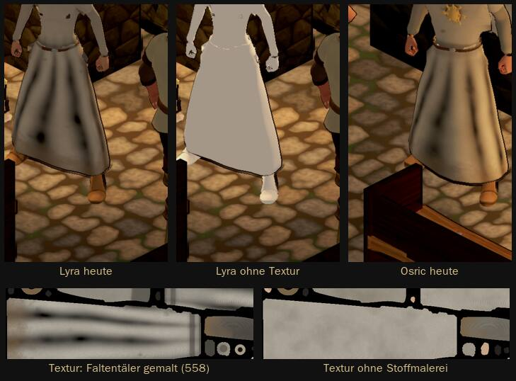

# 1092 · Dunkle Streifen in hellen Roben: als Fehler beheben oder vorher ein Bild?
Tom (Befund 08:50), Sokrates (Vorlage 09:12) · 13.11., 09:12 · E Figuren · Zweig `claude/tom-1092-streifen` · am Rechner mit den gekauften Figuren, Stand Build 282
Kurz: die gemalten Faltentäler der Stoffmalerei 558 laufen ins Schwarze; nur das Schwarz kappen und im nächsten Build prüfen, oder erst ein Bild vorher/nachher

Geprüft an: [Commit 68ab772](https://github.com/tramour-cmyk/androidapp_rpg_bornim/commit/68ab77244) (Probe `streifen_1092.gd`: Lyra, Osric, Rowena, je fünf Bilder mit Toon-Licht und Tusche wie im Spiel; je Bild eine Ursache abgeschaltet: Stoffbild, Schatten, Lichtstufen, Linien in den Falten); Archiv 558 (04.11., 22:21)

**Frage:** Wie werden die dunklen Längsstreifen in hellen Roben und Röcken (Lyra, Osric, Rowena; in Build 282 als „bekannt“) behoben?

**Votum:** „1092 B“ (Sokrates).

**Berührt:** 1092 (Tom), alle Stoffteile mit Stoffmalerei 558: Wappenröcke, Umhänge, Schürzen, auch der Held

**Begründung:** Zu 558 hast du gesagt: „Keine weiteren Roben mehr“, keine Vorlage mehr zu Roben oder Stoff (04.11., 22:21). Das Schwarz in den Tälern ist ein Rechenfehler (Tiefe ohne Untergrenze), keine neue Gestaltung; darum als Fehler behandeln, nicht als neue Stoffrunde.

**Sachverhalt:**
- Ursache (Tom, gemessen): `held3.py` `stoff()`: Faltentäler 0,85 tief mal Tiefe bis etwa 1,3, ohne Untergrenze; im Tal schwarz. Schatten, Lichtstufen, Tusche ausgeschlossen (je abgeschaltet, Streifen bleiben; nur ohne Stoffbild weg).
- Auf hellem Stoff fällt es auf, auf dunklem kaum.

**Auswertung:**
- **A (Tom):** Täler höchstens 40 % dunkler, Tiefe höchstens 1; vorher ein Probebild vorher/nachher zu dir. Kosten: eine Sitzung, ein Probebild, Leute und Held neu bauen.
- **B (Empfehlung Sokrates):** nur das Schwarz kappen (Untergrenze), die Faltenform aus Probe 5 bleibt sonst gleich; kein Probebild, sondern ein Prüfpunkt „Robe Lyra, vorher/nachher“ im nächsten Build. Kosten: eine Sitzung, Leute und Held neu bauen.
- **Stärkstes Gegenargument gegen B:** der mit 558 abgenommene Held ändert sich, ohne dass du es vorher siehst; du wolltest den Stoff ausdrücklich nicht „zu clean“. Dagegen: es fällt nur das Schwarz weg, nicht die Falten; sieht es im Build zu glatt aus, geht es mit einem Satz zurück. A nimmt mehr weg (bis 40 %) und kostet eine Vorlage, die du zu Stoff nicht mehr wolltest.

**Folgerungen:** Bei B baut Tom die Untergrenze, Prüfpunkt in der nächsten Prüfliste; bei A Probebild als neue Vorlage hier.

Antwort: …
