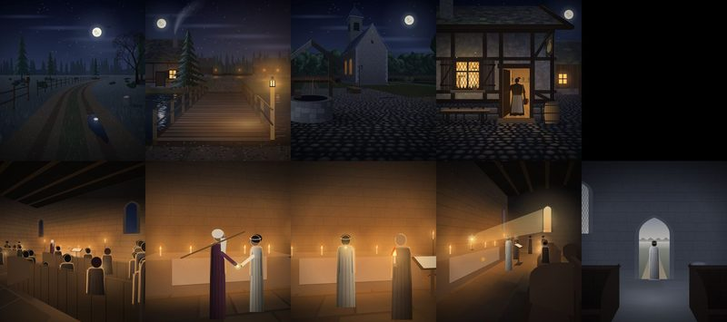

# 112 · Tempelszene nach dem Muster Intro neu malen?
Homer · 17.10., 09:1x · Vorgang 112 (berührt 68, 70)
Kurz: Tempel weicht in 7 Punkten vom Intro ab; Empfehlung: Tom malt neu, Ablauf und Texte bleiben

**Frage.** Das Intro ist das Muster (`DESIGN-STIL.md` „Zwischensequenzen“, sechs Merkmale). Die Tempelszene weicht so ab. Soll Tom sie danach neu malen?

| # | Muster Intro | Tempel heute | Bilder |
|---|---|---|---|
| 1 | dunkel, warmes Licht nur als Insel an der Quelle | orangefarbener Schleier über dem ganzen Bild; doppelt so hell (Helligkeit 75–86 statt 27–45), Wand gleichmäßig beleuchtet | 2, 3, auch 1, 4 |
| 2 | warm gegen kalt (Mond, Himmel) | nur warm; Bild 5 nur kalt und grau, ohne Morgenrot | alle |
| 3 | jede Fläche mit Struktur (Pflaster, Bohlen, Moos) | glatte Flächen: Ziegelraster ohne Fugen und Alter, Altar weißes Rechteck, Boden leer, Bänke flach; im Malcode etwa 15 Struktur-Aufrufe statt rund 200 | alle |
| 4 | Tiefe: großer Gegenstand vorn, Blick schräg | Bild 2 und 3 frontal wie eine Bühne, nichts vorn; Bild 5 zwei Bankklötze | 2, 3, 5 |
| 5 | Figuren mit Kleidung und Merkmal (Rowena: Schürze, Krug) | Kegel mit Kugelkopf, Gemeinde lauter gleiche Figuren; Aldrics Stab ein Strich quer durchs Bild | 1, 2, 3, 4 |
| 6 | Licht hat Quelle und Abfall (Laterne, Kegel aufs Pflaster) | Kerzen ohne Lichtkreis auf Altar und Boden; Strahl in Bild 4 gut, das Bild ist das beste der Reihe | 2, 3 |
| 7 | Leben (Fackeln flackern, Zug, Rauch) | kein Leben; Kerzen und Morgenstrahl stehen still | alle |

**Empfehlung: ja.** Tom malt die fünf Bilder neu nach diesen sieben Punkten; Bildaufbau (68n), Texte und Musik bleiben. Leben (7) erst, wenn die Bilder stehen. Vorlage vorher an mir gemessen, dann an den Chef.

**Stärkstes Gegenargument.** Die Szene kommt einmal, am Ende von Kapitel 1; Wochenziel und Meilenstein brauchen Spielbares, und im Sparmodus kostet eine Neumalerei mit Runden Guthaben. Darum: erst nach dem Wochenziel, ohne Zwischenrunden.

Antwort z. B. „112 ja“, „112 ja, nach Meilenstein“ oder „112 noch nicht“.
