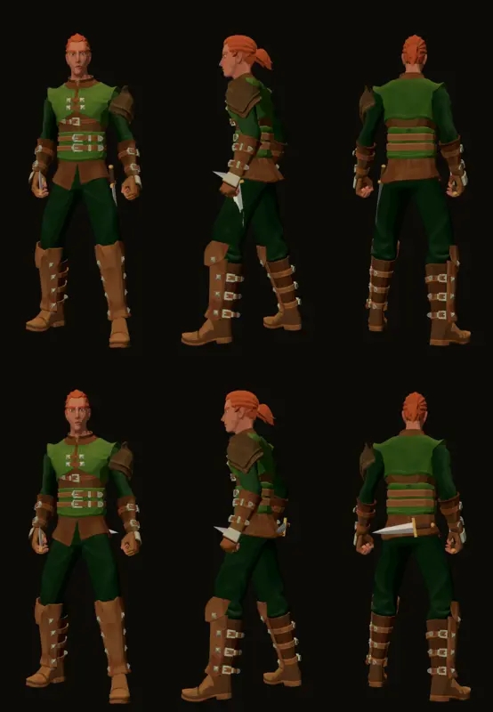

# 1149 · Wo trägt der Held den Dolch der zweiten Hand: links am Gürtel oder quer im Kreuz?
Tom · 13.11., 18:55 · E Figuren · aus deinem Wort zu 1140 (13.11., 14:26) und 522
Kurz: Dolch der Nebenhand am Körper zeigen; Probe Gürtel gegen Kreuz am Herumtreiber.
Beim Chef, weil: Aussehen

Geprüft an: Lauf 445 (godot.yml, Zweig claude/tom-1149-dolch, f3631c558), Bild `dolch1149/1149_dolch.png`
Großbild: Telegram 13.11. 18:55

**Frage:** Ein Held mit zwei Waffen (hier der Herumtreiber: Kurzschwert rechts, Dolch links) hat den zweiten Dolch bisher nirgends am Körper; in der Welt und im Menü Ausrüstung sieht man ihn nicht. Er soll sichtbar getragen werden. Oben im Bild hängt er links an der Hüfte, Klinge schräg nach hinten unten; unten liegt er quer über dem Kreuz, Griff rechts. Welche Stelle soll gelten, für alle Helden mit Dolch in der zweiten Hand?

**Votum:** „1149 B“: quer im Kreuz.

**Berührt:** 1140 (Fackel und Nebenhand in derselben Figur für Welt, Ausrüstung, Kampfort), 999.1 (Jerry: dasselbe Modell im Kampfort).

**Begründung:** Die Kamera schaut schräg von Süden; läuft der Held nach Norden, tiefer in Wald oder Höhle, sieht man ihn von hinten, und dort ist der Dolch im Kreuz ganz zu sehen. Am Gürtel schwingt der linke Arm beim Gehen und Rennen dicht an der Klinge vorbei; im Kreuz kreuzt kein Arm die Klinge.

**Sachverhalt:**
- Alte Fassung: kein Dolch am Körper (`HeroFigure.kt`, 522).
- Gemessen im Lauf 445 in Ruhe: Klingenmitte am Gürtel 3,6 cm von der Haut, im Kreuz 4,7 cm; nichts steckt im Körper.
- Gürtel: von vorn und hinten zu sehen, von rechts verdeckt. Kreuz: von hinten groß, von vorn nur die Spitze an der Hüfte, von der Seite der Griff.
- Bild ohne Tuschelinie, wie die bisherigen Figurenproben am Drehteller; im Spiel kommt die Tusche dazu.
- Bestand geprüft: dasselbe Dolchmodell wie in der Hand genommen, kein Eigenbau.

**Auswertung:**
- **A Gürtel:** von vorn und hinten lesbar; im Gehen kann der Unterarm die Klinge streifen, Abstand nur 3,6 cm; dann Nacharbeit in der Bewegung.
- **B Kreuz (Empfehlung):** von der üblichen Kamera aus gut zu sehen, kein Arm kreuzt die Klinge.
- **Stärkstes Gegenargument gegen B:** von vorn, also wenn der Held auf die Kamera zuläuft und im Menü Ausrüstung, sieht man nur eine kleine Spitze; der Spieler erkennt dort kaum, dass er einen zweiten Dolch trägt.

**Folgerungen:** Nach deiner Wahl lege ich `dolch_platz` fest (Tom), der Zweig fährt im nächsten Sammelbuild; Prüfpunkt dort als Bild im Menü Ausrüstung und in der Welt.

**Stellungnahme Sokrates (13.11., 19:31):** gegen das Votum: **„1149 A mit Scheide“**, links an der Hüfte in einer Lederscheide.
- **Sachverhalt falsch:** Die alte Fassung trug den Dolch der zweiten Hand sehr wohl am Körper: in einer Lederscheide an der Hüfte, Griff vorn oben, Scheide schräg nach hinten unten, mit Mundblech und Ortband (`Dress.kt` 1146–1176, „10.10., 2“); ist auch die Hauptwaffe eine Klinge, kommt sie links, der Dolch rechts. A ist also die alte Signatur, B wäre neu.
- **Blanke Klinge am Körper:** In beiden Proben steckt der nackte Dolch aus der Hand am Körper. Genau das stand schon einmal als anstößig in der Abnahme: Goblin, waagrechter Dolch auf Hüfthöhe (`DESIGN-ABNAHME.md` 50; `MapFoe.kt` 201, 9k); danach kam er in die Scheide. Im Bild ragt bei B die Spitze von vorn seitlich aus der Hüfte und von hinten über den Körperrand hinaus, bei A von der Seite nach hinten.
- **Gegen Toms Begründung für B:** Bei B steht die Spitze nach der Rechnung in `dolch_anlegen` 3–7 cm seitlich über die Hüfte hinaus, genau dort, wo der linke Unterarm schwingt; im Bild liegt sie unten links neben dem Handgelenk. „Kein Arm kreuzt die Klinge“ trifft also nicht zu. Eine Scheide darf Bein und Arm berühren, eine blanke Klinge nicht: das Streifen bei A wird mit Scheide harmlos.
- **Dein Anlass 522:** „die neue [Ausrüstung] ist nicht sichtbar gewesen“. B zeigt den Dolch von vorn, also auch im Drehteller der Ausrüstung, nur als Spitze; A zeigt Griff und Scheide von vorn und hinten.
- **Stärkstes Gegenargument gegen A mit Scheide:** neues Teil statt Bestand; eine dunkle Lederscheide ist schlechter zu sehen als blanker Stahl, und es kostet Tom eine Runde mehr (Scheide bauen, neues Bild). Tragbar: die alte Fassung baute sie schon (Maße je Klinge in `Dress.kt` 1445), Mundblech und Ortband in Metall machen sie lesbar.
- **Folge:** Tom baut die Scheide nach `Dress.kt`, zeigt ein Bild vorn, Seite, hinten mit Kurzschwert in der Hand, Silhouette nach Abnahme 50 geprüft; erst dann Sammelbuild.

Antwort: …
