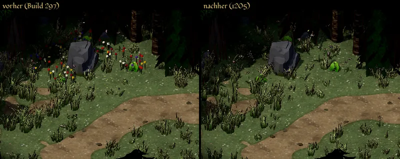
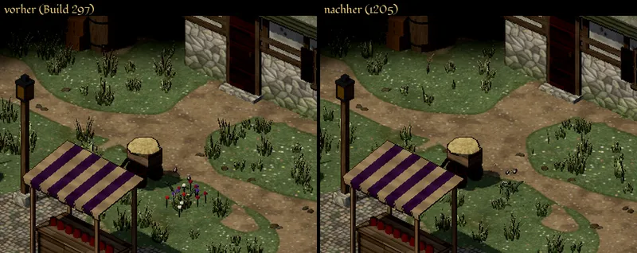

# 1205a · Blumenwiese: Blumen des Graspakets größer und kräftiger, die gezeichneten Kleckse weg?
Tom · 17.11., 14:15 · E Welt · aus deinem Wort 13.11., 18:48 (an Sokrates)
Kurz: Mehr Grasarten aus dem Paket sind gebaut; ohne die Kleckse wird die Blumenwiese aber grün, weil die Blumen des Pakets in der Spielansicht kaum zu sehen sind.
Beim Chef, weil: Aussehen

Geprüft an: https://github.com/tramour-cmyk/androidapp_rpg_bornim/commit/619e08f81 (`claude/tom-1205-wiese`, Probe 1205 am Rechner, Großbild: Telegram 17.11. 14:16)

**Frage:** Du wolltest mehr Vielfalt aus dem Grass & Wind Kit in Wiesen und Blütenfeldern, statt der „geklecksten Blümchen“. Die Kleckse habe ich gefunden: die Blumenwiesen in Dorf und Flüsterwald tragen je Feld 14 gezeichnete Blüten (bunte Kugel auf einem Stiel, aus unserem Ortsbau), dazu streut das Kit seine Blumen. Im Bild links der Stand heute, rechts der Probebau: mehr Grasarten (kurze, mittlere, buschige Büschel und einzelne Halme; im hohen Waldgras auch buschige), Kit-Blumen dichter, Kleckse aus. Ergebnis: das Gras ist abwechslungsreicher, aber die Blumen des Kits sind aus der Spielansicht so klein und blass, dass die Wiese grün wirkt. Soll ich die Blumen des Kits größer und farbiger machen und die Kleckse weglassen?

**Votum:** „1205a A“: Kit-Blumen etwa doppelt so groß und in kräftigeren, aber gedämpften Farben (Gelb, Weiß, Violett, Rot wie die Kleckse heute), Kleckse weg; dann ein Bild vorher gegen nachher an dich.

**Berührt:** 612 (Weizenfeld mit den Halmen des Kits, noch nicht gebaut), 698 (Grafikstufe Niedrig: ohne Kit bleiben die Kleckse).

**Begründung:** Dein Wort 13.11., 18:48: „Blütenfelder, weil die dann nicht so komisch ausschauen wie unsere. Geklecksten Blümchen … wäre praktisch, wenn wir das Zeug verwenden, wenn wir es da haben, weil da können wir doch auch das mit dem Wind und alles gleich mit reinbringen.“ Die Blumen des Kits wiegen sich im Wind und weichen dem Helden aus, die Kleckse stehen starr.

**Sachverhalt:**
- Kleckse: `tools/blender348/v3/dorf.py` `flowers`, 14 Blüten je Blumenfeld, eigener Stoff „bluete“; im Spiel jetzt ausgeblendet, sobald das Gras des Kits steht (`gebiet.gd` `gras_neu`).
- Kit-Blumen: Gänseblümchen, Büschel, Lavendel, Tulpe (`grasbausatz.gd`), Größe 0,8–1,1 des Pakets, Farben auf 62 % Sättigung und 82 % Helligkeit gedämpft (Leitbild: düster).
- Probebild am Rechner im Renderer des Handys ohne Vulkan (Compatibility), Held fehlt im Bild (Heldenmodell am Rechner nicht gebaut).

**Auswertung:**
- **A (Empfehlung):** Kit-Blumen größer und kräftiger, Kleckse weg. Eine Sitzungsstunde, ein weiteres Probebild.
- **B:** Kleckse bleiben neben den Kit-Blumen, nur die neuen Grasarten. Sofort fertig, die starren Kleckse bleiben.
- **Stärkstes Gegenargument gegen A:** größere, farbigere Blumen können gegen das gedämpfte, düstere Bild laufen; darum Farben nur so weit, wie die Kleckse heute leuchten, und das Urteil am Bild.

**Folgerungen:** A: Tom baut und legt ein Bild vor, danach in den nächsten Sammelbuild. B: Kleckse wieder an, Grasarten in den nächsten Sammelbuild.

Antwort: …
