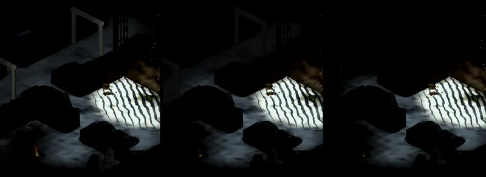
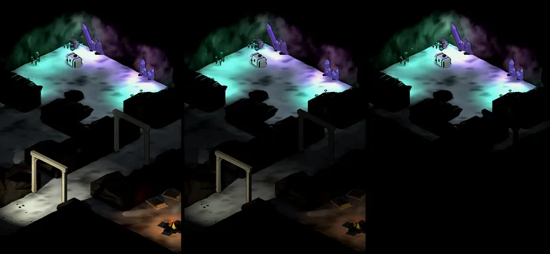

# 1289a · Soll in der Höhle alles außer Sicht schwarz sein, auch was du schon gesehen hast?
Jerry · 15.11., 21:52 · G Stil · aus deinem Wort 20:34 (t289.1, Blutzahnhöhle bei Krogg)
Kurz: Höhle: Gesehenes außer Sicht schwarz statt gedämpft, Wände nur von der Seite des Helden hell.
Beim Chef, weil: Aussehen (ändert dein Wort vom 04.11., 13:54 zu 492: Gesehenes gedämpft)

Geprüft an: `f92345859` auf `claude/jerry-1289-hoehle-mobile`, Renderer mobile am Rechner (lavapipe); Großbild: Telegram 15.11. 21:53
Beim Chef, weil: Aussehen

**Frage:** Du hast am 15.11., 20:34 gesagt: „Da sind die Wände kniehoch, dann sehe ich noch auf die Rückseite von Wänden, wo ich nicht mal durchgucken kann gerade. Bloß weil ich es theoretisch kenne. Also das passt nicht.“ Am 04.11., 13:54 (zu 492) hattest du gesagt: „Und wenn ich schon mal was gesehen habe … dann sehe ich das halt abgedunkelt.“ Beides zusammen geht in der Höhle nicht: was man kennt, aber nicht sieht, ist entweder gedämpft sichtbar oder schwarz. Soll es in der Höhle schwarz sein (die Gebietskarte zeigt es weiter)?

**Votum:** „1289a C“: in der Höhle ist alles außer Sicht schwarz, auch Gesehenes; jede Wand ist nur auf der Seite hell, auf der der Held steht. Wald und Dorf bleiben, wie sie sind.

**Berührt:** 1289 (Jerry, Höhle im Renderer mobile), 505c (Nebel im Wald, bleibt), 492 (Höhle).

**Begründung:** Dein Wort 20:34 sagt, was nicht passt: man sieht, was man nur kennt. C erfüllt das, ohne die Wände umzubauen; die Orientierung gibt die Gebietskarte.

**Sachverhalt:**
- Nachgestellt im Renderer mobile (nach 1289 jetzt gleich wie Compatibility): der Gang hinter der Wand ist „gesehen“ und erkennbar (Helligkeit 30–40 von 255).
- Eine Wand nahm die Sicht vom Boden bis zwei Kacheln weit (wie in der alten Fassung). Darum war eine zwei Kacheln dicke Wand ganz hell, auch auf der Seite, die der Held nicht sieht: das ist die „Rückseite“.
- Die Wände vorn sind niedrig (0,4 m), hinten hoch (2,4 m), wie in der alten Fassung, damit der Held vorn nie verdeckt ist (`tools/blender348/v3/hoehle.py`). Durch die niedrige Wand sieht man auf das, was dahinter liegt.
- Bilder je links A (heute), Mitte B, rechts C; bei Krogg und im Westflügel mit den Kristallen. Der Held fehlt, weil es die gekauften Modelle in dieser Sitzung nicht gibt; Licht und Nebel sind wie im Spiel:

**Auswertung:**
- **A:** wie heute; Gesehenes gedämpft, Wand bis zwei Kacheln hell. Passt nicht zu deinem Wort 20:34.
- **B:** Gesehenes deutlich dunkler, aber noch zu ahnen; Wand nur von der Seite des Helden hell. Kosten: gering, schon gebaut.
- **C (Empfehlung):** Gesehenes außer Sicht schwarz wie Unbekanntes; Wand nur von der Seite des Helden hell. Kosten: gering, schon gebaut.
- **D:** dazu die Wände vorn hoch und um den Helden ausgeschnitten wie die Bäume im Wald. Großer Umbau; erst nach C ansehen, ob die niedrigen Wände dann noch stören.
- **Stärkstes Gegenargument gegen C:** du hattest am 04.11. Gesehenes ausdrücklich gedämpft gewollt; in der Höhle verliert man ohne Karte leichter die Richtung.

**Folgerungen:** Nach „C“ oder „B“ geht der Stand in den nächsten Sammelbuild, Prüfpunkt Höhle am Handy (Jerry). Nach „D“ zuerst eine Probe der hohen Wände.

Antwort: …
