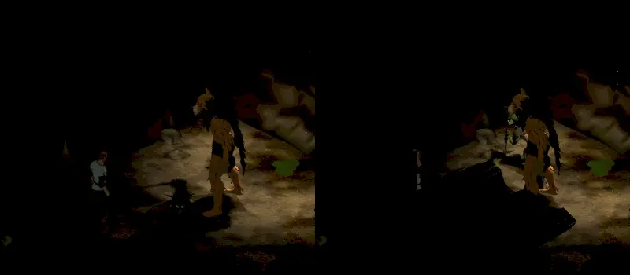

# 1423a · Darf der Held in der Höhle hinter einer hohen Wand im Dunkeln stehen?
Tom · 17.11., 06:21 · G Stil · aus deinem 👍 zu 1423 (Höhlenwände, 06:09), offener Punkt Krogg
Kurz: Seit die Zwischenwände hoch sind, schirmen sie das Lagerfeuer ab; der Held steht bei Krogg ohne eigene Fackel im Dunkeln.
Beim Chef, weil: Aussehen

Geprüft an: https://github.com/tramour-cmyk/androidapp_rpg_bornim/commit/c4380cc5f (Lichtmessung am Rechner ohne Bild, Höhle alt und neu)

**Frage:** Im Bild bei Krogg (Grottenschrat, Ostflügel der Höhle) ist der Held hinter der neuen hohen Wand kaum zu sehen (Bild unten, rechts neu, der Held links von Krogg). Das Loch in der Wand um den Helden ist da. Es ist aber nur Dunkel zu sehen, weil er dort kein Licht bekommt. Soll das so bleiben?

**Votum:** „1423a A“: so lassen; Licht nur aus Quellen, wer im Dunkeln steht, nimmt eine Fackel.

**Berührt:** 1423 (Höhlenwände, Tom). Fährt im nächsten Sammelbuild mit (Jerry).

**Begründung:** Signatur 1: Licht hat eine Quelle, außerhalb des Lichtkreises kaltes Blauschwarz (`DESIGN-STIL.md`).

**Sachverhalt:**
- Lichtmessung (Strahl von der Brust des Helden zu jeder Lichtquelle der Höhle, Wände der Höhle als Hindernis): bei Krogg (Felder 14 und 15 in Zeile 11) erreichte das Lagerfeuer den Helden vorher über die 80-cm-Wand. Mit der 2,4-m-Wand kommt es nicht mehr an. Im Feld 16 daneben scheint es weiter.
- Die eigene Fackel des Helden leuchtet nur, wenn er sie in der Nebenhand trägt (`held.gd` 399.1). Im Bildlauf trug er keine.

**Auswertung:**
- **A (Empfehlung):** so lassen, keine Kosten. Die Höhle wird dunkler und düsterer; mit Fackel in der Hand sieht man den Helden.
- **B:** den Helden in der Höhle im Schatten leicht aufhellen (wie draußen am Tag, Umriss erkennbar), etwa 1 $, Bild an dich.
- **Stärkstes Gegenargument gegen A:** Ohne Fackel verliert der Spieler seinen Helden hinter Wänden aus dem Blick, gerade neben einem Gegner. Wie stark, ist am Handy nicht gemessen; im Bild ist er nur noch zu ahnen.

**Stellungnahme Sokrates (17.11., 09:18):** Was fehlt: wer im Spiel betroffen ist. Die Fackel sitzt in der Nebenhand (399.1, wie alt), dort sitzt auch der Schild (1291a D). Wachsoldat und Kleriker mit Schild stehen in der Höhle also immer ohne eigenes Licht; für sie ist „nimm eine Fackel“ eine echte Wahl Schild gegen Licht, und genau die soll das Spiel haben (Leitbild). Stärker als Toms Gegenargument ist: die Tuschelinie (Stil 2) ist dunkel und hilft vor Schwarz nicht, der Held ist dann wirklich weg; gemessen ist nur am Rechner, nicht am Handy. Empfehlung: **A**, mit einer Prüfzeile im nächsten Sammelbuild „Held mit Schild bei Krogg am Handy: findest du ihn?“; findest du ihn nicht, ist B (etwa 1 $) der Rückweg, ohne neue Vorlage.

**Folgerungen:** A: nichts zu tun, 1423 (Höhlenwände) bleibt wie gebilligt. B: Tom baut die Aufhellung und schickt ein Bild bei Krogg alt gegen neu.

Antwort: …
