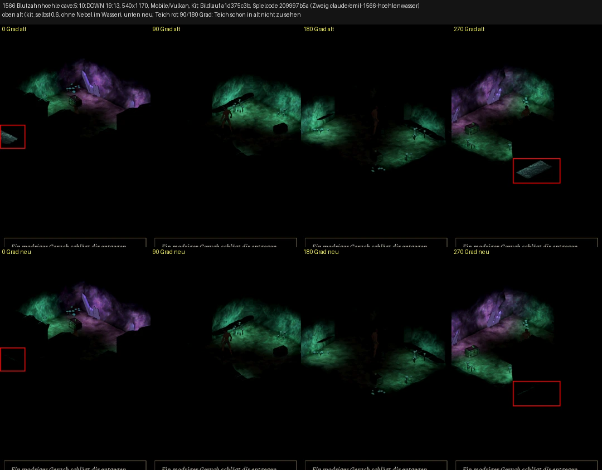

# 1566 · Randlinie am Höhlenwasser heute noch beheben?

Sokrates · 22.11., 22:33 · G Stil · im Chat 21:54 gefragt, Telegram 22:33
Kurz: Randlinie am nie gesehenen Höhlenwasser heute noch weg (A) oder reicht so (B)?

Geprüft an: https://github.com/tramour-cmyk/androidapp_rpg_bornim/commit/2823bffbb

Beim Chef, weil: Aussehen.

**Frage:** Silkes Behebung macht das nie gesehene Höhlenwasser aus allen vier Kameradrehungen fast schwarz; es bleibt eine dünne türkise Randlinie. Soll sie heute noch mit einem Lauf weg, oder reicht der Stand?

**Votum:** „1566 A“: Linie heute noch beheben.

**Berührt:** 1566 (Silke, Welt), Laufsperre 287 (Ausnahme Chef 20:58), 1976 (Werkzeug).

**Begründung:** Chef 21:47: „dass es halt nicht eine feste Perspektive gibt“; die Linie hängt von der Drehung ab, also sieht sie der Spieler je nach Blick.

**Sachverhalt:**
- Bild oben alt, unten neu (Mobile 540x1170, Spielcode 209997b5a, Zweig claude/emil-1566-hoehlenwasser).
- Teichrahmen hellster Punkt: 0° alt 119, neu 26; 270° alt 160, neu 58; bei 90° und 180° liegt der Teich hinter der Wand.
- Nebelkarte dort voll (nie gesehen); Ursache der Linie vermutlich Spiegelung des Pilzlichts am Rand, unbelegt.

**Auswertung:**
- **A (Empfehlung):** ein Lauf heute: Wasser außer Sicht ganz durchsichtig (ALPHA = Sicht), vier Drehungen; ein Prüfer, ein Lauf.
- **B:** reicht so; nach Test des Chefs nach main, Linie als Kür.
- **Stärkstes Gegenargument gegen A:** kostet Guthaben, und unter durchsichtigem Wasser könnte Boden oder Loch auftauchen; entkräftet: derselbe Messrahmen zeigt es, dann Rest als Kür.

**Folgerungen:** A: Disponent startet Prüfer für Silkes Laufanforderung, Silke baut und läuft. B: Silke meldet fertig, Prüfer, dann Testbuild für den Chef.

Antwort: 👍 = Votum (A), 👎 = nein, dann Buchstabe.
