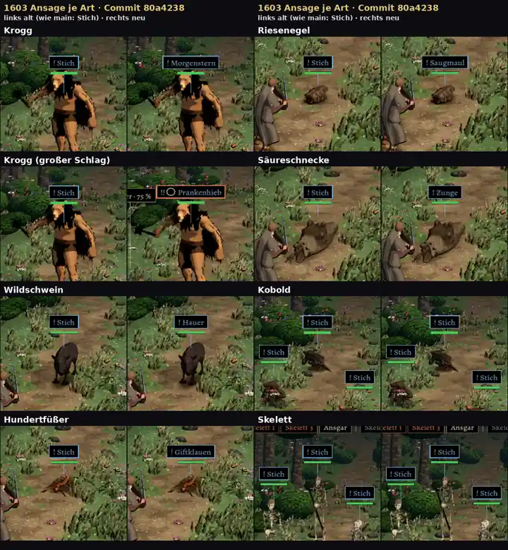
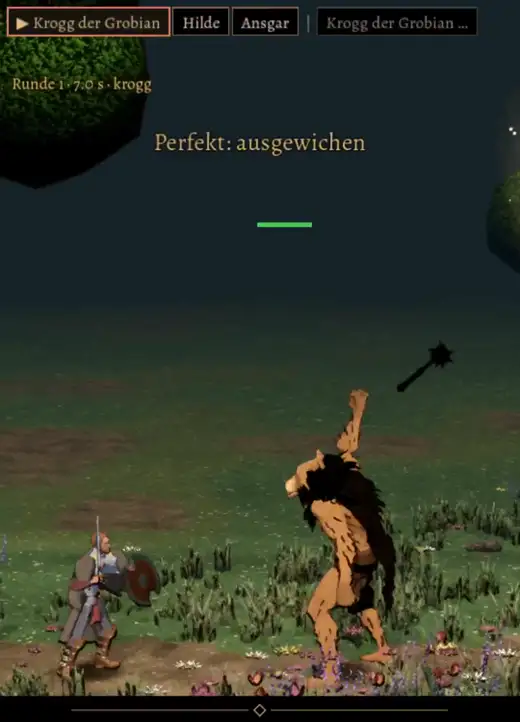

# 1603 · Gegner sagen ihren eigenen Schlag an: so billigen, und Kroggs Prankenhieb bekommt später eine eigene Bewegung?
Sokrates · 24.11., 15:45 · E Kampf · Prüfer „ja“ 15:36; dein Wort 12:27 („Es war ja nicht mal eine Frage da.“)
Kurz: Sechs Gegnerarten sagen jetzt ihren Schlag an statt „Stich“; beim Prankenhieb schwingt Krogg aber den Morgenstern, der Text spricht von der Pranke.
Beim Chef, weil: Aussehen; Story; Code auf main

Geprüft an: Bildlauf 593, Commit 80a423815 (Zweig arne/1603-ansagen); Prüfer „ja“ 15:36

**Frage:** Bisher rief jeder Gegner vor dem Angriff „Stich“. Jetzt sagt jede Art ihren eigenen Schlag an (Bild 1): Krogg „Morgenstern“, Wildschwein „Hauer“, Hundertfüßer „Giftklauen“, Riesenegel „Saugmaul“, Säureschnecke „Zunge“; Kobold und Skelett bleiben bei „Stich“. Dazu hat Krogg einen großen Schlag, den Prankenhieb, den man nur mit dem Ring abfangen kann. Die Eingebung dazu (Story-Quelle) lautet: „Er holt mit der Pranke aus. Treffe ich den Ring, fange ich den Hieb ab.“ Im Spiel (Bild 2, Film) hebt Krogg aber den Arm und schwingt den Morgenstern; eine eigene Pranken-Bewegung gibt es nicht. Billigst du die Ansagen so, und soll die Pranken-Bewegung ein eigener Auftrag werden?

**Votum:** „1603 A“: Ansagen so billigen; Prankenhieb-Bewegung als eigener Auftrag; danach Testbuild für dich, erst nach deinem Test nach main.

**Berührt:** Kampf (Gegnerabsichten), Story (Texte 1057, 1069), Figur (Krogg-Bewegung).

**Begründung:** Die Texte stehen wörtlich in der Story-Quelle (`STORY-BRS-KAMPF.md`), ändern darf sie nur Story mit deinem Wort. Die Ansagen helfen dem Spieler sofort, den Gegner zu lesen; der Widerspruch liegt in der Bewegung, nicht im Text.

Film: Zweig `bilder`, `2026-11/24-1541-1603-Karla-prankenhieb-lauf593.mp4` (13,2 s, seitlich, dreimal Prankenhieb mit Ring).

**Sachverhalt:**
- Bild 1 (Commit 80a4238): je Art die Ansage über dem Gegner, links alt, rechts neu; Prüfer hat jede Zeile gegen die Story-Quelle verglichen, wortgleich.
- Bild 2: Krogg reckt den leeren Arm, der Morgenstern schwebt eine Armlänge daneben in der Luft. Das ist zusätzlich ein Fehler (Waffe nicht in der Hand), nicht nur die falsche Bewegung.
- Schwierigkeit Krogg (Rechnung, Zusatz 0,3, mein Entscheid C 24.11., 00:07: Maß „jeder zweite Ring gut“, Grenze 10 Punkte): −8,5 bzw. +7,0 Punkte, also in der Spanne. Wer nie den Ring trifft, verliert deutlich öfter (−22 bis −25), wer ihn immer trifft, gewinnt öfter (+24 bis +25). Gewollt: der Ring ist die Antwort auf den Prankenhieb.
- Tests: Logik 194 gut, Ansageprüfung 29 Fälle ohne Fehler. Kosten 1603 bisher 38,82 $.

**Auswertung:**
- **A (Empfehlung):** billigen; neuer Auftrag „Krogg schlägt beim Prankenhieb mit der freien Pranke, Morgenstern bleibt in der Hand“ (Figur). Testbuild für dich, dann nach main.
- **B:** billigen, aber der Text wird auf den Morgenstern umgeschrieben (Story, dein Wort nötig); keine neue Bewegung.
- **C:** nicht billigen, erst mit Pranken-Bewegung wieder vorlegen.
- **Stärkstes Gegenargument gegen A:** Bis die Bewegung da ist, liest der Spieler „Pranke“ und sieht den Morgenstern, dazu die schwebende Waffe; das wirkt unfertig.
- **Entkräftet durch:** Die Eingebung kommt einmal je Spielstand, die Ansagen wirken in jedem Kampf; die schwebende Waffe ist ohnehin zu beheben, auch unter B und C.

**Folgerungen:** A: Arbeitsplaner legt den Auftrag Krogg-Pranke an, Testbuild über Disponent, nach deinem Test mische ich nach main. B: Story-Auftrag für den Text. C: 1603 zurück an Kampf.

Antwort: …
