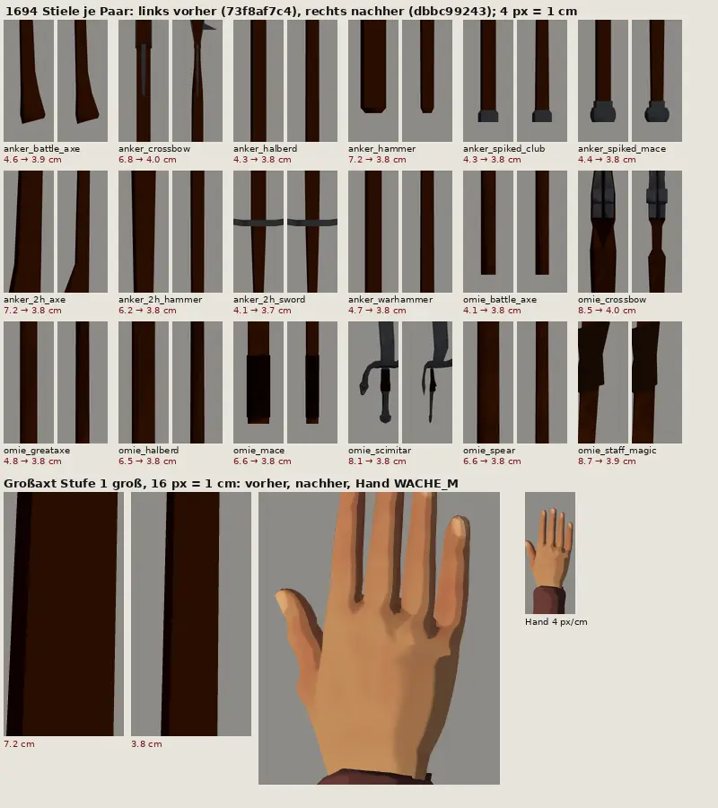

# 1694 · Stiele bleiben dünn wie im Bild, und die Ursache des Griffs suchen wir mit 15 $ weiter?
Sokrates · 24.11., 15:10 · E Figuren · aus deinem Wort 10:30 (Vergleichsbild) und dem 5. „steckt fest“
Kurz: Vergleichsbild der Stiele liegt vor; Ursache, warum die Hand im Spiel die Großaxt nicht greift, ist weiter offen.
Beim Chef, weil: Aussehen; Obergrenze B

Geprüft an: Bild 78e972f88 (Zweig claude/figur-1694-griff), Prüfer „ja“ zum Bild 14:36; Messung 153cd7548

**Frage:** Du wolltest um 10:30 die Stiele vorher und nachher sehen, mit Hand daneben. Das Bild ist da (unten). Sollen die 18 Waffen so dünn bleiben (3,7 bis 4,0 cm statt 4,1 bis 8,7 cm)? Und zweitens: Die Hand greift im Spiel die Großaxt weiterhin nicht richtig, im Prüfaufbau aber schon. Die vermutete Ursache hat sich als falsch erwiesen; gemessen ist jetzt, dass die gezeichnete Hand im Spiel von Lauf zu Lauf um bis zu 2,9 cm springt, obwohl die Knochen gleich stehen. Sollen wir dieser Spur weiter nachgehen? Oder willst du die Stiele nach dem Bild wieder dick haben?

**Votum:** „1694 A“: Stiele bleiben so; ein Figur-Nachfolger misst je Bild Knochen gegen gezeichnete Hand, nichts bauen, Deckel 15 $.

**Berührt:** 1621 (Zweihandwaffen kürzer), 1649 (Zweihandwaffe im Stand), 1657 (Robe), 2022 (Griff einmal grundsätzlich lösen); alle Träger von Waffen (Held, Leute, Monster).

**Begründung:** Dein Wort 23.11., 22:23: „Und dann verdünnen wir halt das Ganze. Also Vorgang 1694, gehen wir auf A.“ Das Bild zeigt genau das. Vermutung, nicht belegt (gemessen nur Großaxt an WACHE_M im Stehen): Springt die gezeichnete Hand allgemein, trifft das alle Träger und könnte die Wurzel der fünf früheren Griff-Vorgänge sein.

**Sachverhalt:**
- Bild `docs/chefsache/bilder/1694-stiele-vorher-nachher.webp`: 18 Formen, je links vorher, rechts nachher, Spielfarbe; unten Großaxt Stufe 1 groß (7,2 → 3,8 cm) und Hand WACHE_M im selben Maßstab.
- Messung 14:40 (Figur, sechs Läufe, Großaxt im Stand): Knochenpose in allen Läufen gleich, gezeichneter Zeigefinger 0,5 bis 3,4 cm neben der Rechnung; im Prüfaufbau stabil 0,1 cm.
- Prüfer 14:36: frühere Ursache („Formschlüssel“) nicht belegt; Figur hat das berichtigt.
- 1694 bisher 71,86 $, davon letzter Lauf (Jana, Deckel 15 $) 6,65 $ laut Disponent beim Archivieren 15:07.

**Auswertung:**
- **A (Empfehlung):** Stiele bleiben; ein Lauf misst Bild für Bild, ob die gezeichnete Hand der Knochenpose hinterherhinkt. Bis 15 $, bei 12 $ Halt; den Stand liest der Disponent in jeder Runde aus der Sitzung (Kosten), die Fachkraft selbst kann ihn nicht ablesen. Ergebnis: Ursache belegt oder Spur verworfen.
- **B:** Stiele bleiben; 1694 ruht, bis 2022 (Griff grundsätzlich) dran ist. Kostet nichts jetzt, Griff im Spiel bleibt fehlerhaft.
- **C:** Stiele zurück auf dick (Rücknahme dbbc99243), dann wie B. Die Hand greift dicke Stiele heute nicht (dein Wort 22:21).
- **Stärkstes Gegenargument gegen A:** 72 $ ohne Behebung, und die Messung im Spiel ist unruhig; noch ein Lauf kann wieder nichts ergeben.
- **Entkräftet durch:** Der Lauf misst nur noch eine Größe, nichts wird gebaut, und der Deckel begrenzt den Verlust auf 15 $.

**Folgerungen:** A: Arbeitsplaner schreibt den Auftrag, Disponent startet Figur und wacht über den Deckel. B: 1694 ruht, 2022 bekommt den Befund. C: Figur nimmt dbbc99243 zurück, dann wie B.

Antwort: …
