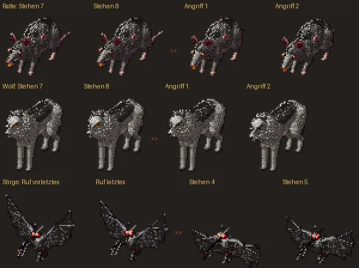

# 19e · Kampf: Monster setzen aus dem Atmen ruckartig in ihre Bewegung an
Jerry · 20.10., 12:09 · E Kampf · K (Beispiel zu 19e: Chef 20.10., 11:45 zu Garrick: „grds mal schauen bei animationen, dass sie weich ineinander übergehen“)

## Befund

Alle Kampfbewegungen von Kapitel 1 nachgemessen (Held in allen Haltungen, alle Gegner), jeweils der Schritt vom Stehen in die Bewegung und zurück.

- **Held, Goblin, Kobold, Grak, Skelett und alle Puppen-Gegner:** weich, höchstens ein Viertel dessen, was der Sprungtest erlaubt.
- **Vierbeiner (Ratte, Wolf, Schreckenswolf, Eber):** Im Stehen atmen sie (Brustkorb und Rücken heben sich). Jede Bewegung (Biss, Treffer, Ausweichen, Fallen) beginnt aber im ausgeatmeten Bild. Kommt der Biss mitten im Einatmen, springt die Figur in einem Bild um das **3- bis 4-Fache** des größten Atemschritts (Ratte am stärksten, Wolf am wenigsten). Nach der Bewegung dasselbe zurück.
- **Stirge und Fledermaus:** am Ende des Schreis springt der Flügelschlag auf das Doppelte eines normalen Schlags.
- **Spinne, Tausendfüßler, Gallertwürfel:** im Rahmen.

Der Sprungtest prüft nur den Weg vom **ersten** Stehbild aus. Im Spiel läuft das Atmen aber nach der Uhr weiter, und die Bewegung beginnt bei jedem Atembild. Das gilt im klassischen Kampf und in MARS.

Bildserie, je Zeile vier Bilder in der Folge des Spiels, der Sprung liegt bei „>>“: Ratte und Wolf aus dem Einatmen in den Biss, Stirge vom Ende des Schreis ins Schweben.

## Vorschlag

1. Nach jeder Bewegung beginnt das Atmen wieder beim ersten Bild. Damit ist der Weg **zurück** weich, ohne Verzögerung.
2. Vor einer Bewegung atmet die Figur im doppelten Takt zum ersten Bild zurück, dann beginnt die Bewegung. Das kostet höchstens etwa ein Drittel Sekunde vor dem Biss.
3. Der Sprungtest prüft künftig von jedem Stehbild aus, damit es nicht wiederkommt.

**Empfehlung: 1 und 3 bauen, 2 erst nach deinem Blick aufs Gerät.** *Stärkstes Gegenargument:* Auf dem Handy ist der Sprung klein (beim Wolf etwa 26 Bildpunkte am Umriss), du hast ihn bei Monstern bisher nicht bemängelt; 2 verzögert jeden Biss und kann den Kampf träger wirken lassen. Darum 2 nur, wenn du den Ruck nach 1 noch siehst.

**Antwort:** „1 und 3“, „alle drei“ oder „nein“.

**Berührt:** 19e, 239 (Garrick, Tom), Sprungtest 12a.

## Stellungnahme Sokrates (20.10., 16:08)

- **Stärkstes Gegenargument:** Punkt 1 kann neuen Ruck erzeugen: Setzt jede Figur nach ihrer Bewegung das Atmen auf Bild 1, atmen Wölfe, die im selben Zug zubeißen, danach im Gleichtakt; ein Rudel wirkt dann mechanisch. Jerry sollte beim Bau prüfen, dass jede Figur ihren eigenen Versatz behält. Und Punkt 2 als Warten ist der falsche Weg: eine Überblendung vom aktuellen Atembild in den Bewegungsanfang (zwei, drei Bilder) wäre weich ohne Verzögerung.
- **Widerspruch zu Entschiedenem:** keiner. Passt zu deiner Linie 11:45 („weich ineinander übergehen“) und 239; Oberste Direktive 179 stellt Fehler und Kapitel 1 vor Kür, das hier ist Feinschliff (K).
- **Kosten:** klein, wenn 1 und 3 in einem ohnehin geplanten Jerry-Build mitfahren; ein eigener Build oder eigener Gerätetest dafür lohnt nicht.
- **Empfehlung:** „1 und 3“, mit dem nächsten Jerry-Build, ohne eigenen Test; 2 nur, wenn du danach noch Ruck siehst, und dann als Überblendung statt Warten.
