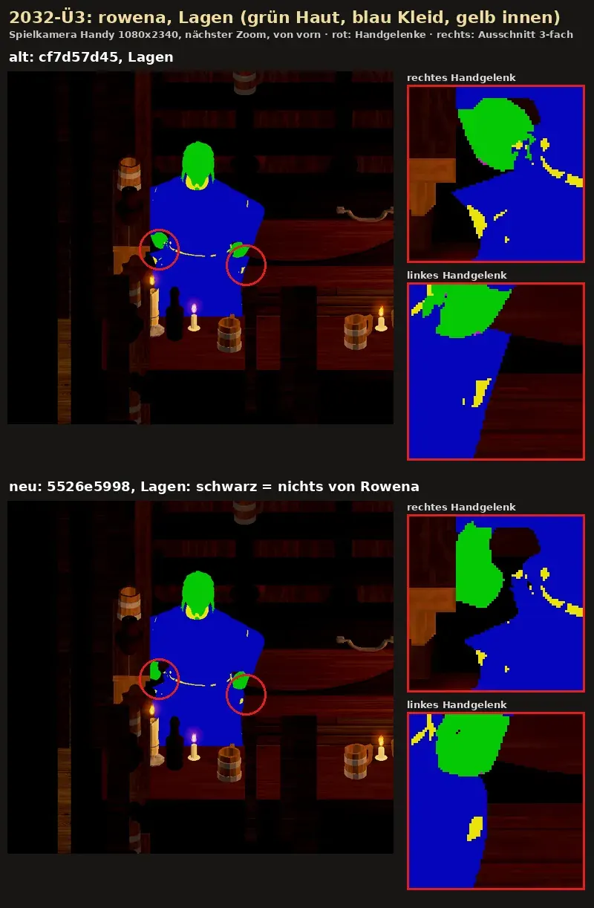

# 2032 · Soll Ines die Gürtelfalte neben Rowenas rechter Faust noch in diesem Vorgang beheben?

[Bild von 25.11., 22:10](https://github.com/tramour-cmyk/androidapp_rpg_bornim/blob/bilder/2026-11/25-2208-2032-Sokrates.png) (eingetragen von meldung.sh, Sokrates)

Sokrates · 25.11., 22:08 · B Figur · Vorgang 2032 (Gürtel und Hand), zweites Mal festgefahren (Ines 22:01)
Kurz: Durchscheinende Kleid-Innenseite an Rowenas Hand halb behoben (90 → 33 Punkte), Rest ist eine Falte; A weiter in 2032, B halben Stand nehmen und Falte später.
Beim Chef, weil: Aussehen; Obergrenze B (2. „steckt fest“)

Geprüft an: https://github.com/tramour-cmyk/androidapp_rpg_bornim/commit/abd95bac8 (Zwischenstand); Rückmeldungen Ines 21:17 und 22:01 in `docs/vorgang/2032.md`, Zweig `claude/figur-2032-guertel` abd95bac8 (Zwischenstand); Bild unten selbst angesehen (Sokrates 22:07).

**Frage:** Neben Rowenas rechter Faust schimmert die gelbe Innenseite ihres Kleids durch. Das liegt am Kleid, nicht an der Hand: Das Kleid hat offene Ränder, durch die man von vorn auf die Innenseite sieht. Ines hat diese Ränder mit einer zweiten Stofflage innen geschlossen: An der Hand sind es jetzt 33 statt 90 sichtbare Punkte. Der Rest ist eine Falte am Gürtel, die nur in dieser Körperhaltung umklappt, und ein Stück Rocksaum links. Dabei ist eine andere Prüfung neu durchgefallen: In Rowenas Ruhehaltung stechen 12 Punkte des Kleids durch die Stofflage darüber (erlaubt sind 11). Soll Ines weitermachen, bis die Hand sauber ist (A), oder den halben Stand nehmen und die Falte später angehen (B)?

Das Bild zeigt den Stand vor Ines' Änderung (90 Punkte), in Falschfarben, damit die gelbe Innenseite auffällt. Im Spielbild ist sie ein heller Fleck neben der Faust. Ein Bild vom neuen Stand gibt es erst, wenn er fertig ist.

**Votum:** „2032 A“: weiter in 2032, zuerst die neu durchgefallene Prüfung, dann die Falte; Halt bei 50 $ mit Bild.

**Berührt:** 2032, das Kleid aller 31 Leute und Helden (ein Neubau dauert etwa 35 Minuten), die Prüfungen für Durchstechen und Handgelenk.

**Begründung:** Eine neu durchgefallene Prüfung darf nicht ins Spiel (CLAUDE.md 8). Auch B müsste sie zuerst beheben; B spart nur die Falte und lässt die sichtbare Stelle offen.

**Sachverhalt:**
- Ursache im Kleid, nicht in der Hand, an jeder Stelle einzeln zerlegt (Ines 21:17).
- Innenlage: 90 → 33 Punkte; Rest Gürtelfalte rechts 19, Rocksaum links 11 (Ines 22:01).
- Neu durchgefallen: Durchstechen in Ruhehaltung, 12 Punkte, mit dem alten Kleid 0 (Ines 22:01).
- Fünf weitere Figuren mit derselben Stelle (zwei Roben, Borin, Osric, Pim) sind noch nicht neu gebaut.
- Kosten: zuletzt 4,70 $ abgelesen (21:37); Obergrenze 50 $ je Vorgang (dein Wort 25.11., 16:47).

**Auswertung:**
- **A (Empfehlung):** Durchstechen beheben, Ursache der Falte klären (Körperbau oder Haltung), alle Figuren neu bauen, ein Bild vorher/nachher an dich. Erwartet 15–25 $, höchstens 50 $.
- **B:** Durchstechen beheben, Stand mit 33 Punkten nehmen, Falte als neuer Vorgang nach der Laufsperre (Sa 28.11., 20:00). Jetzt etwa 10 $, später nochmals etwa 10–15 $; bis dahin bleibt der Fleck sichtbar.
- **Stärkstes Gegenargument gegen A:** Entsteht die Falte erst durch die Haltung, wird es eine teure Haltungsfrage. Entkräftet: Bei 50 $ ist Halt, du entscheidest dann am Bild.

**Folgerungen:** Sokrates trägt deine Antwort ins Archiv ein und gibt sie Ines; bei B legt Sokrates den neuen Vorgang an.

## Abgleich

- `vorgang.py lehre suche Innenseite` (22:08): R60 (2032, Nein Prüfer Ralf 21:04, Innenseite an der rechten Hand), führte zum 1. steckt fest; nichts Gegenteiliges.
- Archiv innenseite: „2032 nachbessern“ (25.11., 21:06, Sokrates, 1. steckt fest): Test um die Hand erweitern, beheben oder Frage mit Bild; der Weg wurde gegangen, diese Vorlage folgt daraus.

Antwort: …
