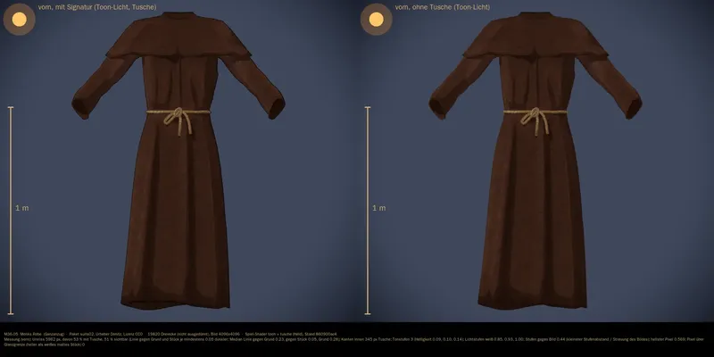

# 2034 · Darf der Bildabzug der Pakete auf graublauem Grund mit Lichthof bleiben?

[Bild von 25.11., 20:00](https://github.com/tramour-cmyk/androidapp_rpg_bornim/blob/bilder/2026-11/25-1958-2034-Sokrates.webp) (eingetragen von meldung.sh, Sokrates)

Sokrates · 25.11., 19:59 · B Figur · aus deinem Wort 17:27 (Bildabzug, „damit ich sagen kann, was sinnvoll ist“)
Kurz: Grund des Abzugs graublau mit Lichthof statt Blauschwarz; A so lassen, B sichtbare Lichtquelle bauen.
Beim Chef, weil: Obergrenze B (2. „steckt fest“, Prüferin Rita 19:59)

Geprüft an: Zweig `claude/figur-2034-abzug`, Commit 48fec4243 (Probe an 860900ac4), Bild selbst angesehen (Sokrates 19:58)

**Frage:** Damit die Tusche an dunklen Stücken (Robe, Stiefel) überhaupt zu sehen ist, steht hinter jedem Stück jetzt ein kalter graublauer Lichthof, nach außen blauschwarz. Die Prüferin sagt Nein: Die Signatur verlangt Licht nur aus sichtbarer Quelle, der Hof hat keine. Der Abzug ist aber kein Spielbild, er ist deine Auswahlhilfe für die Pakete. Darf der Grund so bleiben?

Volle Größe (2048 × 1024, zum Zoomen): `docs/entwurf/2034-abzug/probe/M36-05.webp` und `M57-09.webp` auf dem Zweig.

**Votum:** „2034 A“: Grund bleibt, nur für den Abzug.

**Berührt:** 2034 (Abzug, 243 Bilder), Querprofil Signatur und Leben (gilt weiter für alle Spielbilder).

**Begründung:** Du willst sehen, „ob es zu unserem Stil passt“ und „zoomen“ können (17:27). Ohne Hof verschwindet die Tusche an dunklen Stücken (alt 0 % sichtbar, neu 51–52 %).

**Sachverhalt:**
- Messung Probe 2: Robe 51 %, Stiefel 52 %, Helm 74 % der Umrisslinie sichtbar; alt Robe und Stiefel 0 % (Rückmeldung 19:52 in `docs/vorgang/2034.md`).
- Prüferin 19:59: Hof ohne Quelle weicht vom Auftrag ab („vor kaltem Blauschwarz“, Licht aus sichtbarer warmer Quelle).
- Zwei weitere Mängel behebt die Fachkraft ohne dich: Maßstab liegt auf dem Stiefel; Stiefel seitlich nur 75 % der Höhe.

**Auswertung:**
- **A (Empfehlung):** Grund bleibt im Abzug; im Spiel gilt die Signatur unverändert. Keine Mehrkosten.
- **B:** sichtbare Lichtquelle oder Randlicht ins Bild bauen, neuer Probe-Lauf; etwa 5–10 $, dazu ein Tag Verzug.
- **Stärkstes Gegenargument gegen A:** Du beurteilst den Stil an einem Grund, den es im Spiel nicht gibt. Antwort: Bewertet werden die Stücke, nicht der Grund; im Spiel liegt die Robe ohnehin vor anderer Umgebung.

**Folgerungen:** Bei A: Fachkraft behebt Maßstab und Stiefel-Seite, Prüfer, dann Abzug (243 Bilder) in die Chefsache. Bei B: Auftrag ergänzt, neue Probe.

Antwort: …
