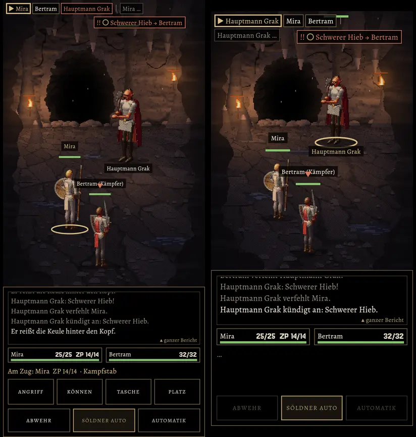
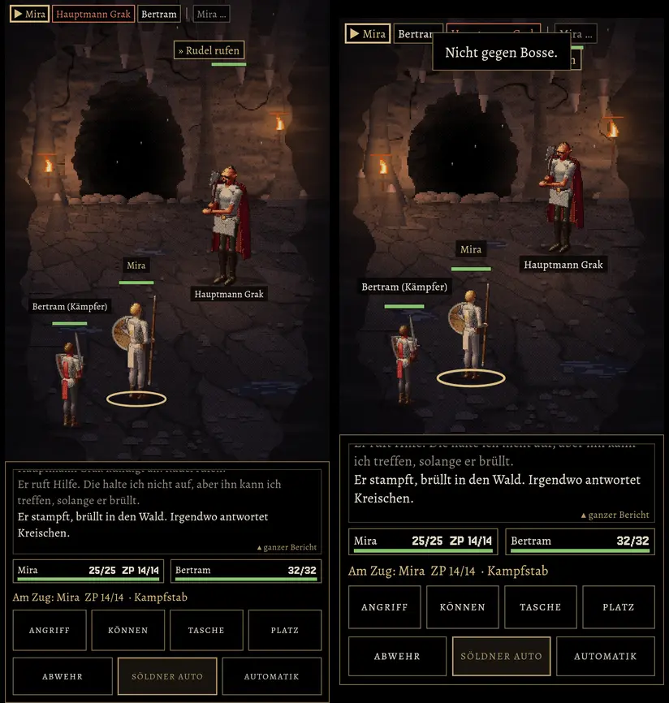
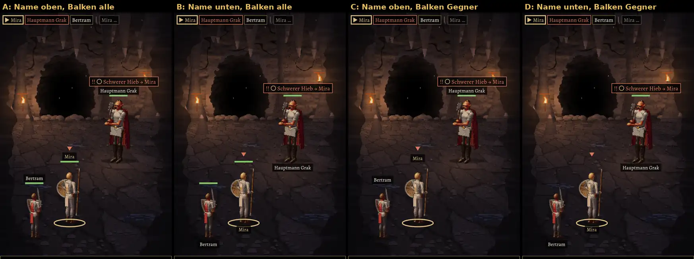

# 211 · MARS-Bildschirm: Standbild A56 und klein, so mit 223 bauen?
Jerry · 19.10., 18:40 · E Kampf · M (Anlass: Vorgangsarchiv 211 „vorher Standbild auf A56 und kleinem Format an den Chef“)
Kurz: 211 ist gebaut (Zweig `claude/jerry-223-nachteil-hinten`, mit 223), beide Formate ohne Überlappung; Build 37 so, nach Test 36? (Empfehlung: ja)

**211.7 (Chef 18:46, Nachtrag 18:55):** steht in einer Reihe nur eine Figur, steht sie mittig; vorn und hinten auf einer Achse zum Gegner, beide Seiten (Grak steht allein auch mittig):

Echte MARS-Probe gegen Grak durch die Oberfläche, Vorschau `MARS211=grak MARS211FORMAT=a56|klein`.

**Gebaut (wie entschieden):** Bericht 5 Zeilen, 15 sp, umbrechend, neueste hell, ältere gedämpft, Schaden gold, Tippen öffnet den ganzen Bericht · Absicht 14 sp mit Ziel und Ring-Zeichen · Zugleiste 13 sp, ganze Namen, gleiche Gegner nummeriert („Wolf 1“), ▶ am Zug, Strich vor der nächsten Runde · je Figur ein Kästchen (Name, Balken, Zahl, ZP) · Knöpfe 52 dp/15 sp, untere Reihe 48 dp/14 sp, Auswahl 6 dp eng · Namen 12 sp, Würfelzahlen 13 sp.

**Selbst angesehen:** auf dem A56 alles lesbar, nichts überlappt. Auf dem kleinen Format überlappten zuerst „Bertram (Kämpfer)“ und „Hauptmann Grak“; darum dort (unter 800 dp Höhe) Bericht 4 Zeilen, Knöpfe 48/44 dp, Figuren bis 20 % kleiner und Gegner etwas höher. Jetzt frei.

**Beschriftung (Chef 19:09): vier Varianten, A56, gleicher Kampf, einheitlich nur der Name** (nicht mehr „Bertram (Kämpfer)“):

Dazu behoben: Name und Balken bei Grak sitzen jetzt am Kopf, nicht mehr hoch über ihm. Eigene Leute haben ihre Balken in C und D nur unten im Kästchen.

**Frage 2:** Welche Variante? **Empfehlung: C** (Name oben, Balken nur über Gegnern): die eigenen Lebenspunkte stehen schon im Kästchen; über den Köpfen bleibt nur, was man im Kampfort braucht, Name und Absicht stehen beieinander.
*Stärkstes Gegenargument:* Mit Name unten (D) bleibt über dem Kopf mehr Platz für Absicht, Wurfzahlen und Ring; bei mehreren Gegnern drängt sich oben mehr.

**Frage 1:** So als Build 37 mit 223 bauen, gleich nach Test 36?

**Empfehlung: ja.**

*Stärkstes Gegenargument:* Auf kleinen Handys wirkt der Kampfort enger (kleinere Figuren), und die Zugleiste bricht bei vier Figuren in zwei Zeilen um. Der Bericht nennt Gegner ohne Nummer („Wolf verfehlt Mira“), die Zugleiste mit; Nummern im Bericht hieße die Kampfzeilen im Kern umbauen (später mit 72u.1 und 212).

**Berührt:** 211, 223, 204, 210, 219, 72u.1, 212.
