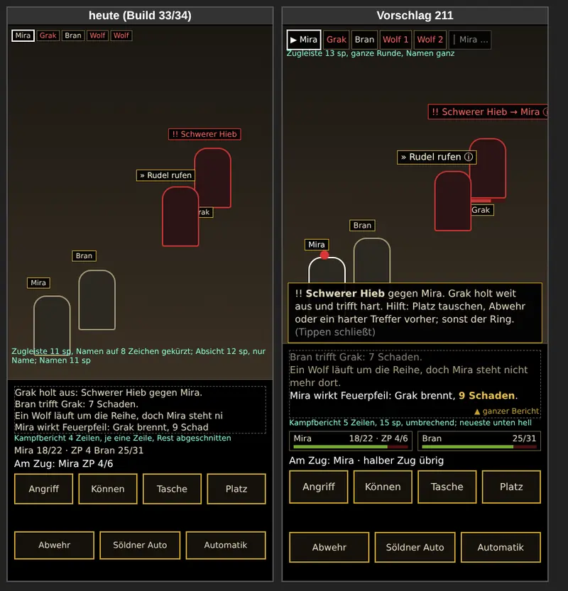

# 211 · MARS-Bildschirm: so anordnen?
Homer · 19.10., 13:10 · E Kampf · M? (Bau Jerry; vor 204 und 210, sonst zweimal gebaut)

Kurz: Kampfbericht 5 Zeilen und umbrechend, Absicht mit Ziel und Erklärkarte, Zugleiste größer, Lebenspunkte als Balken, Knöpfe größer; der Kampfort wird etwa 10 % niedriger.

Chef 12:30: „… was ist wo, wie groß ist etwas, wie kann ich den Text des Kampfes gut lesen …, wie was die Gegner (und ich) vorhaben als Popup, wie "groß" wird die Zugreihenfolge …“; 12:36: „nicht um hübsch …, sondern für den Spieler sinnvoll, funktional und klar.“

Skizze, kein Standbild aus dem Spiel. Gemessen an Samsung A56 (412 × 892 dp). Heute nachgesehen in `SkirmishScreen.kt` (Zweig `claude/jerry-203-abwehr`).

**Frage:** Bauen wir den MARS-Bildschirm so um (Jerry, ohne neue Bilder)?

| Teil | Heute | Vorschlag |
|---|---|---|
| Kampfbericht | 4 Zeilen, 14 sp, jede Zeile abgeschnitten („… doch Mira steht ni“) | 5 Zeilen, 15 sp, Zeilen brechen um; neueste unten hell, ältere gedämpft, Schaden gold. Tippen öffnet den ganzen Bericht des Kampfes zum Zurückblättern |
| Absicht der Gegner | 12 sp über dem Gegner, nur Name; Ziel nur als roter Punkt | 14 sp, mit Ziel („!! Schwerer Hieb → Mira“) und ⓘ. Langer Druck auf die Absicht öffnet eine Karte: was sie tut, was hilft (210, gebaut; Texte 210T). Kurzes Tippen bleibt dem Ring |
| Karte (Popup) | Tipps der Knöpfe (204) am unteren Rand des Kampforts | Eine Karte für alles: Absicht, Tipp (204), eigene Wahl. Immer an derselben Stelle, Tippen schließt, nie während des Rings |
| Was ich vorhabe | nichts | Beim Ziel wählen zeigt die Karte die Aussicht: „Feuerpfeil auf Grak: trifft bei 12+, 1W10 Feuer“ |
| Zugleiste | oben links über dem Kampfort, 11 sp, Namen auf 8 Zeichen gekürzt | gleiche Stelle, 13 sp, ganze Namen, gleiche Gegner nummeriert („Wolf 1“), wer dran ist mit ▶; nach einem Strich der Anfang der nächsten Runde |
| Eigene Leute | eine Textzeile „Mira 18/22 · ZP 4“ | je Figur ein Kästchen mit Name, Balken, Zahl und ZP |
| Knöpfe | 48 dp, 14 sp und 13 sp | 52 dp, 15 sp; untere Reihe 48 dp, 14 sp |
| Namen, Würfelzahlen am Kampfort | 11 sp und 12 sp | 12 sp und 13 sp |

**Empfehlung: ja, alles außer „Was ich vorhabe“ jetzt; „Was ich vorhabe“ erst nach 210, falls die Tester (Prüfbogen M5) es vermissen.** Billig, weil nur Anordnung und Schrift (`SkirmishScreen.kt`), etwa ein Sammelbuild Jerry. Der Bericht ist heute das größte Ärgernis: Sätze wie Durchbrechen und Flanke (210) sind abgeschnitten, also unlesbar. Eine Karte für alles spart drei verschiedene Popups (204, 210, Aussicht). 204 und 210 bauen dann auf der Karte auf statt zweimal.

*Stärkstes Gegenargument:* Der Kampfort wird rund 56 dp niedriger (von etwa 578 auf 522 dp). Die Figuren bleiben gleich groß (der Maßstab hängt an der Breite), aber sie stehen nach Anteilen der Höhe (`placeAt`) und rücken darum zusammen. Auf kleinen Handys (360 × 740 dp) können sich die Absichten mit den Namen überlappen. Darum baut Jerry zuerst ein Standbild auf A56 und einem kleinen Format, bevor er den Umbau fertig macht. Zweitens sieht der klassische Kampf dann anders aus als MARS. Das ist hinnehmbar, weil beide Bildschirme ohnehin getrennt sind (212); den längeren Bericht kann der klassische Kampf später billig übernehmen.

**Berührt:** 204, 210, 210T, 72u.1 (Kampfort aus der Karte: braucht dieselbe Höhe), 212, 209 (Prüfbogen M5), Idee „Zeichen der Absicht als eigene Zeile“ (`LISTE-IDEEN.md`, wäre damit erledigt).

**Stellungnahme Sokrates** (19.10., 15:06): *Stärkstes Gegenargument:* MARS gehört nicht zu Kapitel 1. Es läuft nur als Probekampf im Systemmenü, die Tester sehen es nicht, und der klassische Kampf hat das Problem nicht (nachgesehen: der abgeschnittene Bericht, `maxLines = 1`, steht nur in `SkirmishScreen.kt`). Der volle Umbau macht Kapitel 1 also nicht spielerfreundlicher. Er bindet aber Testzeit des Chefs, und die ist der Engpass: bei Jerry warten sechs gebaute Vorgänge auf den Test, bei Tom fünf. Dazu kommt das Risiko auf kleinen Bildschirmen. „Sonst zweimal gebaut“ trägt nur halb: 204 und 210 sind schon gebaut (Zweig `claude/jerry-203-abwehr`), der Umbau verschiebt ihre Popups und verlangt einen zweiten Test. *Widerspruch zu Entschiedenem:* Wochenziel und 179 („Kampfprobe 72.10 … nach dem Meilenstein“, MARS als Alternative erst nach dem Meilenstein, 212), außer der Chef sagt „jetzt“. Kein Widerspruch zu 210, im Gegenteil: Die Eingebung des Helden steht im Kampfbericht und ist mit einer abgeschnittenen Zeile unlesbar, 210 wirkt also erst mit einem umbrechenden Bericht. *Kosten:* ein Sammelbuild Jerry, etwa 0,6 bis 1,5 $ (204 kostete 1,45 $), dazu ein Gerätetest auf zwei Formaten. *Empfehlung:* teilen: Kampfbericht (5 Zeilen, umbrechend) und Absicht mit Ziel sofort als Muss im selben Build wie 204 und 210, weil 210 sonst nicht lesbar ist; Karte für alles, Kästchen, Zugleiste und Knöpfe als Kür nach dem Meilenstein zusammen mit 212, „Was ich vorhabe“ wie von Homer empfohlen später.

**Ergänzung Sokrates** (19.10., 15:38): Seit 15:35 entschieden: **219** (Ring verständlich und lohnend). Davon berührt 211 zweierlei: Die Absicht braucht Platz für das Zeichen „Ring kommt“, und das Ergebnis des Rings („Perfekt: ausgewichen“) braucht eine feste Stelle. Für die Stelle eignet sich die Karte aus 211. Das stützt den Kern von 211 (Absicht mit Ziel, lesbarer Bericht) als Muss im selben Build wie 204, 210 und 219, sonst wird die Absichtszeile zweimal gebaut. An der Empfehlung, den Rest nach dem Meilenstein zu bauen, ändert es nichts.
